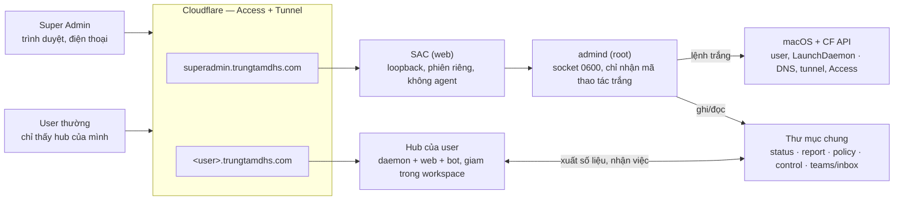

# BRD — Super Admin Console (superadmin.abc.com)

Nov 18, 2026 · cập nhật v0.2 Nov 21, 2026 · @Lê Phương (Web-1)

Tài liệu này đặc tả **Super Admin Console** — một tên miền riêng (ví dụ `superadmin.abc.com`) để người quản trị cao nhất xem và thao tác trên **mọi user, mọi hub, mọi tên miền con** của hệ cfharness trên máy chủ chung, thay cho chuỗi lệnh `sudo` và script `setup-hub-user.sh` đang làm tay hôm nay.

## 0. Thông tin tài liệu

| Mục | Nội dung |
| --- | --- |
| Sản phẩm | cfharness (agent-hub) — phân hệ Super Admin |
| Phiên bản tài liệu | 0.2 — cập nhật theo plan triển khai (`docs/dev-notes/plan-superadmin.md` §1, B1–B10) |
| Nền tảng hiện có | cfharness v0.2.20; quản trị máy `admin_*` (plan-admin-users P1+P2); web public qua Cloudflare Tunnel + TOTP |
| Tài liệu liên quan | `docs/BRD-chi-tiet.md`, `docs/dev-notes/plan-admin-users.md`, `admin-users.md`, `admin-overview.md`, `plan-multi-instance.md`, `web-public.md`, `huong-dan-tao-hub-lamlinh.md`, `plan-trusted-device.md` |
| Trạng thái | Đã duyệt (Q1–Q3, Q5–Q10); Q4 còn mở — chỉ chặn bật mức `Hoạt động` trên production |

### 0.1 Quy ước

- Mã yêu cầu: `FR-SA-<nhóm>-<số>` (chức năng), `NFR-SA-<số>` (phi chức năng), `BR-SA-<số>` (quy tắc nghiệp vụ).
- Mức ưu tiên MoSCoW: **M** (Must — bắt buộc bản đầu), **S** (Should), **C** (Could), **W** (Won't — không làm bản này).
- `abc.com` là miền ví dụ; thực tế là zone Cloudflare đang dùng (`trungtamdhs.com`, `cchchn.com`…).

### 0.2 Thuật ngữ

| Thuật ngữ | Nghĩa |
| --- | --- |
| Super Admin Console (SAC) | Ứng dụng web ở `superadmin.<miền>` — nội dung chính của BRD này |
| Super Admin | Người có toàn quyền trên SAC; số lượng rất ít (1–3 người) |
| User hệ thống | Một người dùng cfharness = một user hệ điều hành + một hub riêng (`HUB_HOME` 0700) |
| Hub | Daemon + web + MCP + bot Telegram/Slack của một user; quản lý một workspace |
| Tên miền con (sub-domain) | Địa chỉ web public của một hub, ví dụ `lamlinh.abc.com`, đi qua tunnel `cfharness` |
| admind | Tiến trình đặc quyền (root) mới, chạy lệnh hệ thống theo danh sách trắng thay cho SAC |
| Job | Một thao tác quản trị chạy nền nhiều bước (tạo user, cập nhật hàng loạt…), có trạng thái và nhật ký |
| ESTOP admin | Cờ dừng khẩn do quản trị bật; user không tự gỡ được |
| Chính sách (policy) | Giới hạn do quản trị ép xuống hub: ngân sách, model, sandbox, phiên bản tối thiểu… |
| Four-eyes | Thao tác cần một Super Admin thứ hai duyệt mới chạy |
| Break-glass | Truy cập khẩn ngoài quy trình thường, luôn để lại dấu vết và cảnh báo |

## 1. Bối cảnh & vấn đề

### 1.1 Hiện trạng

cfharness chạy theo mô hình **mỗi người một user hệ điều hành + một hub riêng** trên một máy chủ chung (Mac mini). Mỗi hub có tên miền con riêng qua tunnel Cloudflare `cfharness`, đăng nhập bằng TOTP, cổng web/MCP riêng.

Quản trị hiện có (P1+P2 đã làm):

- **Đọc:** `admin overview`, `admin users list`, cảnh báo `admin.alert`, audit metadata 30 ngày, lịch sử 90 ngày — qua CLI và trang `/admin/*` trên web của hub admin.
- **Ghi duy nhất qua web/RPC:** bật/gỡ ESTOP admin.
- **Mọi việc còn lại làm tay bằng `sudo`:** tạo user (script `setup-hub-user.sh`, 10 bước), cấp cổng, thêm hostname vào `cfharness-config.yml`, tạo DNS (zone khác `cchchn.com` phải vào dashboard Cloudflare), kickstart LaunchDaemon, cấp lại TOTP, gỡ khoá đăng nhập, sửa chính sách (`policy template` chỉ in lệnh), thu hồi/xoá user.

### 1.2 Vấn đề

| # | Vấn đề | Hệ quả |
| --- | --- | --- |
| P1 | Không có một nơi duy nhất thấy **miền nào trỏ về hub nào, cổng nào, của ai** | Trùng cổng, hostname mồ côi trong tunnel, DNS tạo nhầm zone (đã gặp: `lamlinh.trungtamdhs.com.cchchn.com`) |
| P2 | Thao tác vòng đời user phải SSH + Terminal.app của admin + sudo | Chỉ 1 người làm được; không làm được từ điện thoại; dễ sai bước |
| P3 | Hỗ trợ user (mất điện thoại TOTP, bị khoá do nhập sai, hub treo) cần lệnh tay | Thời gian xử lý tính bằng giờ, phụ thuộc người trực |
| P4 | Chính sách chỉ sửa được bằng file root | Không có phiên bản, diff, mô phỏng tác động, áp hàng loạt |
| P5 | Cập nhật phiên bản từng hub riêng lẻ | Hub lệch phiên bản (`version_behind`), bản `--system-install` không tự nâng |
| P6 | Nhật ký thao tác quản trị rải rác (shell history, admin-log, audit từng hub) | Khó trả lời "ai đã làm gì với user X, lúc nào" |

### 1.3 Đề xuất

Xây **Super Admin Console** tại `superadmin.<miền>`: một màn hình duy nhất quản lý **tên miền → hub → user**, làm được toàn bộ vòng đời user và hub bằng giao diện, mọi thao tác đều có xác thực bước hai, nhật ký bất biến và toàn bộ chức năng, màn hình quản trị ẩn hoàn toàn với user không phải quản trị.

## 2. Mục tiêu & KPI

Mục tiêu gốc: mọi thao tác quản trị user/hub/tên miền làm được từ `superadmin.<miền>` mà không cần SSH hay gõ `sudo`, và không làm yếu ranh giới cô lập giữa các user.

| Mã | Mục tiêu | KPI | Mục tiêu số |
| --- | --- | --- | --- |
| G1 | Một nguồn sự thật về tên miền, hub, user | % hostname trong tunnel khớp bản ghi SAC | 100%, kiểm tự động mỗi 10 phút |
| G2 | Tạo user mới không cần SSH | Thời gian từ bấm "Tạo" tới hub truy cập được qua tên miền | ≤ 10 phút, không bước tay ngoài nhập token Claude |
| G3 | Hỗ trợ user nhanh | Thời gian cấp lại TOTP / gỡ khoá / khởi động lại hub | ≤ 2 phút, làm được từ điện thoại |
| G4 | Vận hành an toàn | Thao tác ghi không có bản ghi audit | 0 |
| G5 | Đồng bộ phiên bản | Số hub lệch phiên bản quá 7 ngày sau phát hành | 0 |
| G6 | Ẩn chức năng quản trị với user thường | Số màn, menu, route, lệnh, RPC quản trị lộ ra cho user không có vai trò quản trị | 0, kiểm bằng test quét tự động mỗi bản phát hành |
| G7 | Không hồi quy bảo mật | Ca kiểm thử bảo mật hiện có (`test_sec_auth`, cô lập workspace, `admin_shared`) | 100% xanh |

## 3. Phạm vi

### 3.1 Trong phạm vi

1. Truy cập SAC qua tên miền riêng, xác thực nhiều lớp, phân vai trò quản trị.
2. Quản lý tên miền: zone, tên miền con, DNS, ingress tunnel, Cloudflare Access, kiểm tra sức khoẻ.
3. Vòng đời user: tạo, xem, sửa, tạm khoá, mở khoá, thu hồi, xoá hẳn, khôi phục, nhập user có sẵn.
4. Điều khiển hub: khởi động/dừng/khởi động lại, cập nhật phiên bản, chẩn đoán, sao lưu/khôi phục.
5. Truy cập của user: TOTP, phiên, thiết bị tin cậy, khoá đăng nhập, kênh Telegram/Slack.
6. Chính sách: soạn, phiên bản hoá, mô phỏng, áp hàng loạt, rollback.
7. ESTOP theo máy / user / nhóm.
8. Tài khoản Claude, ngân sách và chi phí theo user.
9. Giám sát, cảnh báo, tài nguyên máy.
10. Nhật ký quản trị bất biến + trang minh bạch phía user.
11. Thao tác hàng loạt và hàng đợi job.
12. CLI/RPC tương ứng cho mọi chức năng trên web.

### 3.2 Ngoài phạm vi (Won't bản này)

- Hub đa người thuê trong một daemon (đi ngược nguyên tắc "1 người, 1 hub" — Q-11).
- Điều khiển từ xa máy chủ khác (fleet). Theo Q10, mọi thực thể có `host_id` thật, máy chủ hiện trong danh sách và bộ lọc; nhưng admind chỉ thao tác trên máy nó đang chạy (không agent từ xa, không kênh mạng — C3).
- Thao tác **bên trong** hub user thay user: tạo/sửa agent, giao việc, duyệt thao tác phá huỷ của agent. Quản trị chỉ chặn (ESTOP, chính sách), không làm hộ.
- Đọc tệp trong workspace của user và transcript đầy đủ của run. Báo cáo hoạt động (7.5) chỉ lấy tiêu đề việc và tóm tắt kết quả, theo mức xem đã thông báo cho user; xem transcript từng vụ ở FR-SA-CNT, chờ chốt.
- Thanh toán/hoá đơn với Anthropic; chỉ đối chiếu chi phí ước tính.
- Đăng ký/mua tên miền mới ở nhà đăng ký; SAC chỉ làm việc với zone đã có trên Cloudflare.

## 4. Stakeholder, persona & vai trò

### 4.1 Stakeholder

| Stakeholder | Quan tâm |
| --- | --- |
| Chủ hệ thống / chủ repo | Toàn quyền nhưng không phá cô lập; vận hành ít tốn công |
| Người dùng hub (user hệ thống) | Hub chạy ổn, được hỗ trợ nhanh, nhận việc rõ ràng từ team |
| Người phụ trách tài chính | Chi phí Claude theo user/tháng, ngân sách không vượt |
| Bảo mật / kiểm toán | Nhật ký đầy đủ, không sửa được; quyền tối thiểu |

### 4.2 Persona

- **Phương — Super Admin.** Chủ máy, tạo hub cho từng người, xử lý sự cố. Cần làm từ điện thoại khi không ngồi trước máy.
- **Operator trực.** Người được giao hỗ trợ user hằng ngày: cấp lại TOTP, khởi động lại hub, bật ESTOP. Không được xoá user hay đổi chính sách.
- **Auditor.** Chỉ xem tổng quan, chi phí, nhật ký; xuất báo cáo.
- **LamLinh — user hệ thống.** Dùng hub qua `lamlinh.abc.com`. Không thấy SAC hay bất kỳ menu, màn hình, thông báo quản trị nào; chỉ thấy việc được giao từ team.

### 4.3 Vai trò trên SAC

| Vai trò | Mô tả | Số lượng gợi ý |
| --- | --- | --- |
| Super Admin | Toàn quyền, kể cả quản lý tài khoản quản trị khác và cấu hình hệ thống | 1–3 |
| Operator | Vận hành hằng ngày: hub, truy cập user, ESTOP, xem chi phí | Không giới hạn |
| Auditor | Chỉ đọc: tổng quan, cảnh báo, chi phí, nhật ký | Không giới hạn |
| Team Lead | User thường được gán làm trưởng team: chỉ thấy khu team của mình (bảng việc, hồ sơ và báo cáo thành viên) | 1 mỗi team |

Phạm vi vai trò có thể giới hạn theo **nhóm user** hoặc **zone** (ví dụ Operator chỉ quản lý user thuộc `cchchn.com`). Ma trận chi tiết ở mục 8.

## 5. Giả định, ràng buộc & quyết định cần đảo

"Mọi quyền trên user" không làm được nếu giữ nguyên kiến trúc hiện tại: nhiều thao tác cần root, mà web của hub admin chạy bằng uid thường. BRD này vì vậy đề xuất **đảo 3 quyết định đã chốt** — cần chủ repo duyệt trước khi làm.

### 5.1 Quyết định cũ cần đảo

| Quyết định hiện tại (plan-admin-users) | Đề xuất mới | Lý do |
| --- | --- | --- |
| §4: `cfharness-admind` (root) "chưa nên làm" | Làm `admind` chạy root, chỉ nhận lệnh từ SAC qua socket cục bộ, thực thi theo danh sách thao tác trắng | Tạo user, LaunchDaemon, tunnel, khoá/mở user đều cần root |
| §7.10: web chỉ hiện lệnh sudo cho chính sách | SAC soạn và ghi chính sách qua `admind` | Không còn bước tay; có phiên bản và rollback |
| Web admin = web của hub admin (`/admin/*`) | SAC là ứng dụng riêng, tên miền riêng, phiên riêng | Tách bề mặt tấn công: agent của hub admin không chạm được SAC |

Sau khi có SAC (hết SA2), trang `/admin/*` trên web của hub admin bị gỡ — SAC thay thế.

Giữ nguyên: không socket/HTTP chéo giữa các hub user; không chữ tự do hai chiều giữa quản trị và agent; mặc định không xem nội dung; user không thấy chi phí người khác. Đảo thêm: trang "Quản trị máy" và admin-log phía user (P2) chuyển sang ẩn mặc định, theo yêu cầu ẩn chức năng quản trị với user thường (FR-SA-VIS).

### 5.2 Ràng buộc

| Mã | Ràng buộc |
| --- | --- |
| C1 | Một máy chủ (macOS, có hỗ trợ Windows riêng); mỗi user = một user hệ điều hành |
| C2 | Web chỉ nghe loopback; ra ngoài duy nhất qua Cloudflare Tunnel có TLS |
| C3 | `admind` không bao giờ nghe mạng; chỉ socket Unix 0600 chủ là user chạy SAC |
| C4 | Token API Cloudflare lưu trong secret store của `admind`, quyền tối thiểu: DNS edit + Tunnel edit + Access edit trên các zone đã khai |
| C5 | Agent của bất kỳ hub nào (kể cả hub admin) không đọc/ghi được dữ liệu SAC/admind: sandbox + `permissions.deny` + classifier forbidden |
| C6 | Root vẫn toàn quyền trên máy; SAC không hứa chống được người có root |

### 5.3 Giả định cần xác minh

| Mã | Giả định | Cách kiểm |
| --- | --- | --- |
| A1 | Mọi zone dùng cho hub đều nằm trong một tài khoản Cloudflare | Liệt kê zone bằng token API |
| A2 | Cloudflare Access dùng được cho `superadmin.<miền>` (gói hiện tại) | Thử tạo ứng dụng Access |
| A3 | `sysadminctl`/`dseditgroup`/`launchctl` gọi từ `admind` không cần phiên GUI | Spike trên máy thật |
| A4 | Tunnel chạy dạng LaunchDaemon hệ thống (không phụ thuộc phiên đăng nhập của admin) | Chuyển `com.cfharness.tunnel` sang system domain |
| A5 | Token Claude (`claude setup-token`) nhập vào hub user được qua `admind` mà không in ra màn hình | Spike với `account add` |

## 6. Kiến trúc tổng quan

SAC là ứng dụng web riêng, không chạy trong hub nào; mọi thao tác cần root đi qua `admind`. Hub user vẫn chỉ trao đổi với quản trị bằng file trong thư mục chung (mô hình kéo từ file hiện có).



*Chỉ admind chạy quyền root; SAC và hub user không gọi nhau trực tiếp.*

User thường chỉ có đường tới hub của mình; `superadmin.abc.com` bị Cloudflare Access chặn với mọi email ngoài danh sách quản trị.

| Thành phần | Chạy bằng | Vai trò |
| --- | --- | --- |
| SAC (web) | user hệ thống riêng `_cfh_sac`, loopback | Giao diện, xác thực, RBAC, job, báo cáo; không có agent |
| admind | root, LaunchDaemon hệ thống | Thực thi \~40 mã thao tác có kiểu, giữ secret Cloudflare, ghi `sac.db` và audit |
| Thư mục chung | `/Users/Shared/cfharness` | Kênh hai chiều với hub: hub ghi `status/report/profile`, đọc `policy/control/teams/inbox` |
| Hub user | uid của từng user | Không đổi kiến trúc; thêm bộ xuất SPEC v3, báo cáo ngày, hộp thư team, ẩn giao diện quản trị |
| Cloudflare | Tunnel `cfharness` (system) + Access | Mỗi hostname một đường: SAC hoặc đúng một hub |

## 7. Yêu cầu chức năng

18 nhóm. Mọi thao tác **ghi** đều: kiểm quyền theo vai trò → hỏi xác nhận → step-up nếu thuộc mức nguy hiểm → ghi audit → ghi admin-log (ẩn với user, FR-SA-VIS) (BR-SA-01..05, mục 7.19).

### 7.1 Truy cập & xác thực SAC (FR-SA-AUTH)

| Mã | Chức năng | Mô tả / quy tắc | Ưu tiên |
| --- | --- | --- | --- |
| AUTH-01 | Tên miền riêng | SAC chỉ phục vụ trên `superadmin.<miền>` (cấu hình được), bind loopback, ra ngoài qua tunnel. Host/Origin khác → 421/403 | M |
| AUTH-02 | Lớp 1: Cloudflare Access | Bắt buộc Access (email OTP hoặc SSO Google) với danh sách email quản trị. SAC từ chối request thiếu JWT Access hợp lệ | M |
| AUTH-03 | Lớp 2: đăng nhập SAC | Mỗi tài khoản quản trị: mật khẩu (scrypt) + TOTP bắt buộc. Passkey/WebAuthn thay TOTP: S, giai đoạn SA5 (cần thư viện mới) | M |
| AUTH-04 | Phiên ngắn | Phiên RAM, hết sau 15 phút không thao tác, tối đa 8 giờ; cookie `__Host-`, Secure, HttpOnly, SameSite=Strict | M |
| AUTH-05 | Step-up | Thao tác mức **Cao** (bảng 7.19) yêu cầu nhập lại TOTP/passkey trong 5 phút gần nhất | M |
| AUTH-06 | Four-eyes | (`superadmin init` cảnh báo khi chỉ có 1 Super Admin.) Thao tác mức **Tới hạn** (xoá user, xoá zone, đổi Super Admin, xem nội dung) tạo yêu cầu chờ; Super Admin thứ hai duyệt trong 24 giờ mới chạy. Hệ chỉ có 1 Super Admin → thay bằng chờ 1 giờ + cảnh báo Telegram | M |
| AUTH-07 | Chống dò | Khoá theo IP, toàn cục và theo ngày (dùng lại `LoginLimiter`); 5 lần sai → khoá 15 phút + cảnh báo | M |
| AUTH-08 | Quản lý tài khoản quản trị | Thêm, sửa vai trò/phạm vi, khoá, xoá, đặt lại TOTP cho tài khoán quản trị khác. Không được tự hạ quyền hoặc xoá Super Admin cuối cùng | M |
| AUTH-09 | Tài khoản break-glass | Một tài khoản khẩn, mã khôi phục in giấy, chỉ dùng được từ loopback (`cfharness superadmin recover`); mọi lần dùng → cảnh báo tới mọi Super Admin | S |
| AUTH-10 | Danh sách IP cho phép | Tuỳ chọn giới hạn SAC theo dải IP/quốc gia (áp ở Access) | C |
| AUTH-11 | Phiên đang hoạt động | Xem và thu hồi phiên SAC của chính mình/quản trị khác (IP, trình duyệt, lần cuối) | S |

### 7.2 Quản lý tên miền (FR-SA-DOM)

Bảng trung tâm: mỗi dòng là một tên miền con, cột `hostname · zone · user · cổng web · DNS · ingress tunnel · Access · TLS · HTTP · lần kiểm cuối`.

| Mã | Chức năng | Mô tả / quy tắc | Ưu tiên |
| --- | --- | --- | --- |
| DOM-01 | Quản lý zone | Khai zone Cloudflare dùng được (`abc.com`, `cchchn.com`…), kiểm token API có đủ quyền trên zone. Zone đang có hostname không xoá được | M |
| DOM-02 | Danh sách tên miền | Lọc theo zone, user, trạng thái; tìm theo hostname; xuất CSV | M |
| DOM-03 | Cấp tên miền con | Kiểm trùng, kiểm tên (chữ thường, số, `-`, ≤ 63) và danh sách tên cấm (`superadmin`, `www`, `mail`, `api`…). Tạo CNAME → `<tunnel-id>.cfargotunnel.com` qua API **trong đúng zone** (sửa lỗi tạo nhầm zone của `cert.pem`), thêm cặp hostname/service vào ingress, `ingress validate`, kickstart tunnel | M |
| DOM-04 | Đổi tên miền con | Tạo hostname mới → đặt `web.public_origin` mới cho hub → giữ hostname cũ chuyển hướng 301 trong N ngày (mặc định 7) → gỡ. Huỷ mọi phiên web của hub | S |
| DOM-05 | Thu hồi tên miền | Gỡ ingress → gỡ DNS → gỡ Access → xoá `public_origin`. Hub vẫn chạy cục bộ | M |
| DOM-06 | Cloudflare Access cho hub | Bật/tắt lớp Access trước trang TOTP của hub; sửa danh sách email được vào | S |
| DOM-07 | Kiểm tra sức khoẻ | Mỗi 10 phút: DNS phân giải đúng, ingress khớp, tunnel có connector, HTTPS trả trang đăng nhập, chứng chỉ còn hạn. Lệch → cảnh báo `domain_*` | M |
| DOM-08 | Đối chiếu & sửa lệch | Phát hiện: hostname mồ côi (có DNS, không có hub), hub không có hostname, cổng trùng, CNAME trỏ tunnel khác. Nút "Sửa" tạo job tương ứng | S |
| DOM-09 | Cấp phát cổng | Dải cổng cấu hình được (mặc định 8711–8799); mỗi hub một cặp web/MCP, tự cấp cổng trống. **Cấm** trỏ ingress vào cổng MCP | M |
| DOM-10 | Danh mục cho app desktop | Thay `admin directory export/token`: bật/tắt, xoay token, xem danh mục | S |
| DOM-11 | Nhiều tên miền cho một hub | Một hub có hơn một hostname (bí danh) | W |

### 7.3 Vòng đời user (FR-SA-USR)

Trạng thái user: `Đang tạo → Hoạt động ⇄ Tạm khoá → Đã thu hồi → Đã xoá`, có nhánh `Lỗi tạo` (bảng chuyển trạng thái ở mục 9.1).

| Mã | Chức năng | Mô tả / quy tắc | Ưu tiên |
| --- | --- | --- | --- |
| USR-01 | Danh sách user | Cột: tên, họ tên, nhóm, tên miền, trạng thái, phiên bản, chi phí hôm nay/tháng, % ngân sách, run đang chạy, duyệt đang chờ, cảnh báo. Lọc, sắp xếp, chọn nhiều | M |
| USR-02 | Tạo user (wizard) | Bước 1 thông tin (tên đăng nhập, họ tên, email, nhóm) → Bước 2 tên miền (zone + sub, gợi ý = tên user) → Bước 3 tài khoản Claude (chọn từ kho hoặc dán token, ẩn khi gõ) → Bước 4 chính sách + ngân sách → Bước 5 tuỳ chọn (điều phối viên `dieu-phoi`, Không gian số KGS sync/lane, Telegram/Slack) → xem lại → Tạo. Chạy thành job tương đương `setup-hub-user.sh` bước 1–10, idempotent | M |
| USR-03 | Tiến trình tạo | Hiện từng bước (tạo user hệ điều hành, cài `uv`/`claude`/`cfharness`, token, cấu hình, giam workspace, LaunchDaemon, tunnel + DNS, TOTP…), nhật ký đã che secret. Bước lỗi → "Thử lại từ bước này" hoặc "Huỷ và dọn" | M |
| USR-04 | Bàn giao cho user | Sau khi tạo: link đăng ký TOTP (hạn 24 giờ) hiện **một lần**, kèm nút gửi email/QR; không lưu lại link | M |
| USR-05 | Chi tiết user | Mở hồ sơ 360° của user — chi tiết ở 7.4 (FR-SA-PRO) | M |
| USR-06 | Sửa thông tin | Họ tên, email, nhóm, ghi chú quản trị (chỉ SAC thấy, không tới agent) | M |
| USR-07 | Tạm khoá | Bật ESTOP admin cho user + dừng run đang chạy + huỷ phiên web + tắt ingress (trả trang "Tạm khoá"). Dữ liệu giữ nguyên. Chọn `reason_code` | M |
| USR-08 | Mở khoá | Đảo USR-07; cảnh báo hồi phục | M |
| USR-09 | Thu hồi | Theo `RevokePlan`: cờ ESTOP → bootout LaunchDaemon → gỡ nhóm `cfharness-users` → thu hồi tên miền (DOM-05) → vô hiệu TOTP + thiết bị tin cậy → nhắc thu hồi bot Telegram/Slack. Không xoá `HUB_HOME` | M |
| USR-10 | Xoá hẳn | Chỉ sau khi đã thu hồi. Bắt buộc sao lưu `/Users/<u>` trước (USR-12), gõ lại tên user, four-eyes, chờ 24 giờ trước khi `sysadminctl -deleteUser` | S |
| USR-11 | Khôi phục user đã thu hồi | Trả về Hoạt động: nhóm, LaunchDaemon, tên miền, TOTP mới | S |
| USR-12 | Sao lưu trước xoá | Nén `HUB_HOME` + workspace vào kho sao lưu quản trị, mã hoá, giữ 90 ngày | S |
| USR-13 | Nhập user có sẵn | Quét máy: user thuộc `cfharness-users`, plist `com.cfharness.daemon.<u>`, hostname trong ingress → đưa vào SAC không chạm hub | M |
| USR-14 | Nhóm user | Nhóm quản trị (phòng ban) để gán chính sách, ngân sách, phạm vi Operator. Nhóm làm việc chung = Team user ở 7.6 (FR-SA-TEAM) | S |
| USR-15 | Đổi tên user hệ điều hành | Đổi short name macOS | W |

### 7.4 Hồ sơ 360° của user (FR-SA-PRO)

Một trang xem **toàn bộ thông tin** của một user. Mỗi trường gắn một **mức xem** (BR-SA-06): `Số liệu` → `Hồ sơ` → `Hoạt động` → `Nội dung`. Hai mức đầu bật mặc định; mức `Hoạt động` bật theo thông báo tổ chức; `Nội dung` chỉ qua FR-SA-CNT.

| Mã | Chức năng | Mô tả / quy tắc | Mức xem | Ưu tiên |
| --- | --- | --- | --- | --- |
| PRO-01 | Danh tính | Họ tên, email, user hệ điều hành, nhóm, team và vai trò trong team, ngày tạo, người tạo, trạng thái, ghi chú quản trị | Số liệu | M |
| PRO-02 | Hạ tầng hub | Tên miền, cổng, phiên bản, kiểu cài, uptime, dung lượng `HUB_HOME` + workspace, gốc workspace, sandbox/confine, `doctor` gần nhất | Số liệu | M |
| PRO-03 | Truy cập | TOTP đã kích hoạt, số thiết bị tin cậy, phiên web đang mở, lần đăng nhập cuối, đăng nhập sai/khoá, Telegram/Slack đã ghép nối (không `chat_id`), token MCP có/không, tài khoản Claude đang dùng + tuổi token | Số liệu | M |
| PRO-04 | Agent & cấu hình | Danh sách agent (tên, vai trò, model, ngân sách, mức tin cậy, MCP được cấp, trạng thái), team agent, lịch chạy, điều phối viên, plugin/skill | Hồ sơ | M |
| PRO-05 | Chỉ số hoạt động | Run hôm nay/7/30 ngày, tỉ lệ thành công, task theo trạng thái kanban, duyệt/câu hỏi đang chờ và thời gian chờ, guard chặn, giờ hoạt động | Số liệu | M |
| PRO-06 | Chi phí | Theo ngày, theo agent, theo model; % ngân sách ngày/tháng; dự báo cuối tháng | Hồ sơ | M |
| PRO-07 | Thư mục chung | Kết nối Không gian số (sync/lane), thư mục được cấp, thư mục team | Hồ sơ | S |
| PRO-08 | Việc đang làm | Tiêu đề task/run đang chạy và gần đây, agent, thời lượng, kết quả | Hoạt động | M |
| PRO-09 | Dòng thời gian | Gộp sự kiện quản trị (SAC) + sự kiện hub (tạo/sửa agent, đổi cấu hình, ESTOP, cập nhật, lỗi lặp) theo thời gian | Hồ sơ | S |
| PRO-10 | Xuất hồ sơ | PDF/CSV một user hoặc nhiều user đã chọn | — | S |
| PRO-11 | Minh bạch | Tắt mặc định (VIS-07). Khi bật, user xem bản hồ sơ quản trị thấy về mình và mức xem đang áp dụng (mở rộng `admin me`) | — | C |

Cơ chế dữ liệu: giữ mô hình **kéo từ file**. Hub xuất thêm bản `profile` (SPEC v3, danh sách trắng theo mức xem) vào `status/<u>/`; SAC đọc, coi là dữ liệu không tin cậy, escape khi hiển thị và không đưa vào LLM nào.

### 7.5 Báo cáo hoạt động hằng ngày (FR-SA-RPT)

Mỗi hub chốt ngày và xuất `report/<u>/<YYYY-MM-DD>.json`; SAC gom thành báo cáo theo user, team và toàn hệ.

| Mã | Chức năng | Mô tả / quy tắc | Mức xem | Ưu tiên |
| --- | --- | --- | --- | --- |
| RPT-01 | Báo cáo ngày theo user | Chốt lúc 23:59 (giờ máy), có trong SAC trước 00:15: số run, thành công/lỗi/bị dừng, task hoàn thành/đang làm/kẹt, agent đã dùng, giờ hoạt động, duyệt đã xử lý, chi phí, cảnh báo trong ngày | Số liệu | M |
| RPT-02 | Danh sách việc đã làm | Mỗi task/run: tiêu đề, agent, trạng thái, bắt đầu–kết thúc, chi phí, tóm tắt kết quả 1–3 câu (câu kết quả từ `task_report.parse`, không gọi LLM, ≤ 300 ký tự, đã qua `redact`), đường dẫn kết quả trong thư mục chung nếu có | Hoạt động | M |
| RPT-03 | Tệp đã thay đổi | Số tệp tạo/sửa/xoá theo thư mục gốc; tên tệp ở mức Hoạt động; không nội dung tệp | Số liệu / Hoạt động | S |
| RPT-04 | Thao tác của người | Những gì chính user làm trên hub: tạo/sửa agent, đổi cấu hình (tên khoá), duyệt/từ chối, bật/tắt ESTOP — từ audit metadata | Số liệu | M |
| RPT-05 | Báo cáo gộp | Theo team, nhóm, toàn hệ: bảng user × chỉ số, so với hôm trước và trung bình 7 ngày | — | M |
| RPT-06 | Gửi báo cáo | Lịch gửi (mặc định 08:00 hôm sau) qua Telegram/Slack của quản trị, email khi đã cấu hình SMTP (SYS-01); trưởng team nhận báo cáo team mình | — | M |
| RPT-07 | Tuần / tháng | Báo cáo gộp tuần (thứ Hai) và tháng (ngày 1), có biểu đồ xu hướng | — | S |
| RPT-08 | Lịch sử & xuất | Lưu 90 ngày (cấu hình được), tìm theo user/ngày/từ khoá tiêu đề, xuất PDF/CSV/xlsx | — | M |
| RPT-09 | Bất thường | Đánh dấu: không hoạt động ≥ N ngày, chi phí ≥ 2× trung bình 7 ngày, tỉ lệ lỗi ≥ 30%, task kẹt ≥ 24 giờ, duyệt chờ ≥ 4 giờ | Số liệu | S |
| RPT-10 | User xem báo cáo của mình | Tắt mặc định (VIS-07). Khi bật, user thấy bản báo cáo gửi lên và thêm được ghi chú/giải trình trước giờ gửi | — | C |
| RPT-11 | Tóm tắt bằng AI | Agent chỉ-đọc, không tool, tóm tắt tuần cho từng team. Đầu vào là chữ do user tạo → coi là dữ liệu, chống prompt injection | — | C |

### 7.6 Team user (FR-SA-TEAM)

Team user giống team agent nhưng **mỗi thành viên là một user** (kèm hub của họ). Team có trưởng team, vai trò chuyên môn, bảng việc chung, thư mục chung, ngân sách và báo cáo chung. Việc giao tới thành viên đi vào **hộp thư của hub**, user (người) nhận việc rồi mới tới agent — giữ bất biến "không chữ tự do từ quản trị thẳng tới agent".

| Mã | Chức năng | Mô tả / quy tắc | Ưu tiên |
| --- | --- | --- | --- |
| TEAM-01 | Tạo / sửa / giải tán team | Tên, mô tả, mục tiêu, trưởng team, ngày bắt đầu/kết thúc. Giải tán giữ lại lịch sử việc và báo cáo | M |
| TEAM-02 | Thành viên | Thêm/bớt user; vai trò trong team: Trưởng team · Thành viên · Quan sát. Một user thuộc nhiều team; chuyển thành viên giữa team | M |
| TEAM-03 | Vai trò chuyên môn | Gắn kỹ năng cho thành viên (nghiên cứu, lập trình, review, vận hành, nội dung…) như role của agent, để gợi ý người khi giao việc | S |
| TEAM-04 | Thư mục chung của team | Tạo thư mục team trên Không gian số (filehub lane/sync) và cấp cho mọi hub thành viên; quyền đọc/ghi theo vai trò; thu hồi khi rời team | M |
| TEAM-05 | Bảng việc team (kanban) | Trưởng team/Super Admin tạo việc (tiêu đề, mô tả, hạn, ưu tiên, người nhận). Cột: Chưa giao · Chờ nhận · Đang làm · Chờ duyệt · Xong · Trả lại | M |
| TEAM-06 | Giao việc vào hub thành viên | Việc ghi vào `teams/<team>/inbox/<u>/` (qua admind; hộp thư CHỈ ĐỌC với user — nhận/từ chối/xong hub ghi vào `teams/<team>/status/<u>.json` của chính mình); hub thành viên kiểm hộp thư mỗi 30 giây, hiện "Việc được giao" trên web/Telegram/Slack. User bấm **Nhận** → tạo task trên hub (giao agent hoặc điều phối viên), hoặc **Từ chối** kèm lý do | M |
| TEAM-07 | Đồng bộ trạng thái | Hub xuất trạng thái task gắn mã việc team (đang làm, % tiến độ nếu có, xong, lỗi) → bảng team cập nhật ≤ 1 phút | M |
| TEAM-08 | Phụ thuộc giữa việc | Việc B chỉ giao khi việc A xong (giống phụ thuộc task của agent); việc chia nhỏ cho nhiều thành viên | S |
| TEAM-09 | Bàn giao & duyệt | Thành viên đánh dấu xong + đường dẫn kết quả trong thư mục team; trưởng team Duyệt hoặc Trả lại kèm nhận xét | M |
| TEAM-10 | Ngân sách team | Ngân sách ngày/tháng của team, chia hạn mức cho thành viên; cảnh báo 80/100%; áp theo kiểu lấy giá trị chặt hơn với chính sách user | S |
| TEAM-11 | Chính sách team | Chính sách áp cho mọi thành viên (model được dùng, sandbox bắt buộc…), gộp theo kiểu chặt hơn | S |
| TEAM-12 | Dashboard team | Thành viên đang làm gì, việc theo cột, việc quá hạn, chi phí team, cảnh báo của thành viên | M |
| TEAM-13 | Báo cáo team | Báo cáo ngày/tuần của team (RPT-05) gửi trưởng team và quản trị | M |
| TEAM-14 | Kênh thông báo team | Gắn một kênh Slack hoặc nhóm Telegram cho team: việc mới, việc xong, việc quá hạn, báo cáo ngày | S |
| TEAM-15 | ESTOP team | Dừng khẩn mọi hub thành viên của team một lần | S |
| TEAM-16 | Mẫu team | Lưu cấu trúc team (vai trò, chính sách, thư mục, kênh) làm mẫu; tạo team mới + user mới hàng loạt từ mẫu | C |
| TEAM-17 | Trưởng team vào SAC | Vai trò **Team Lead** trên SAC: chỉ thấy team mình, xem hồ sơ + báo cáo thành viên, quản lý bảng việc; không thao tác hạ tầng | M |
| TEAM-18 | Agent giao việc chéo | Agent của user A tự giao việc cho hub user B không qua người | W |

### 7.7 Ẩn chức năng quản trị với user thường (FR-SA-VIS)

User không có vai trò quản trị **không thấy, không đoán được** chức năng quản trị nào: không menu, không màn hình, không lệnh, không thông báo. Ẩn giao diện không thay cho phân quyền: ranh giới thật vẫn là vai trò SAC, nhóm hệ điều hành và `admind`.

| Mã | Chức năng | Mô tả / quy tắc | Ưu tiên |
| --- | --- | --- | --- |
| VIS-01 | Tên miền SAC vô hình | Email không thuộc danh sách quản trị bị Cloudflare Access chặn trước khi tới SAC. Request không có phiên hợp lệ → 404 trơn (không tên sản phẩm, không "Forbidden"). `superadmin` không xuất hiện trong danh mục hub, link hay email gửi user | M |
| VIS-02 | Web hub của user | Không có menu/nút/trang quản trị (kể cả trang "Quản trị máy" hiện có). Route `/admin/*` trả 404 giống route không tồn tại; `admin.nav` trả rỗng | M |
| VIS-03 | CLI, RPC, MCP | User không thuộc nhóm quản trị: `cfharness admin …` không hiện trong `--help`, gọi thẳng báo "không có lệnh"; RPC/tool MCP `admin.*`, `superadmin.*` trả cùng lỗi như method không tồn tại | M |
| VIS-04 | Thông báo trung tính | Khi quản trị tạm khoá, bật ESTOP, ép chính sách hay cập nhật hub: user chỉ thấy thông báo chung ("Hub đang tạm dừng — liên hệ quản trị", "Vượt hạn mức"), không tên người quản trị, không mã lý do, không đường dẫn SAC | M |
| VIS-05 | Không lộ người khác | User không thấy danh sách user, tên miền, chi phí, trạng thái của người khác; danh mục app desktop chỉ trả hub của chính user. Trong team chỉ thấy tên thành viên và việc được giao | M |
| VIS-06 | Không lộ dữ liệu thu thập | Bản xuất `status/`, `report/`, `profile` và cấu hình xuất không hiện trong UI của user; khoá cấu hình `admin_export.*` không nằm trong danh mục Cài đặt; agent không đọc được (C5) | M |
| VIS-07 | Trang minh bạch (tuỳ chọn) | Một công tắc toàn hệ trên SAC, **tắt mặc định**. Bật thì user thấy hồ sơ/báo cáo về mình (PRO-11, RPT-10) và admin-log | C |
| VIS-08 | Menu theo vai trò trong SAC | Operator, Auditor, Team Lead chỉ thấy mục thuộc quyền; mục không có quyền bị ẩn hẳn (không hiện xám), URL gõ tay trả 404 | M |
| VIS-09 | Team Lead là user thường | Chỉ khi được gán vai trò Team Lead mới thấy khu team trong SAC; mọi chức năng khác vẫn ẩn | M |
| VIS-10 | Kiểm thử ẩn | Bộ test đăng nhập bằng user thường, quét mọi route web, lệnh CLI, method RPC/MCP, sự kiện Telegram/Slack → 0 dấu vết quản trị; chạy trong CI | M |

### 7.8 Điều khiển hub (FR-SA-HUB)

| Mã | Chức năng | Mô tả / quy tắc | Ưu tiên |
| --- | --- | --- | --- |
| HUB-01 | Khởi động / dừng / khởi động lại | Riêng daemon hoặc web (`launchctl kickstart -k system/com.cfharness.{daemon,web}.<u>`). Dừng daemon đang có run → hỏi "dừng run rồi dừng" hay "chờ run xong" | M |
| HUB-02 | Cập nhật phiên bản | Một hub hoặc hàng loạt lên tag chọn; kiểu cài `uv tool` và `--system-install` (root, chạy qua admind). Hiện release note từ `CHANGELOG.md` trước khi xác nhận | M |
| HUB-03 | Cập nhật theo đợt | 1 hub thử → chờ `doctor` xanh + 10 phút không lỗi → phần còn lại theo lô N hub; lỗi → dừng đợt | S |
| HUB-04 | Ghim phiên bản | Ghim một hub ở tag cố định, loại khỏi cập nhật hàng loạt | S |
| HUB-05 | Quay về bản cũ | Cài lại tag trước đó nếu chưa có migration DB không đảo được; có thì chặn và nói rõ | S |
| HUB-06 | Chẩn đoán từ xa | Chạy `doctor` / `doctor multi` (không tốn tiền), hiện kết quả ok/cảnh/lỗi kèm cách sửa | M |
| HUB-07 | Log hệ thống | Xem `daemon.out`, `web.out`, `update.log` đã lọc qua `redact`; tối đa 2.000 dòng cuối; tải về. Không gồm transcript run | S |
| HUB-08 | Sao lưu / khôi phục | Chạy `backup` của hub theo lịch hoặc ngay; khôi phục về một điểm (four-eyes) | S |
| HUB-09 | Nhân bản hub | Dùng `hub_transfer`/hub-clone để tạo hub mới từ cấu hình mẫu (agent, MCP, chính sách — không secret, không lịch sử) | C |
| HUB-10 | Cấu hình hub | Đặt các khoá thuộc danh sách quản trị được phép (`hub.max_concurrent_runs`, `workspace.confine.root`, `web.public_origin`, `admin_export.*`…); khoá khác thuộc quyền user | S |

### 7.9 Truy cập của user (FR-SA-ACC)

| Mã | Chức năng | Mô tả / quy tắc | Ưu tiên |
| --- | --- | --- | --- |
| ACC-01 | Cấp lại TOTP | `totp disable` → `totp enroll` → kickstart web (huỷ mọi phiên). Link đăng ký mới hiện một lần, hạn 24 giờ | M |
| ACC-02 | Gỡ khoá đăng nhập sai | Xoá khoá của `LoginLimiter` mà không phải khởi động lại web (cần RPC mới) | M |
| ACC-03 | Thu hồi phiên | Huỷ mọi phiên web của user | M |
| ACC-04 | Thiết bị tin cậy | Xem danh sách (nhãn trình duyệt, lần dùng cuối), thu hồi từng cái hoặc tất cả (khi plan-trusted-device đã làm) | S |
| ACC-05 | Link đăng nhập một lần | Cấp link một lần (5 phút) khi user chưa có TOTP; chỉ gửi qua kênh đã xác minh | S |
| ACC-06 | Telegram / Slack | Xem trạng thái ghép nối, gỡ ghép nối, thay token bot (ẩn khi gõ) | S |
| ACC-07 | Token MCP | Xem có/không, xoay token MCP của hub (không hiện giá trị cũ) | S |
| ACC-08 | Email Access của hub | Sửa email được qua Cloudflare Access trước trang TOTP | S |

### 7.10 Chính sách (FR-SA-POL)

| Mã | Chức năng | Mô tả / quy tắc | Ưu tiên |
| --- | --- | --- | --- |
| POL-01 | Soạn chính sách | Form theo `POLICY_SPEC`: ngân sách/ngày, trần mỗi run, số run đồng thời, `require.{sandbox,confine,export}`, `models.allow`, `min_version`, `policy_required`. Kiểm hợp lệ trước khi ghi | M |
| POL-02 | Phạm vi | Toàn máy (`_machine`), mặc định (`_default`), nhóm, team, từng user. Hiệu lực = lấy giá trị chặt hơn (giữ quy tắc hiện có) | M |
| POL-03 | Xem hiệu lực | Với một user: bảng từng khoá, giá trị cuối và nguồn (máy/nhóm/team/user) | M |
| POL-04 | Mô phỏng | Trước khi lưu: liệt kê user/hub bị ảnh hưởng, hub sẽ bị chặn run (vd phiên bản dưới `min_version`) | S |
| POL-05 | Phiên bản & rollback | Mỗi lần lưu tăng `rev`, lưu người sửa + diff; quay về `rev` cũ một bước | M |
| POL-06 | Theo dõi áp dụng | Hub báo `policy.rev_applied`; chênh lệch quá 2 chu kỳ xuất → cảnh báo `policy_mismatch` | M |

### 7.11 ESTOP (FR-SA-EST)

| Mã | Chức năng | Mô tả / quy tắc | Ưu tiên |
| --- | --- | --- | --- |
| EST-01 | ESTOP toàn máy | Bật/gỡ `control/estop`; tuỳ chọn dừng run đang chạy. Nút luôn ở thanh trên cùng của SAC | M |
| EST-02 | ESTOP user / nhóm / team | Chọn nhiều đối tượng, cùng `reason_code` | M |
| EST-03 | Tự gỡ theo hẹn | Tuỳ chọn tự gỡ sau N giờ (bảo trì có lịch) | C |
| EST-04 | Danh sách cờ | Cờ đang bật, ai bật, lúc nào, hub đã áp cờ chưa | M |

### 7.12 Tài khoản Claude, ngân sách & chi phí (FR-SA-CLA)

| Mã | Chức năng | Mô tả / quy tắc | Ưu tiên |
| --- | --- | --- | --- |
| CLA-01 | Kho tài khoản Claude | Danh sách token `claude setup-token` (tên, trạng thái `auth status`, hạn mức, tuổi token, số user đang gán). Token không bao giờ hiện lại | M |
| CLA-02 | Gán tài khoản cho user | Gán/đổi tài khoản Claude đang dùng của hub user (thay `account use`); đổi hàng loạt khi một tài khoản hết hạn mức | M |
| CLA-03 | Xoay token | Thêm token mới → chuyển user → kiểm → gỡ token cũ; cảnh báo token sắp hết hạn | S |
| CLA-04 | Báo cáo chi phí | Theo user, team, nhóm, tài khoản Claude, model; ngày/tuần/tháng; xuất CSV/xlsx | M |
| CLA-05 | Ngân sách | Đặt qua chính sách (POL) ở mọi phạm vi; cảnh báo 80/100%; dự báo vượt cuối tháng | M |

### 7.13 Giám sát & cảnh báo (FR-SA-MON)

| Mã | Chức năng | Mô tả / quy tắc | Ưu tiên |
| --- | --- | --- | --- |
| MON-01 | Trang tổng quan | Số user theo trạng thái, hub đang chạy/dừng, run đang chạy, duyệt đang chờ, chi phí hôm nay, cảnh báo đang mở, tên miền lỗi; cập nhật 5 giây | M |
| MON-02 | Cảnh báo | Dùng bộ mã `admin.alert` hiện có + mã mới `domain_dns`, `domain_tunnel`, `domain_tls`, `job_failed`, `disk_low`, `team_overdue`, `superadmin_login_new_ip`. Xác nhận (ack), tắt tiếng N giờ, ghi chú xử lý | M |
| MON-03 | Kênh cảnh báo | Telegram/Slack/email của quản trị; quy tắc gửi theo mức và theo nhóm/team | M |
| MON-04 | Tài nguyên máy | CPU, RAM, đĩa (tổng + theo user), số tiến trình `claude` đang chạy, trạng thái tunnel | S |
| MON-05 | Lịch sử | Biểu đồ 90 ngày từ `admin_samples` | S |

### 7.14 Nhật ký quản trị (FR-SA-AUD)

| Mã | Chức năng | Mô tả / quy tắc | Ưu tiên |
| --- | --- | --- | --- |
| AUD-01 | Ghi mọi thao tác | Ai, vai trò, IP, lúc nào, thao tác, đối tượng, tham số đã che secret, kết quả, mã job, người duyệt (four-eyes) | M |
| AUD-02 | Bất biến | Chỉ nối thêm; mỗi dòng chứa hash dòng trước (chuỗi hash); kiểm toàn vẹn hằng ngày, lệch → cảnh báo `tamper` | M |
| AUD-03 | Tìm & lọc | Theo người làm, user bị tác động, loại thao tác, khoảng thời gian; xuất CSV | M |
| AUD-04 | Lưu giữ | Tối thiểu 1 năm; không ai xoá được qua SAC | M |
| AUD-05 | Audit hub (metadata) | Xem audit metadata 30 ngày của từng hub (đã có) trong hồ sơ user | M |

### 7.15 Xem nội dung có kiểm soát (FR-SA-CNT)

Cần chủ sản phẩm chốt (câu hỏi Q1, mục 12). Mặc định không có.

| Mã | Chức năng | Mô tả / quy tắc | Ưu tiên |
| --- | --- | --- | --- |
| CNT-01 | Yêu cầu xem một run | Super Admin chọn run cụ thể + lý do bắt buộc → four-eyes → hub xuất bản transcript đã che secret của đúng run, hết hạn sau 24 giờ | C |
| CNT-02 | Break-glass sự cố | Sự cố an ninh: bỏ bước chờ, vẫn four-eyes sau sự việc trong 24 giờ, cảnh báo tới mọi Super Admin | C |

### 7.16 Job & thao tác hàng loạt (FR-SA-JOB)

| Mã | Chức năng | Mô tả / quy tắc | Ưu tiên |
| --- | --- | --- | --- |
| JOB-01 | Hàng đợi job | Mọi thao tác nhiều bước là job: trạng thái Chờ · Chờ duyệt · Đang chạy · Xong · Lỗi · Đã huỷ; nhật ký từng bước | M |
| JOB-02 | Idempotent & tiếp tục | Chạy lại bỏ qua bước đã xong; admind khởi động lại thì job đang chạy chuyển Lỗi kèm "tiếp tục từ bước X" | M |
| JOB-03 | Hàng loạt | Chọn nhiều user/team → cập nhật, ESTOP, áp chính sách, khởi động lại, đổi tài khoản Claude; tối đa 3 job ghi song song | M |
| JOB-04 | Nhập user từ CSV | Tạo nhiều user (tên, họ tên, email, nhóm, team, sub) từ CSV; chạy thử trước, báo dòng lỗi | S |

### 7.17 Cấu hình hệ thống (FR-SA-SYS)

| Mã | Chức năng | Mô tả / quy tắc | Ưu tiên |
| --- | --- | --- | --- |
| SYS-01 | Cloudflare | Token API (ẩn, xoay), tunnel id, đường dẫn cấu hình ingress, zone | M |
| SYS-02 | Mặc định user mới | Phiên bản cfharness, dải cổng, gốc workspace, chính sách, có tạo điều phối viên không, URL Không gian số + chế độ sync/lane | M |
| SYS-03 | Mức xem dữ liệu | Bật/tắt mức `Hoạt động` toàn hệ hoặc theo team (mặc định tắt cho tới khi Q4 có quyết định; bật phải nhập số văn bản quy định — NFR-SA-10); công tắc trang minh bạch (VIS-07) | M |
| SYS-04 | Giờ báo cáo & lưu giữ | Giờ chốt/gửi báo cáo, số ngày giữ báo cáo, lịch sử, sao lưu | M |
| SYS-05 | Kiểm tra cài đặt | Thay `admin setup check`: nhóm, thư mục chung, quyền, admind, tunnel dạng system | M |

### 7.18 CLI & API (FR-SA-API)

| Mã | Chức năng | Mô tả / quy tắc | Ưu tiên |
| --- | --- | --- | --- |
| API-01 | CLI tương ứng | `cfharness superadmin …` cho mọi chức năng web, có `--json`; chạy từ loopback, xác thực bằng tài khoản SAC | S |
| API-02 | RPC mới | Hub KHÔNG có method `superadmin.*` (SAC nói chuyện với admind qua socket riêng, mã thao tác có kiểu). RPC mới phía hub (`team.inbox_*`) ∈ `HUMAN_ONLY`, không ∈ `MANAGER_ALLOWED`, có ca trong `test_sec_auth.py` | M |
| API-03 | Không MCP cho agent | Không agent nào (kể cả điều phối viên của hub admin) gọi được SAC/admind | M |

### 7.19 Quy tắc nghiệp vụ & mức nguy hiểm

- **BR-SA-01** Mọi thao tác ghi kiểm quyền ở cả SAC và admind (admind không tin SAC mù quáng: nhận mã thao tác + tham số đã kiểu hoá, không chuỗi lệnh shell).
- **BR-SA-02** Không chữ tự do từ quản trị tới agent. Ngoại lệ duy nhất là việc team, phải qua bước **Nhận** của người (TEAM-06).
- **BR-SA-03** Secret (token Claude, token bot, TOTP, token Cloudflare) không bao giờ hiện lại, không vào log/audit.
- **BR-SA-04** Thao tác không hoàn tác được có bước chờ + four-eyes.
- **BR-SA-05** Chức năng quản trị ẩn hoàn toàn với user không có vai trò (FR-SA-VIS).
- **BR-SA-06** Dữ liệu user chia 4 mức xem: `Số liệu` (bật), `Hồ sơ` (bật), `Hoạt động` (bật khi tổ chức đã có quy định nội bộ cho phép), `Nội dung` (chỉ CNT).

| Mức | Yêu cầu xác thực | Ví dụ |
| --- | --- | --- |
| Thường | Phiên hợp lệ + xác nhận | Khởi động lại hub, cấp lại TOTP, gỡ khoá, bật ESTOP, giao việc team |
| Cao | + step-up TOTP/passkey | Tạo/tạm khoá/thu hồi user, đổi chính sách, gỡ ESTOP, cập nhật hàng loạt, đổi tài khoản Claude, cấp/thu hồi tên miền, bật mức xem Hoạt động |
| Tới hạn | + four-eyes + chờ | Xoá hẳn user, xoá zone, khôi phục sao lưu, thêm/hạ Super Admin, xem nội dung, xoay token Cloudflare |

## 8. Ma trận phân quyền

`Ghi` = xem và thao tác · `Xem` = chỉ đọc · `—` = ẩn hoàn toàn (không hiện menu, URL trả 404). Operator và Team Lead bị giới hạn theo phạm vi được gán (nhóm/zone/team).

| Nhóm chức năng | Super Admin | Operator | Auditor | Team Lead | User thường |
| --- | --- | --- | --- | --- | --- |
| Tài khoản quản trị (AUTH-08) | Ghi | — | — | — | — |
| Tên miền (DOM) | Ghi | Xem | Xem | — | — |
| Tạo / thu hồi user (USR-02, 09) | Ghi | — | — | — | — |
| Tạm khoá / mở khoá user | Ghi | Ghi | — | — | — |
| Xoá hẳn / khôi phục user | Ghi (four-eyes) | — | — | — | — |
| Hồ sơ 360° — Số liệu, Hồ sơ | Xem | Xem | Xem | Xem (thành viên) | — |
| Hồ sơ & báo cáo — mức Hoạt động | Xem | — | Xem | Xem (thành viên) | — |
| Báo cáo hằng ngày (RPT) | Xem | Xem | Xem | Xem (team) | — |
| Team: tạo, thành viên, ngân sách | Ghi | — | — | — | — |
| Team: bảng việc, giao việc, duyệt | Ghi | — | Xem | Ghi (team) | Nhận việc được giao |
| Điều khiển hub (HUB) | Ghi | Ghi | — | — | — |
| Truy cập user (ACC) | Ghi | Ghi | — | — | — |
| Chính sách (POL) | Ghi | Xem | Xem | — | — |
| ESTOP bật | Ghi | Ghi | — | Ghi (team) | — |
| ESTOP gỡ | Ghi | — | — | — | — |
| Tài khoản Claude (CLA-01..03) | Ghi | Xem | — | — | — |
| Chi phí (CLA-04) | Xem | Xem | Xem | Xem (team) | — |
| Giám sát & cảnh báo (MON) | Ghi | Ghi | Xem | — | — |
| Nhật ký quản trị (AUD) | Xem | Xem (của mình) | Xem | — | — |
| Xem nội dung (CNT) | Ghi (four-eyes) | — | — | — | — |
| Cấu hình hệ thống (SYS) | Ghi | — | — | — | — |

User thường chỉ có một ô khác `—`: nhận việc team trong hub của mình — đó là tính năng làm việc, không phải giao diện quản trị.

## 9. Luồng nghiệp vụ chính

### 9.1 Trạng thái user

| Từ | Thao tác | Tới |
| --- | --- | --- |
| — | Tạo user (USR-02) | Đang tạo |
| Đang tạo | Job xong | Hoạt động |
| Đang tạo | Bước lỗi | Lỗi tạo → Thử lại (về Đang tạo) hoặc Huỷ và dọn |
| Hoạt động | Tạm khoá (USR-07) | Tạm khoá |
| Tạm khoá | Mở khoá (USR-08) | Hoạt động |
| Hoạt động / Tạm khoá | Thu hồi (USR-09) | Đã thu hồi |
| Đã thu hồi | Khôi phục (USR-11) | Hoạt động |
| Đã thu hồi | Xoá hẳn (USR-10, four-eyes, chờ 24 giờ) | Đã xoá |

### 9.2 Luồng 1 — Tạo user mới

1. Super Admin mở **User → + Tạo user**, điền 5 bước wizard, bấm Tạo, xác nhận step-up.
2. SAC kiểm: tên user và hostname chưa dùng, còn cổng trống, zone hợp lệ, tài khoản Claude còn hạn mức.
3. SAC tạo job, gửi admind từng bước có kiểu: tạo user hệ điều hành → cài `uv`, `claude`, `cfharness@<tag>` → nạp token Claude vào secret store của hub → cấu hình cổng, giam workspace → LaunchDaemon daemon + web → DNS + ingress + kickstart tunnel → `public_origin` → điều phối viên, Không gian số (nếu chọn) → thêm vào nhóm, team, bật xuất `status/report/profile` → `doctor`.
4. Màn tiến trình cập nhật từng bước; lỗi → dừng, hiện cách sửa, cho Thử lại.
5. Xong: SAC kiểm `https://<sub>.<zone>` trả trang đăng nhập, tạo link đăng ký TOTP, hiện một lần + nút gửi email.
6. Ghi audit. User nhận email chào mừng chỉ có link hub của họ (không nhắc tới SAC — VIS-01).

### 9.3 Luồng 2 — Giao việc trong team user

1. Trưởng team tạo việc trên bảng team, chọn người nhận (SAC gợi ý theo vai trò chuyên môn và số việc đang mở).
2. SAC ghi việc vào hộp thư của hub thành viên qua admind; việc vào cột **Chờ nhận**.
3. Hub thành viên thấy việc trong ≤ 30 giây, báo qua web/Telegram/Slack.
4. Thành viên bấm **Nhận** → hub tạo task (giao agent hoặc điều phối viên) → việc sang **Đang làm**. Bấm **Từ chối** + lý do → việc về **Chưa giao**, trưởng team được báo.
5. Agent làm việc trong workspace + thư mục team; hub xuất trạng thái task → bảng team cập nhật.
6. Thành viên đánh dấu xong + đường dẫn kết quả → **Chờ duyệt**.
7. Trưởng team **Duyệt** → Xong (việc phụ thuộc được mở khoá và giao tiếp), hoặc **Trả lại** + nhận xét → về Đang làm.

### 9.4 Luồng 3 — Báo cáo hằng ngày

1. 23:59 mỗi hub chốt ngày, ghi `report/<u>/<ngày>.json` theo mức xem đang bật.
2. 00:05 SAC gom, kiểm lại theo SPEC, tính bất thường, dựng báo cáo user/team/toàn hệ. Hub thiếu file → đánh dấu "không có báo cáo" + cảnh báo `missing`.
3. 08:00 gửi: Super Admin/Auditor nhận báo cáo toàn hệ, Team Lead nhận báo cáo team.

### 9.5 Luồng 4 — User mất điện thoại TOTP

1. User liên hệ quản trị qua kênh ngoài hệ thống.
2. Operator mở hồ sơ user → **Truy cập → Cấp lại TOTP**, xác nhận danh tính theo quy trình nội bộ.
3. admind chạy `totp disable` → `totp enroll` → kickstart web; thiết bị tin cậy cũ tự vô hiệu.
4. Link đăng ký hiện một lần → Operator gửi cho user. Tổng thời gian ≤ 2 phút.

### 9.6 Luồng 5 — Xoá hẳn user (four-eyes)

1. User đã ở trạng thái Đã thu hồi. Super Admin A bấm Xoá hẳn, gõ lại tên user, nhập lý do, step-up.
2. SAC tạo job sao lưu (USR-12) và yêu cầu duyệt; Super Admin B nhận thông báo.
3. B duyệt trong 24 giờ (không duyệt → yêu cầu hết hạn). Sau duyệt, chờ thêm 24 giờ, trong thời gian này A hoặc B huỷ được.
4. admind xác minh sao lưu đọc được → `sysadminctl -deleteUser` → dọn `status/`, `report/`, hộp thư team → ghi audit.

## 10. Data model, event & lưu trữ

SAC có CSDL riêng (SQLite, `/var/db/cfharness-superadmin/sac.db`, root 0600, chỉ admind ghi), tách khỏi `hub.db` của mọi hub. Số liệu từ hub vẫn đến bằng file xuất, không truy vấn chéo vào hub.

### 10.1 Thực thể

| Thực thể | Trường chính | Ghi chú |
| --- | --- | --- |
| AdminAccount | id, email, họ tên, vai trò, phạm vi (nhóm/zone/team), hash mật khẩu, TOTP/passkey, trạng thái, lần đăng nhập cuối | Tài khoản SAC, không trùng user hệ thống |
| HubUser | id, os\_user, họ tên, email, nhóm, trạng thái, người tạo, created\_at, revoked\_at, ghi chú | Một user = một hub (bản này) |
| Hub | id (`hub_id`), user\_id, cổng web/MCP, phiên bản, kiểu cài, ghim phiên bản, home\_hash | `host_id` dự phòng cho nhiều máy |
| Zone | id, tên miền, cloudflare\_zone\_id, trạng thái token |  |
| Domain | id, hub\_id, zone\_id, sub, dns\_record\_id, ingress\_service, access\_app\_id, trạng thái, lần kiểm cuối | Duy nhất (sub, zone) |
| Group | id, tên, mô tả | Nhóm quản trị |
| Team | id, tên, mục tiêu, lead\_user\_id, thư mục team, kênh thông báo, ngân sách, trạng thái |  |
| TeamMember | team\_id, user\_id, vai trò trong team, kỹ năng, joined\_at | N–N |
| TeamTask | id, team\_id, tiêu đề, mô tả, người giao, người nhận, hạn, ưu tiên, trạng thái, depends\_on\[\], kết quả, nhận xét, hub\_task\_id | Đồng bộ với task trên hub |
| Policy / PolicyVersion | scope (machine/default/group/team/user), rev, nội dung theo `POLICY_SPEC`, người sửa, diff | Bản ghi file root vẫn là nơi hub đọc |
| ClaudeAccount | id, tên, trạng thái, set\_at, hạn mức; token trong secret store | Không lưu token trong DB |
| DailyReport | user\_id, ngày, mức xem, số liệu, danh sách việc, bất thường, file nguồn hash | Giữ 90 ngày |
| ProfileSnapshot | user\_id, ts, nội dung theo SPEC v3 | Giữ bản mới nhất + 30 ngày |
| Job / JobStep | id, loại, đối tượng, trạng thái, người tạo, người duyệt, bước, log đã che |  |
| ApprovalRequest | id, thao tác, tham số, người yêu cầu, người duyệt, hạn, trạng thái | Four-eyes |
| Alert | id, user/hub/domain, mã, mức, trạng thái (on/ack/resolved), người xử lý |  |
| AuditEntry | seq, ts, actor, vai trò, IP, thao tác, đối tượng, tham số đã che, kết quả, job\_id, prev\_hash, hash | Chỉ nối thêm, giữ ≥ 1 năm |

### 10.2 Thư mục chung (mở rộng bố cục hiện có)

```
/Users/Shared/cfharness/
  status/<u>/<hub_id>.json      (đã có)  + profile.json (SPEC v3, mới)
  report/<u>/<YYYY-MM-DD>.json  (mới)    <u>:cfharness-admin 0640
  audit/<u>/                    (đã có)
  policy/                       (đã có, giờ do admind ghi)
  control/                      (đã có)
  teams/<team>/inbox/<u>/       (mới)    admind ghi, <u> đọc + đánh dấu đã nhận
  teams/<team>/status/<u>.json  (mới)    hub ghi trạng thái việc team
```

### 10.3 Event mới

`superadmin.login`, `superadmin.login_failed`, `superadmin.action`, `superadmin.approval_requested|approved|expired`, `job.started|step|succeeded|failed`, `domain.created|changed|revoked|unhealthy`, `user.created|suspended|resumed|revoked|deleted`, `team.task_assigned|accepted|rejected|submitted|approved|returned`, `report.ready`. Phía hub: `team.inbox_new`, `team.task_status`. Mọi payload chỉ id/enum, trừ nội dung việc team (chỉ trong hộp thư, không trong event).

## 11. Yêu cầu phi chức năng

| Mã | Nhóm | Yêu cầu |
| --- | --- | --- |
| NFR-SA-01 | Bảo mật | SAC và admind chạy tiến trình riêng, không chung tiến trình/uid với bất kỳ hub nào. admind chỉ nhận \~40 mã thao tác đã khai, tham số kiểm bằng regex, không bao giờ chạy chuỗi shell từ SAC |
| NFR-SA-02 | Bảo mật | Hai lớp xác thực (Access + TOTP/passkey), CSRF, CSP chặt, cookie `__Host-`; kiểm thử thâm nhập trước khi mở ra ngoài |
| NFR-SA-03 | Bảo mật | Dữ liệu từ hub là dữ liệu không tin cậy: không theo symlink, kiểm chủ file, giới hạn kích thước, lọc theo SPEC, escape khi hiển thị |
| NFR-SA-04 | Ẩn | Test VIS-10 chạy trong CI mỗi PR; lộ một route/lệnh quản trị cho user thường = lỗi chặn phát hành |
| NFR-SA-05 | Hiệu năng | Danh sách 200 user tải ≤ 1 giây; hồ sơ user ≤ 1 giây; báo cáo ngày toàn hệ dựng xong ≤ 2 phút |
| NFR-SA-06 | Quy mô | Thiết kế cho ≤ 50 user trên một máy; 200 bản ghi tên miền; 20 team; mọi bảng có `host_id` (Q10) |
| NFR-SA-07 | Sẵn sàng | SAC hoặc admind chết không ảnh hưởng hub user đang chạy. Hub user không phụ thuộc SAC để chạy |
| NFR-SA-08 | Độ tin cậy | Job idempotent; mọi thay đổi ingress đều `ingress validate` trước khi kickstart; lỗi thì giữ cấu hình cũ |
| NFR-SA-09 | Khả dụng | Tiếng Việt; dùng được trên điện thoại (≥ 360 px) cho Luồng 4 và ESTOP; sáng/tối theo hệ thống |
| NFR-SA-10 | Riêng tư | Mức xem `Hoạt động` chỉ bật khi có quy định nội bộ (nhân sự/pháp chế) cho phép; công tắc ghi audit kèm số văn bản quy định |
| NFR-SA-11 | Tương thích | Hub phiên bản cũ (chưa có SPEC v3/report) vẫn hiện trong SAC với dữ liệu SPEC v2 và nhãn "cần cập nhật" |
| NFR-SA-12 | Nền tảng | macOS trước; Windows (Task Scheduler, không sandbox OS) ở giai đoạn sau |

## 12. Rủi ro, lộ trình & câu hỏi mở

### 12.1 Rủi ro

| Rủi ro | Mức | Giảm thiểu |
| --- | --- | --- |
| Chiếm được SAC = chiếm máy (admind chạy root) | Rất cao | Hai lớp xác thực, step-up, four-eyes, admind chỉ mã thao tác trắng, cảnh báo đăng nhập IP mới, pentest |
| Agent của hub admin chạm tới SAC/admind | Cao | SAC không chạy trong hub admin; socket admind 0600; `permissions.deny` + classifier forbidden cho thư mục SAC (C5, API-03) |
| Prompt injection qua tiêu đề/tóm tắt việc do user tạo | Trung bình | Không đưa dữ liệu user vào LLM trừ RPT-11 (agent không tool); escape khi hiển thị |
| Theo dõi hoạt động khi user không được thông báo, đồng thời ẩn giao diện quản trị | Cao (pháp lý, nhân sự) | Mức `Hoạt động` chỉ bật khi có quy định nội bộ; thông báo một lần khi cấp hub (điều khoản sử dụng), không cần UI quản trị (NFR-SA-10) |
| Token Cloudflare bị lộ | Cao | Quyền tối thiểu theo zone, chỉ admind đọc, xoay định kỳ (four-eyes) |
| Job tạo user lỗi giữa chừng để lại rác (user OS, DNS, ingress) | Trung bình | Job idempotent + "Huỷ và dọn"; đối chiếu DOM-08 |
| Sửa ingress làm sập tunnel của mọi hub | Cao | `ingress validate` + giữ bản cũ + kiểm HTTP sau kickstart, lỗi thì tự quay lại |
| Phụ thuộc một Super Admin | Trung bình | Tài khoản break-glass (AUTH-09), khuyến nghị ≥ 2 Super Admin |

### 12.2 Lộ trình đề xuất

1. **SA0 — Spike (≈ 3 ngày):** kiểm A1–A5; khung admind (socket, mã thao tác, audit chuỗi hash); tunnel chuyển sang LaunchDaemon hệ thống.
2. **SA1 — Nền (M):** AUTH, VIS, danh sách user + nhập user có sẵn (USR-01, 13), hồ sơ mức Số liệu/Hồ sơ (PRO), tên miền chỉ đọc + kiểm sức khoẻ (DOM-02, 07), ESTOP, MON-01..03, AUD.
3. **SA2 — Vòng đời (M):** wizard tạo user, tạm khoá/mở khoá/thu hồi, cấp/thu hồi tên miền, HUB-01/02/06, ACC-01..03, JOB.
4. **SA3 — Báo cáo & Team (M):** RPT-01..08, TEAM-01..07, 09, 12, 13, 17, vai trò Team Lead.
5. **SA4 — Chính sách & chi phí (M/S):** POL, CLA, ngân sách team.
6. **SA5 — Mở rộng (S/C):** xoá hẳn + sao lưu, cập nhật theo đợt, mẫu team, nhập CSV, CNT nếu được duyệt.

### 12.3 Câu hỏi mở (cần chủ sản phẩm trả lời)

- [ ] **Q1 — ĐÃ CHỐT (2026-11-21):** theo đề xuất — chưa làm FR-SA-CNT; nếu làm sau thì bắt buộc four-eyes.
- [ ] **Q2 — ĐÃ CHỐT (2026-11-21):** duyệt đảo 3 quyết định kiến trúc ở 5.1 (admind root, SAC ghi chính sách, SAC tách khỏi hub admin).
- [ ] **Q3 — ĐÃ CHỐT (2026-11-21):** bật mức Hoạt động toàn hệ; Super Admin có toàn quyền kỹ thuật trên mọi user. Giao diện quản trị ẩn với user thường (FR-SA-VIS, chuẩn phân quyền).
- [ ] **Q4 — CÒN MỞ:** chủ hệ thống muốn không thông báo gì cho user. Đề xuất giữ lại **một thông báo duy nhất** khi cấp hub (điều khoản: máy/hub do tổ chức quản lý, hoạt động công việc có thể được ghi nhận) — không cần giao diện quản trị, không lộ Super Admin. Giám sát hoàn toàn bí mật, không báo gì, có rủi ro pháp lý/nhân sự ở nhiều nơi (đây không phải tư vấn pháp lý). Cần pháp chế/nhân sự xác nhận trước khi bỏ hẳn thông báo.
- [ ] **Q5 — ĐÃ CHỐT (2026-11-21):** theo đề xuất — Team Lead xem được mức Hoạt động của thành viên trong team mình.
- [ ] **Q6 — ĐÃ CHỐT (2026-11-21):** theo đề xuất — chốt 23:59, gửi 08:00; kênh email + Telegram/Slack của quản trị.
- [ ] **Q7 — ĐÃ CHỐT (2026-11-21):** theo đề xuất — không; mỗi user một hub, một tên miền (DOM-11 giữ Won't).
- [ ] **Q8 — ĐÃ CHỐT (2026-11-21):** theo đề xuất — khuyến nghị ≥ 2 Super Admin để four-eyes chạy đúng; danh sách email ban đầu do chủ hệ thống cung cấp.
- [ ] **Q9 — ĐÃ CHỐT (2026-11-21):** tên miền chính thức là `superadmin.trungtamdhs.com`.
- [ ] **Q10 — ĐÃ CHỐT (2026-11-21):** có — làm `host_id` thật ngay từ đầu; mọi thực thể gắn `host_id`, máy chủ hiện trong danh sách và bộ lọc. Điều khiển từ xa máy khác vẫn ngoài phạm vi (3.2, v0.2).
