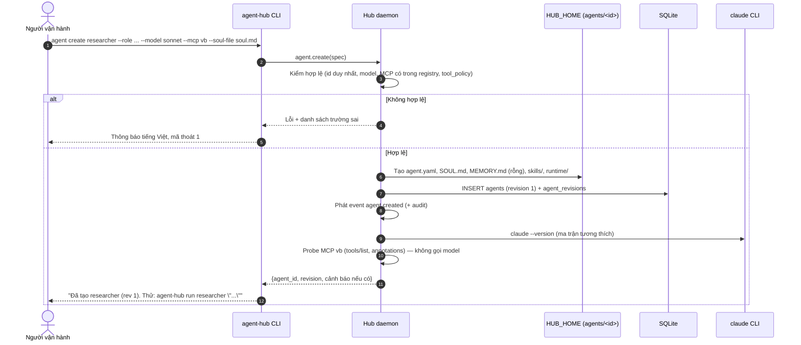
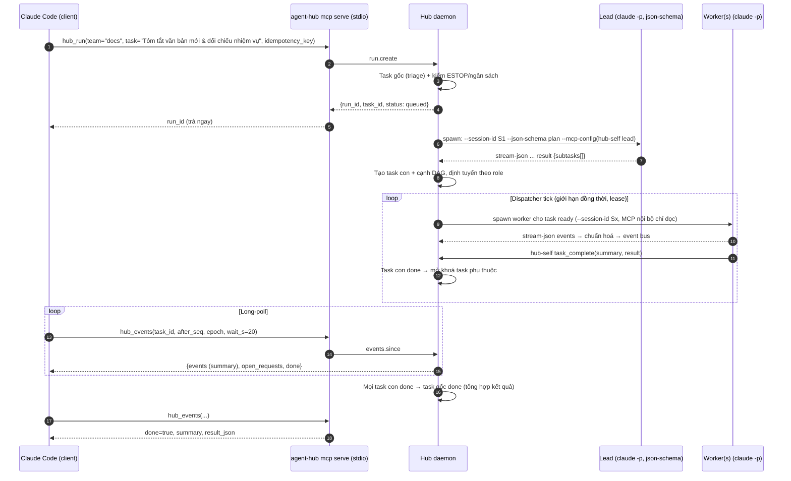
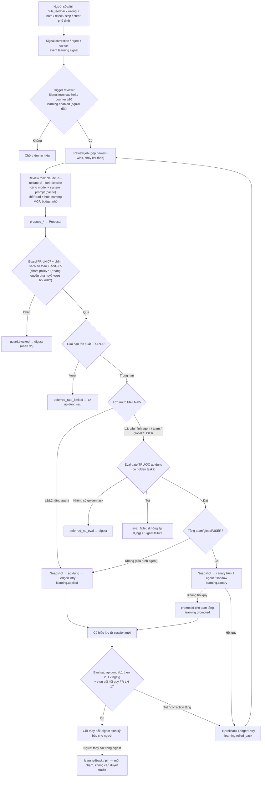

# agent-hub — Tài liệu Yêu cầu Nghiệp vụ (BRD) chi tiết

## 0. Thông tin tài liệu

| Mục | Nội dung |
|---|---|
| Tên sản phẩm | agent-hub |
| Loại tài liệu | Business Requirements Document (BRD) — bản chi tiết |
| Phiên bản | 0.9 (thêm Điều phối viên — mốc M7; ngoại lệ sandbox localhost theo agent; xem mục 15) |
| Ngày | 2026-10-19 (bản đầu 2026-10-18) |
| Chủ sản phẩm | phuonglq |
| Người soạn | Business Analyst (agent) |
| Tài liệu đi kèm | `docs/BRD-tom-tat.md` (bản tóm tắt, cùng mã FR và mốc) |
| Nguồn đầu vào | `research/BRIEF.md` (quyết định đã chốt — ưu tiên cao nhất), `research/00-de-xuat-kien-truc.md`, `research/notes/01..05-*.md`, mẫu output `research/notes/claude-stream-sample.jsonl`, `claude --help` (v2.1.302) |
| Trạng thái | Đã chốt toàn bộ câu hỏi mở (mục 14.1). Đã hiện thực M0–M5; nghiệm thu v2: 120/137 yêu cầu đạt (88%), Must FR 75/83 (90%) — mục 15 |

### 0.1 Lịch sử thay đổi

| Phiên bản | Ngày | Người | Thay đổi |
|---|---|---|---|
| 0.1 | 2026-10-18 | BA | Khởi tạo từ BRIEF + đề xuất kiến trúc + 5 báo cáo nghiên cứu Hermes |
| 0.2 | 2026-10-18 | phuonglq | Chốt Q-01 (claude CLI trên máy, cho chạy nhiều agent), Q-02 (giới hạn đồng thời do setting), Q-03 (đồng ý ngưỡng thay đổi nhỏ), Q-05 (cho dùng tool ghi MCP nội bộ), Q-06 (ghi thẳng vào repo thật); cập nhật FR-TK-07, FR-RT-12, FR-MC-03, FR-LN-05, A-10, R-10, R-11, O10 |
| 0.3 | 2026-10-18 | BA (theo quyết định bổ sung lần 2 của phuonglq) | **Nâng tự cải thiện lên mức tối đa**: agent tự áp dụng mọi thay đổi tri thức (agent/team/global, USER), xoá/gộp/archive skill, sửa cấu hình agent — bỏ hàng chờ duyệt, thay bằng "báo chứ không hỏi" (event + digest + rollback). Viết lại FR-LN-04/05/07/10..15, thêm FR-LN-16..19 (canary, theo dõi hồi quy, giới hạn tần suất, tự sửa cấu hình). **Thêm nhóm FR-SG-01..08 "Bảo vệ thao tác phá huỷ"** (định nghĩa, tài nguyên được bảo vệ, phát hiện, phê duyệt `waiting_human`, bất biến chính sách an toàn, xoá mềm). Cập nhật FR-RT-09, FR-MC-03, FR-MS-02/05, FR-UI-01/04/06/08, FR-AG-03/04, FR-TM-01, FR-OB-08; C-06, C-08, A-01, A-13; G-4/G-5; NFR-11/12/15/25/27, thêm NFR-29..32; R-03, R-06, thêm R-16..R-19; data model, event, sơ đồ luồng 3–4, lộ trình. Chốt Q-04, Q-08, Q-14 |
| 0.4 | 2026-10-18 | phuonglq | Chốt Q-16 (thông báo qua Slack), Q-21 (waiting_human nhả slot, giữ khoá repo), Q-17..Q-20, Q-22, Q-23 theo đề xuất; bỏ các nhãn [ĐỀ XUẤT] tương ứng; thêm FR-SG-09 (thông báo Slack) |
| 0.5 | 2026-10-18 | phuonglq | Chốt Q-07 (golden task và cách chấm do người dùng quyết định; agent không tự tạo/sửa golden task), Q-09 (dừng-và-resume tự động mọi run đang chạy khi daemon khởi động lại), Q-11 (ai cài hub thì người đó dùng — một người dùng/một máy, HTTP chỉ localhost) |
| 0.6 | 2026-10-18 | phuonglq | Chốt Q-10 (event/transcript giữ 30 ngày), Q-12 (xác nhận KPI mục 2), Q-13 (mượn nguyên văn prompt Hermes, kèm NOTICE MIT), Q-15 (chỉ `takeover`, không tích hợp `claude --bg`) — không còn câu hỏi mở |
| 0.7 | 2026-10-18 | BA (theo nghiệm thu `docs/acceptance/traceability-v2.md` §4, `traceability.md` §5, quyết định trong `docs/plan/hardening.md`) | Áp các lệch được đánh giá "cập nhật BRD": FR-AG-01/04, FR-TK-05/06/14, FR-RT-06/09/10/12/15/17, FR-LN-03/09/12/13/17/18, FR-MS-02/08, FR-MC-01/05, FR-OB-01/08, FR-SG-02/03/05, FR-UI-08/10, NFR-15/18, §8, §9. **Quyết định**: canary/eval gate/regression monitor **không bao giờ** rollback thay đổi `actor=user`; thay đổi tầng team/global/USER của người áp ngay, chỉ theo dõi + cảnh báo (FR-LN-06/10/16/17, bất biến 4). **Thêm FR-SG-10** (sandbox OS bắt buộc), **FR-SG-11** (xác thực người gọi RPC nhạy cảm), **FR-SG-12** (toàn vẹn chính sách); thêm danh sách bất biến an toàn ở §6.10. **NFR-19** chốt định nghĩa (học / làm việc), ghi trạng thái chưa đạt. Thêm **mục 15 "Trạng thái hiện thực"**. Lệch phải sửa code (birthtime thay checkpoint, V2-N1 RPC admin thiếu xác thực, V2-N2 lập lịch hoãn, recall classifier) **không** đưa vào BRD — giữ yêu cầu |
| 0.8 | 2026-10-18 | BA (theo yêu cầu phuonglq: "qua terminal khó dùng quá — hỗ trợ qua website; giao tiếp ngoài Slack thêm Telegram"; nguồn `docs/plan/web-telegram.md`, `docs/dev-notes/web.md`, `docs/dev-notes/telegram.md`, README) | Đưa **Web UI** và **Telegram** vào phạm vi (mục 3, O4, O8, persona P1/P2, stakeholder); thêm nhóm **FR-WEB-01..11** (§6.11) và **FR-TG-01..08** (§6.12) theo đúng phần đã hiện thực, mốc mới **M6 "Web & Telegram"**; NFR-33 (bảo mật web), NFR-34 (bảo mật Telegram), NFR-35 (khả dụng web); FR-SG-09 thành **thông báo đa kênh Slack + Telegram** (duyệt bằng nút Telegram qua long polling); FR-UI-08 thêm lệnh `web`, `notify telegram`; KPI G-1, US-19..21, R-20/R-21, §8.2, §9, lộ trình M6, mục 15.2, Phụ lục A |
| 0.9 | 2026-10-19 | BA (theo yêu cầu phuonglq: "muốn có 1 con agent như harness để quản lý và tạo nhiệm vụ cho các con agent còn lại", quyết định quyền "Toàn quyền trừ an toàn"; nguồn `docs/plan/M7-manager.md`, `docs/dev-notes/M7-core.md`, `M7-ui.md`, `hardening-SEC.md` §8) | Thêm **Điều phối viên** (agent manager do người chỉ định): nhóm **FR-MGR-01..08** (§6.13), mốc **M7**; bất biến an toàn **7** (manager không vượt ranh giới an toàn); **FR-SG-13** ngoại lệ sandbox localhost theo agent (chỉ người đặt, audit, nhãn cảnh báo; đã bật cho team toa-soan-ia); NFR-36, R-22/R-23, persona P5, US-22..25, FR-UI-08, §8, §9, lộ trình M7, mục 15.3, Phụ lục A |

### 0.2 Quy ước trong tài liệu

- **Phải / Nên / Có thể / Chưa làm** tương ứng MoSCoW: **Must / Should / Could / Won't (lần này)**.
- **[GIẢ ĐỊNH-CẦN-XÁC-MINH]**: năng lực của `claude` CLI hoặc hành vi chưa được kiểm bằng chạy thật hay bằng `claude --help`. Mỗi giả định có mã `A-xx` (mục 4.1) và phải được xác minh bằng spike trước khi làm FR phụ thuộc.
- **[ĐỀ XUẤT]**: số liệu mục tiêu hoặc giá trị mặc định do BA đề xuất, chưa có baseline đo đạc, cần chủ sản phẩm xác nhận.
- Mã yêu cầu: `FR-<NHÓM>-<số>` (chức năng), `NFR-<số>` (phi chức năng), `US-<số>` (user story), `R-<số>` (rủi ro), `A-<số>` (giả định), `C-<số>` (ràng buộc), `Q-<số>` (câu hỏi mở), `G-<số>` (mục tiêu).
- Cột mốc M0–M7 theo mục 13 (M6 thêm ở 0.8, M7 ở 0.9).

### 0.3 Bảng thuật ngữ

| Thuật ngữ | Định nghĩa trong agent-hub |
|---|---|
| **Agent** | Một "nhân sự AI" có định danh bền (slug), vai trò/mô tả (dùng để định tuyến), persona (SOUL), model, chính sách tool, tập MCP server, hạn mức, memory và skills riêng. Lưu ở thư mục home `HUB_HOME/agents/<id>/` + một dòng trong DB chung. Agent **không** phải một tiến trình; tiến trình chỉ tồn tại trong một Run. |
| **Team** | Nhóm agent có điều lệ (charter), thành viên với vai trò (lead/worker/reviewer/verifier), chính sách chung (duyệt, ngân sách, giới hạn lỗi) và ESTOP riêng. |
| **TeamMember** | Quan hệ agent ↔ team kèm vai trò và giới hạn số việc đang làm. |
| **Task** | Một đơn vị công việc (tiêu đề, nội dung, người nhận, độ ưu tiên, cha trong DAG). Task là *việc*, tồn tại độc lập với số lần thử. |
| **Task DAG** | Đồ thị phụ thuộc không chu trình giữa các Task; task con chỉ sẵn sàng khi mọi task cha `done`. |
| **Run** | Một lần thử thực thi (một Task, hoặc một lệnh ad-hoc) bởi một agent = **một hoặc nhiều tiến trình `claude -p` liên tiếp trên cùng một Session**. Ghi outcome, chi phí, usage, tóm tắt. |
| **Session** | Phiên hội thoại của `claude` CLI, định danh bằng UUID do hub cấp qua `--session-id`; có thể `--resume` và `--fork-session`. Transcript do CLI lưu; hub lưu ánh xạ Run ↔ Session. |
| **Runtime** | Thành phần thực thi vòng lặp agent. Ở bản này là **`claude` CLI (Claude Code) trên chính máy** (quyết định chốt #1). Hub bọc sau interface `AgentRuntime` để có thể thay sau. |
| **Runtime adapter** | Mã của hub dựng dòng lệnh `claude`, sinh file cấu hình cô lập, spawn tiến trình, đọc stdout `stream-json`, ghi stdin `stream-json`, chuyển thành Event của hub. |
| **Hub daemon** | Tiến trình nền dài hạn sở hữu toàn bộ trạng thái (DB, event bus, dispatcher, tiến trình agent). CLI/TUI/MCP chỉ là client. Đóng UI không làm dừng agent. |
| **Event** | Bản ghi có cấu trúc (envelope + type + payload) mô tả một việc xảy ra: từ CLI (đã chuẩn hoá) hoặc từ hub (task, approval, learning…). Có `seq` + `epoch` để replay. |
| **Event bus** | Cơ chế trong daemon: ghi append-only vào DB, giữ ring buffer trong RAM, fanout tới subscriber có hàng đợi giới hạn. |
| **Approval / ApprovalRequest** | Câu hỏi ngược từ agent tới người. Từ 0.3, **chỉ thao tác phá huỷ** mới mở approval (FR-SG-04). Có id, trạng thái `open → waiting_human → allowed/denied/cancelled`, **không tự hết hạn thành từ chối**, replay khi attach. Câu hỏi làm rõ (clarify) dùng cùng cơ chế. |
| **Thao tác phá huỷ** | Thao tác không hoàn tác được hoặc xoá hệ thống/dữ liệu quan trọng (danh mục đầy đủ ở FR-SG-01). Là loại thao tác **duy nhất** cần người duyệt. |
| **Tài nguyên được bảo vệ (ProtectedResource)** | Đường dẫn, repo/nhánh, CSDL/bảng, tool MCP, tài nguyên hub do **người** khai báo; mọi thao tác xoá/ghi đè lên chúng bị coi là phá huỷ (FR-SG-02). |
| **Chính sách an toàn (Safety policy)** | Danh mục thao tác phá huỷ, danh sách tài nguyên được bảo vệ, luật guard, cấu hình audit, công tắc học, thời gian chờ duyệt, biên cấu hình agent. Chỉ người sửa được; agent và vòng học **không bao giờ** sửa được (FR-SG-05). |
| **waiting_human** | Trạng thái của Run/ApprovalRequest khi thao tác phá huỷ đã chờ quá 300 s chưa có người: run tạm dừng, giữ lease và session, nhắc lại định kỳ, chờ tới khi có người (FR-SG-04). |
| **Báo chứ không hỏi** | Nguyên tắc từ 0.3: agent tự áp dụng thay đổi, hub phát event ngay + digest định kỳ cho người; người không phải duyệt nhưng luôn rollback được. |
| **Digest** | Bản tổng hợp định kỳ những gì agent đã tự thay đổi, đã rollback, bị chặn, đang canary (FR-LN-13). |
| **Canary / shadow** | Áp dụng thay đổi tầng team/global cho một agent thử (canary) hoặc chạy song song không ảnh hưởng (shadow) trong một cửa sổ quan sát trước khi mở rộng (FR-LN-16). |
| **Steer** | Gửi thêm một tin nhắn của người vào phiên đang chạy để đổi hướng mà không dừng agent. |
| **ESTOP** | Công tắc dừng khẩn cấp (toàn cục hoặc theo team): không khởi chạy Run mới; tuỳ chọn dừng Run đang chạy. |
| **Signal** | Tín hiệu có cấu trúc về chất lượng hành vi agent, thu từ thao tác/sử dụng của người: sửa lỗi (correction), hoàn tác (undo), sửa output (edit_output), từ chối duyệt (reject), huỷ run (cancel), lặp thao tác (repeat_pattern), thất bại lặp (failure). Gắn bằng chứng (evidence). |
| **Review fork** | Một lượt chạy `claude` riêng, rẽ nhánh từ phiên của agent (`--resume <sid> --fork-session`), chỉ có quyền đọc + công cụ đề xuất học, nhiệm vụ: chưng cất bài học thành Proposal (hub tự áp dụng qua pipeline FR-LN-05). Không ghi vào phiên gốc. |
| **Proposal** | Một thay đổi tri thức/cấu hình do vòng học sinh ra: phạm vi (agent/team/global), đích (memory/skill/config/user_profile), thao tác (add/patch/merge/archive/delete — delete luôn là xoá mềm), lớp rủi ro (L1/L2/L3), diff, bằng chứng, trạng thái. Từ 0.3 **không có trạng thái chờ duyệt mặc định**. |
| **Pipeline áp dụng** | Luật quyết định một Proposal được áp dụng theo đường nào (ngay / sau eval / qua canary), bị hoãn (giới hạn tần suất, thiếu eval) hay bị chặn (chạm chính sách an toàn) — FR-LN-05. Thay cho "policy duyệt" của 0.1–0.2. |
| **Ledger** | Sổ append-only ghi mọi thay đổi đã áp dụng lên memory/skill/config: before/after (blob sha256), tác nhân, thời điểm, điểm eval trước/sau, trạng thái rollback. Cho phép rollback từng mục. |
| **Memory** | Tri thức *khai báo*, ngắn, luôn được nạp vào system prompt, có hạn mức ký tự cứng (`MEMORY.md` của agent; `memory.md` của team; `USER.md` toàn cục). |
| **Skill** | Tri thức *thủ tục* (cách làm một loại việc), dạng thư mục `skills/<tên>/SKILL.md` (+ references/templates/scripts), chỉ đưa *chỉ mục* (tên + mô tả ≤60 ký tự) vào prompt, nạp toàn văn theo nhu cầu. |
| **3 tầng tri thức** | agent (riêng) → team (chia sẻ trong team) → global (toàn hub). Agent tự ghi được cả 3 tầng; tầng team/global bắt buộc qua eval gate + canary (FR-LN-10/16). |
| **Curator** | Tiến trình bảo trì thư viện skill: pha 1 tất định (stale/archive theo hoạt động), pha 2 dùng LLM gộp skill (opt-in); bản liên agent đề xuất promote skill trùng lên tầng team. |
| **Eval gate** | Cổng hồi quy: chạy bộ *golden task* với cấu hình trước và sau một thay đổi; **bắt buộc trước khi áp dụng** thay đổi tầng team/global, USER và cấu hình agent; sau áp dụng với thay đổi tầng agent; điểm tụt quá ngưỡng → không áp dụng hoặc tự rollback. |
| **Golden task** | Task mẫu lấy từ Run thật được người đánh dấu "tốt", kèm tiêu chí chấm. |
| **SOUL** | Persona/hướng dẫn hệ thống cố định của agent (`SOUL.md`). |
| **MCP server (của hub)** | Bề mặt để client bên ngoài (Claude Code…) điều khiển hub, kiểu Serena. |
| **MCP client (của agent)** | Các MCP server bên ngoài (nội bộ công ty, Serena…) mà agent được phép dùng; hub truyền cho `claude` qua `--mcp-config`. |
| **hub-self MCP** | MCP server nội bộ do hub cung cấp *cho chính agent* (xem task, bình luận, hoàn tất, đọc skill, đề xuất học). |
| **Trust tier** | Mức tin cậy MCP server do người đặt: `trusted` (tool ghi chạy có kiểm toán) hoặc `untrusted`/`require_approval` (tool không `readOnlyHint` phải được duyệt). Tool có ý nghĩa xoá luôn là thao tác phá huỷ bất kể trust (FR-SG-01). |
| **HUB_HOME** | Thư mục gốc dữ liệu của hub, mặc định `~/.agent-hub/`. |
| **Web UI** | Giao diện trình duyệt chạy trên chính máy (`agent-hub web`, chỉ loopback), là client của daemon như CLI/TUI (FR-WEB, thêm ở 0.8). |
| **Bot Telegram** | Bot chạy trong daemon bằng long polling: gửi thông báo, nhận nút duyệt và lệnh chat từ các chat trong allowlist (FR-TG, thêm ở 0.8). |
| **Điều phối viên (manager)** | Một agent được **người** chỉ định làm đầu mối: nhận yêu cầu của người, tự tạo/sửa/xoá mềm agent và team, giao task, theo dõi tới xong, báo cáo. Quyền "toàn quyền trừ an toàn", kiểm ở daemon (FR-MGR, thêm ở 0.9). |
| **Hội thoại (conversation)** | Chuỗi trao đổi liên tục giữa người và điều phối viên trên một kênh (web, `telegram:<chat_id>`, cli); mỗi tin của người là một run `kind=manager` tiếp tục (`--resume`) cùng session. |
| **Nhịp (heartbeat/tick)** | Lượt chạy của điều phối viên do sự kiện (task kẹt/xong, run lỗi lặp, approval chờ lâu, digest) hoặc định kỳ dự phòng kích hoạt, chỉ khi có việc. |
| **Allowlist chat** | Danh sách `chat_id` Telegram do người xác nhận khi ghép nối; chỉ các chat này nhận tin và điều khiển được hub. |

---

## 1. Bối cảnh & vấn đề

### 1.1 Bối cảnh
- Chủ sản phẩm đang làm việc hằng ngày bằng **Claude Code + Serena (MCP)**, và có nhiều **MCP nội bộ** (quản lý công việc, văn bản, theo dõi… — phần lớn chỉ đọc, tên tool tiếng Việt). Tài liệu nội bộ viết bằng tiếng Việt, lưu BRD/PRD/AGENTS trong repo.
- `claude` CLI (v2.1.302 trên máy) đã có đủ các năng lực để làm runtime cho agent: chạy không tương tác, luồng event `stream-json`, định danh/tiếp tục/rẽ nhánh phiên, persona qua system prompt, MCP riêng, quyền tool, hooks, subagent, giới hạn ngân sách (chi tiết ở BRIEF và FR-RT-02).
- Nghiên cứu repo **hermes-agent** cho thấy: Hermes mạnh ở *một agent tự học* (memory/skill/review fork/curator/ledger), có Kanban điều phối nhiều worker, có TUI attach/detach; nhưng **không có thực thể Team, không có registry trạng thái tập trung, MCP server chỉ là cầu nối nhắn tin, không có màn "htop" nhiều agent, vòng tự học không có eval/rollback theo kết quả** (00-de-xuat-kien-truc.md §1).

### 1.2 Vấn đề cần giải quyết

| # | Vấn đề | Hệ quả hiện nay |
|---|---|---|
| P1 | Không có chỗ định nghĩa và quản lý một *đội* agent (vai trò, persona, quyền, MCP, ngân sách) bền vững | Mỗi lần dùng phải dựng lại prompt/cấu hình tay; không tái sử dụng được |
| P2 | Không giao được một việc lớn cho nhiều agent phối hợp có phụ thuộc, có giới hạn đồng thời, chịu lỗi | Người phải tự chia việc, tự theo dõi, tự chạy lại khi lỗi |
| P3 | Không quan sát được nhiều agent đang chạy cùng lúc, không duyệt/điều hướng được giữa chừng từ một chỗ | Mất kiểm soát, khó phát hiện agent kẹt hoặc tốn tiền |
| P4 | Agent không học từ chính cách người dùng sửa/huỷ/duyệt; cùng một lỗi bị sửa lặp đi lặp lại | Lãng phí thời gian người, chất lượng không tăng theo thời gian |
| P5 | Nếu cho agent tự học mà không có kiểm soát thì có thể làm *hỏng* agent (học sai, bị prompt injection, phình context); nhưng nếu bắt người duyệt mọi thay đổi thì người thành nút thắt | Mất niềm tin vào tự động hoá, hoặc tự động hoá chậm vì chờ người |
| P8 | Agent có quyền ghi vào repo thật và MCP nội bộ (Q-05, Q-06) có thể vô tình **xoá dữ liệu/hệ thống không hoàn tác được** | Thiệt hại không khôi phục được — đây là điểm duy nhất người phải giữ quyền quyết |
| P6 | Các hệ đang vận hành (Claude Code, MCP nội bộ) không có cách giao việc cho một đội agent qua giao thức chung | Phải chuyển ngữ cảnh thủ công |
| P7 | Chạy `claude` headless mặc định **thừa hưởng cấu hình máy** (đã quan sát: hook SessionStart của Serena vẫn chạy) | Agent bị nhiễm chỉ dẫn/công cụ ngoài ý muốn, hành vi khó tái lập |

---

## 2. Mục tiêu kinh doanh & KPI

> Tất cả chỉ tiêu dưới đây là **[ĐỀ XUẤT]**, chưa có baseline. Baseline sẽ đo ở cuối M2 (cho G1–G3) và cuối M4 (cho G4). Chủ sản phẩm cần xác nhận hoặc chỉnh (Q-12).

| Mã | Mục tiêu | KPI đo được | Chỉ tiêu đề xuất | Cách đo |
|---|---|---|---|---|
| G-1 | Quản lý đội agent nhanh, không cần sửa file tay | Thời gian từ lệnh tạo tới khi agent chạy được run đầu tiên | ≤ 5 phút (agent từ template ≤ 1 phút) | Đo thủ công khi nghiệm thu M0 |
| G-1 | | Tỷ lệ thao tác quản trị (CRUD agent/team/MCP) làm được qua CLI/MCP mà không sửa file | 100% thao tác trong FR-AG/TM/MC | Checklist nghiệm thu |
| G-1 | | Thao tác thường dùng làm được **không cần terminal** (sau bước khởi động `agent-hub web` / ghép nối Telegram): tạo/sửa agent, giao việc, xem live, duyệt, rollback | 100% trên web; giao việc + duyệt + xem trạng thái trên Telegram (thêm ở 0.8) | Checklist nghiệm thu M6 |
| G-2 | Quan sát & điều khiển live nhiều agent | Độ trễ p95 từ khi CLI in một dòng event tới khi hiện trên TUI | ≤ 1 giây | Timestamp nhận stdout vs render (NFR-01) |
| G-2 | | Số agent chạy đồng thời ổn định trên 1 máy | ≥ 5 (mục tiêu mở rộng 10), giới hạn thực tế phụ thuộc rate limit tài khoản | Bài test tải M2 (NFR-02) |
| G-2 | | Tỷ lệ Run vẫn chạy bình thường khi đóng/mở lại TUI | 100% | Test tự động (NFR-05) |
| G-3 | Cắm vào hệ thống đang vận hành qua MCP | Số tool call MCP tối thiểu để Claude Code giao một việc và nhận kết quả | ≤ 3 (`hub_run` → `hub_events` lặp → kết quả trong event cuối) | Kịch bản nghiệm thu M1 |
| G-3 | | Số MCP server import được từ `~/.claude.json` không cần sửa tay | ≥ 90% server cấu hình stdio/http chuẩn | Báo cáo import |
| G-4 | Agent tự cải thiện tối đa từ sử dụng, người tham gia ít nhất | Tỷ lệ lặp lại cùng loại Signal `correction` cho cùng agent+loại việc sau 4 tuần bật học | Giảm ≥ 30% so với 2 tuần đầu | Truy vấn bảng Signal |
| G-4 | | Số thay đổi học (tri thức/cấu hình) phải chờ người duyệt | 0 (người chỉ duyệt thao tác phá huỷ) | Bảng Proposal: không có trạng thái chờ duyệt |
| G-4 | | Tỷ lệ thay đổi tự áp dụng bị rollback (tự động hoặc bởi người) | ≤ 15% (cao hơn → review fork học sai/nhiễu) | Ledger |
| G-4 | | Tỷ lệ thay đổi bị người rollback thủ công (thay đổi xấu lọt qua eval/canary) | ≤ 5% | Ledger `actor=user, op=rollback` |
| G-4 | | Thay đổi tự áp dụng làm tụt điểm eval mà **không** bị rollback | 0 (mọi tụt điểm phát hiện được đều rollback trong 1 chu kỳ eval) | Ledger + EvalResult (từ M4) |
| G-5 | Kiểm soát chi phí & an toàn | Chi phí review fork + eval so với tổng chi phí agent | ≤ 15% | Tổng hợp cost theo `kind` của Run |
| G-5 | | Tỷ lệ input token đọc từ cache trên các Run có resume/fork | ≥ 70% | `usage.cache_read_input_tokens` trong event `result` |
| G-5 | | Số lần vượt ngân sách ngày mà không bị chặn | 0 | Event `budget.exceeded` vs Run phát sinh sau đó |
| G-5 | | Số Run bị nhiễm cấu hình máy (hook/MCP/CLAUDE.md của người dùng) | 0 | Kiểm `system/init.mcp_servers` + không có `hook_started` lạ (FR-RT-03) |
| G-5 | | Số thao tác phá huỷ được thực thi mà **không** có người cho phép | 0 | Audit `guard_decisions` + bộ test phân loại (FR-SG-07) |
| G-5 | | Số lần người phải can thiệp duyệt mỗi tuần | Chỉ thao tác phá huỷ; tỷ lệ báo nhầm (bị coi là phá huỷ nhưng người thấy an toàn) ≤ 5% | Approval `denied/allowed` + nhãn "báo nhầm" của người (NFR-31) |
| G-5 | | Đề xuất học chạm chính sách an toàn được áp dụng | 0 (100% bị `guard.blocked`) | Event `guard.blocked` vs ledger (FR-SG-05) |

---

## 3. Phạm vi

### 3.1 Trong phạm vi (bản này, M0–M7)
1. Hub daemon chạy trên **một máy**, lưu trạng thái SQLite, event bus có replay.
2. Quản lý **Agent** (CRUD, archive, clone/export, phiên bản cấu hình), **Team** (thành viên, vai trò, chính sách, ESTOP), **Task** (DAG, lease/heartbeat, định tuyến theo vai trò, giới hạn đồng thời), **Run**.
3. **Runtime adapter cho `claude` CLI**: dựng lệnh, cô lập cấu hình, đọc `stream-json`, steer qua stdin, resume/fork, ngân sách, phê duyệt.
4. **Harness tự cải thiện mức tối đa**: Signal → review fork (bằng `claude` CLI) → Proposal → pipeline áp dụng tự động (snapshot, eval gate, canary, giới hạn tần suất) → Ledger/rollback tự động → Curator; 3 tầng tri thức; agent tự sửa cấu hình của mình; người được báo (event + digest), không phải duyệt.
5. **MCP server** của hub (stdio + Streamable HTTP localhost) cho Claude Code và client khác; **MCP client** cho agent (registry, trust, import từ `~/.claude.json`).
6. **CLI + TUI kiểu htop**: bảng agent live, attach/detach, approve/steer/stop, tab learnings, lệnh CLI đầy đủ.
7. Quan sát & chi phí: event store, usage/cost theo run/agent/team/ngày, ngân sách, audit.
8. **Bảo vệ thao tác phá huỷ**: danh mục thao tác phá huỷ, tài nguyên được bảo vệ, phân loại tại PreToolUse/permission tool, phê duyệt chờ người (`waiting_human`), chính sách an toàn bất biến với agent, xoá mềm cho mọi dữ liệu trong hub.
9. **Web UI** (thêm ở 0.8, M6): giao diện trình duyệt tiếng Việt trên chính máy (chỉ loopback) cho mọi thao tác thường dùng — tổng quan live, xem run live, duyệt, quản lý agent/task/team, tự học, MCP, chi phí, audit, cài đặt (FR-WEB).
10. **Telegram** (thêm ở 0.8, M6): bot chạy trong daemon bằng long polling — thông báo như Slack, **duyệt bằng nút**, lệnh chat để xem trạng thái và giao việc (FR-TG).
11. **Điều phối viên** (thêm ở 0.9, M7): một agent do người chỉ định quản lý các agent còn lại — tạo/sửa agent và team, giao task, theo dõi, báo cáo — qua hội thoại liên tục trên web/Telegram/CLI và nhịp tự động; quyền "toàn quyền trừ an toàn" kiểm ở daemon (FR-MGR).

### 3.2 Ngoài phạm vi (Won't trong bản này)
| # | Hạng mục | Lý do |
|---|---|---|
| O1 | **Tự viết vòng lặp agent** (agent loop, tool registry, nén context, provider adapter) | Quyết định chốt #1: runtime = `claude` CLI |
| O2 | **Gọi Anthropic API trực tiếp** để chạy agent, review hoặc eval | Quyết định chốt #1: mọi lượt LLM đi qua `claude` CLI |
| O3 | **Đa nhà cung cấp model** (OpenAI, Gemini, model local…) | Phụ thuộc runtime; chỉ chừa interface `AgentRuntime` (NFR-22) |
| O4 | **Gateway nền tảng chat tổng quát** (Zalo, Discord, nút duyệt tương tác trong Slack…) — **thu hẹp ở 0.8**: Slack thông báo (FR-SG-09) và **Telegram** (FR-TG) nay **trong phạm vi** | Chỉ làm kênh chủ sản phẩm yêu cầu; nút trong Slack cần endpoint công khai (trái O6) |
| O5 | Chạy phân tán nhiều máy, nhiều hub, HA | Ràng buộc C-04 (1 máy) |
| O6 | Đa người dùng, chia sẻ hub cho đồng nghiệp, truy cập qua mạng | Đã chốt Q-11: ai cài thì người đó dùng; HTTP chỉ localhost; client chỉ phân biệt read/control (FR-MS-06) |
| O7 | Giao thức A2A, ACP | Thứ tự ưu tiên: MCP trước (04-integration §9.3); để sau M5 |
| O8 | ~~Web dashboard đầy đủ~~ — **đưa vào phạm vi ở 0.8** (FR-WEB, M6) theo yêu cầu chủ sản phẩm (terminal khó dùng). Vẫn ngoài phạm vi: truy cập web từ máy khác qua mạng (chỉ loopback; dùng `ssh -L` nếu cần) | — |
| O9 | Fine-tune/huấn luyện model, sinh dữ liệu huấn luyện | Tự cải thiện chỉ ở tầng prompt/memory/skill/config |
| O10 | Sandbox container cho lệnh của agent | Agent ghi thẳng vào repo thật (đã chốt Q-06); an toàn dựa vào quyền tool của CLI + khoá theo repo + checkpoint git (FR-RT-12) |
| O11 | Marketplace/phân phối skill công khai | Ngoài nhu cầu hiện tại |

---

## 4. Stakeholder & persona

### 4.1 Stakeholder

| Stakeholder | Vai trò | Quan tâm chính |
|---|---|---|
| phuonglq | Chủ sản phẩm, chủ hệ thống, người vận hành chính | Tham gia ít nhất có thể; chỉ quyết thao tác phá huỷ; được báo đầy đủ và rollback được mọi thay đổi tự động; chi phí; dùng hằng ngày cùng Claude Code |
| Người dùng cuối giao việc | Có thể là chính chủ hệ thống hoặc đồng nghiệp dùng chung máy/hub | Giao việc nhanh, nhận kết quả đúng, ít phải sửa lại |
| Client tích hợp | Claude Code (qua MCP), script/CI (qua CLI `--json`), MCP client khác | Giao diện ổn định, bất đồng bộ, không timeout |
| Chủ các MCP nội bộ | Đội vận hành hệ nội bộ | Agent được dùng tool ghi (đã chốt Q-05) nhưng mọi lần ghi phải có nhật ký kiểm toán; không rò dữ liệu ra ngoài |
| Telegram (Bot API — phụ thuộc bên ngoài, thêm ở 0.8) | Kênh thông báo/duyệt/giao việc trên điện thoại | Bot token, long polling, giới hạn 64 byte `callback_data`, khả dụng dịch vụ |
| Anthropic / Claude Code (phụ thuộc bên ngoài) | Nhà cung cấp runtime | Định dạng `stream-json`, cờ CLI, rate limit, điều khoản sử dụng tài khoản |

### 4.2 Persona

**P1 — Người vận hành (Chủ hệ thống)**, ví dụ phuonglq
- Kỹ sư, dùng terminal + Claude Code + Serena hằng ngày; quen MCP.
- Cần: định nghĩa agent/team bằng lệnh; xem cả đội đang làm gì trong một màn; **chỉ** duyệt thao tác phá huỷ (được nhắc khi có agent chờ); khai báo tài nguyên được bảo vệ; đọc digest những gì agent tự học/tự sửa; rollback một chạm khi agent "học hỏng"; xem chi phí.
- Kênh dùng (0.8): terminal (CLI/TUI) khi ngồi máy; **web** khi muốn thao tác bằng chuột; **Telegram** để duyệt/giao việc khi không ở máy.
- Nỗi đau: **dùng qua terminal khó** (phản hồi 2026-10-18); phải lặp lại cùng một chỉ dẫn sửa lỗi; bị hỏi duyệt những việc vụn vặt; không biết agent nào đang ngốn tiền; cấu hình máy rò vào agent; sợ agent xoá nhầm dữ liệu thật.

**P2 — Người dùng cuối giao việc**
- Có thể không biết chi tiết cấu hình agent. Giao việc bằng câu tự nhiên cho một team ("tóm tắt các văn bản mới tuần này và đối chiếu với nhiệm vụ đang mở").
- Cần: giao việc 1 lệnh; biết tiến độ; trả lời câu hỏi làm rõ; phản hồi "đúng/sai" dễ dàng (thành Signal). Từ 0.8 làm được toàn bộ **không cần terminal**: ô *Giao việc* + nút 👍/👎 trên web, `/run` và reply trên Telegram.

**P3 — Client tích hợp (Claude Code / MCP client / script)**
- Gọi hub như gọi Serena: `hub_list_agents`, `hub_run(team, task)`, `hub_events(run_id, after_seq)`.
- Cần: tool có schema rõ, chú thích `readOnlyHint` đúng, run bất đồng bộ (không giữ tool call quá lâu), idempotency, thông điệp lỗi có hướng dẫn, `instructions` + resource hướng dẫn tiếng Việt.

**P5 — Điều phối viên (agent manager, tác nhân hệ thống — thêm ở 0.9)**
- Một agent (vd. `dieu-phoi`, template `manager`, model opus) được người chỉ định. Cần: thấy toàn cảnh hub (agent/team/task/run/approval/chi phí), tạo/sửa agent và team, giao task, theo dõi tới xong, báo cáo ngắn tiếng Việt cho người, chỉ hỏi người việc ngoài quyền.
- **Không được** ("toàn quyền trừ an toàn"): duyệt thao tác phá huỷ; sửa policy/protected/guard, golden task & rubric, ngoại lệ sandbox; purge; tắt ESTOP; đụng prod; sửa cấu hình của chính mình hay của bất kỳ agent manager nào; đặt `bypassPermissions`/`allow_bypass`/`extra_args`; cấp vai trò manager cho agent khác.
- P1 từ 0.9 có thể chỉ nói chuyện với một đầu mối (điều phối viên) thay vì điều khiển từng agent.

**P4 — Agent trong hub (tác nhân hệ thống)**
- Một tiến trình `claude` do hub spawn. Cần: biết task của mình, bình luận/hoàn tất/báo kẹt qua hub-self MCP; đọc skill theo nhu cầu; không thấy cấu hình máy. Được tự cải thiện tri thức và cấu hình của mình; **không** được tự sửa chính sách an toàn hay tự nâng quyền lên mức phá huỷ.

---

## 5. Giả định & ràng buộc

### 5.1 Ràng buộc (C)

| Mã | Ràng buộc |
|---|---|
| C-01 | `claude` CLI **phải được cài và đăng nhập** trên máy chạy hub. Hub dùng đăng nhập sẵn có (OAuth/keychain hoặc `ANTHROPIC_API_KEY`), không tự quản lý credential Anthropic. |
| C-02 | Hub **phụ thuộc phiên bản CLI**. Phiên bản tham chiếu: **2.1.302**. Định dạng `stream-json` và cờ có thể thay đổi giữa các phiên bản (R-01). |
| C-03 | Chịu **quota / rate limit của tài khoản** Claude đang đăng nhập; mọi agent dùng chung một hạn mức. Số agent đồng thời bị chặn trên bởi hạn mức này, không phải bởi hub. |
| C-04 | Chạy trên **một máy** (macOS là nền tảng chính — máy hiện tại là darwin; Linux là thứ yếu). Không HA, không phân tán. |
| C-05 | Không tự viết agent loop, không gọi API trực tiếp, không đa provider (O1–O3). |
| C-06 | Mức tự cải thiện theo **quyết định bổ sung lần 2** (thay quyết định #2): agent **tự** áp dụng thay đổi tri thức tầng agent/team/global, hồ sơ USER, xoá/gộp/archive skill (xoá mềm), sửa cấu hình agent (model, SOUL, toolsets, MCP, limits) — không cần người duyệt. Bù an toàn: xoá mềm, ledger + snapshot, eval gate, canary, tự rollback, giới hạn tần suất, digest. **Chỉ thao tác phá huỷ** cần người (FR-SG). Agent không được sửa chính sách an toàn. |
| C-07 | `--bare` chỉ nhận auth qua `ANTHROPIC_API_KEY` hoặc `apiKeyHelper` (OAuth/keychain không được đọc) — đã thấy trong `claude --help`. Với tài khoản OAuth, hub **không được** dùng `--bare` làm cơ chế cô lập mặc định. |
| C-08 | Tài liệu (BRD…), `instructions` MCP, resource hướng dẫn và thông báo TUI viết **tiếng Việt**; mã định danh (tên tool, cờ, field) giữ tiếng Anh. **Persona (SOUL), skill, memory của agent viết bằng tiếng Anh** (đã chốt Q-14). |
| C-10 | Stack đã chốt (Q-08): **Python 3.12+**, **Textual** cho TUI. |
| C-09 | Chế độ `-p` bỏ qua hộp thoại workspace trust và **bỏ qua im lặng** file settings không hợp lệ (theo `claude --help`) → hub phải tự kiểm hợp lệ file settings nó sinh ra trước khi spawn. |

### 5.2 Giả định cần xác minh (A)

> Các năng lực đã kiểm (bảng BRIEF + `claude --help`) **không** nằm ở đây. Mỗi A-xx phải được spike xác minh trước khi làm FR liên quan; nếu sai, áp dụng phương án dự phòng.

| Mã | Giả định | FR phụ thuộc | Cách xác minh | Phương án dự phòng |
|---|---|---|---|---|
| A-01 | Phê duyệt động từng tool call trong `-p` làm được bằng **một trong hai**: (a) `--permission-prompt-tool <mcp tool>` (được nhắc trong mô tả `--permission-prompts host` nhưng **không** có trong danh sách option của `--help` → có thể là cờ ẩn); (b) hook `PreToolUse` trong file `--settings` trả quyết định allow/deny/ask. | FR-RT-09, FR-SG-03/04, FR-UI-04, FR-MS-05 | Spike M0: chạy 1 tool cần duyệt với mỗi cách, đo hành vi khi hub trả allow/deny và khi hub không trả lời | Chặn tĩnh các mẫu phá huỷ bằng `--disallowedTools`; agent phải gọi hub-self `request_destructive(action, reason)` để mở approval; khi người cho phép, hub **resume** session với quyền mở rộng một lần đúng thao tác đó (FR-SG-04 "tạm dừng & tiếp tục") |
| A-02 | Với `--input-format stream-json`, tiến trình nhận thêm tin user qua stdin **trong khi đang chạy** và áp dụng ở ranh giới lượt kế tiếp (steer), hoặc xếp hàng sau lượt hiện tại. | FR-RT-06, FR-UI-05, FR-MS (hub_steer) | Spike M0/M2: gửi tin giữa lúc tool đang chạy, quan sát thứ tự event | Steer = interrupt + `--resume` với tin nhắn mới |
| A-03 | Gửi SIGINT cho tiến trình `-p` kết thúc lượt gọn và phiên vẫn `--resume` được; transcript không hỏng. | FR-RT-07 | Spike M0 | SIGTERM + resume; nếu phiên hỏng → fork từ điểm cuối hợp lệ |
| A-04 | `--setting-sources` chấp nhận danh sách rỗng hoặc chỉ `project` trỏ vào thư mục do hub kiểm soát, đủ để loại hooks/settings của người dùng; hook SessionStart của Serena không còn xuất hiện. | FR-RT-03 | Spike M0: chạy với tổ hợp cờ, kiểm không có `system/hook_started` lạ | Dùng `--restricted` (bỏ user/project/local settings; nhưng bỏ Bash trừ khi `--tools` nêu tên) hoặc `--safe-mode`; đặt `HOME` giả cho tiến trình (rủi ro mất OAuth — phải kiểm) |
| A-05 | CLAUDE.md cấp người dùng (`~/.claude/CLAUDE.md`) và auto-memory không được nạp khi cwd nằm trong `HUB_HOME` và đã giới hạn `--setting-sources`. | FR-RT-03 | Spike M0: hỏi agent nội dung system prompt có chứa đoạn đánh dấu trong CLAUDE.md người dùng | `--system-prompt` (thay toàn bộ) thay vì `--append-system-prompt`; hoặc `--safe-mode` |
| A-06 | Skill riêng của agent có thể nạp bằng `--plugin-dir <thư mục>` theo cấu trúc plugin của Claude Code. | FR-RT-10 (phương án B) | Spike M4 | Phương án A (mặc định): chỉ mục skill trong system prompt + đọc toàn văn qua hub-self MCP `skill_view` |
| A-07 | `total_cost_usd` trong event `result` phản ánh chi phí đủ chính xác để làm ngân sách. Mẫu cho thấy `modelUsage.*.costBasis: "list"` → với tài khoản thuê bao đây là **ước tính theo giá niêm yết**, không phải hoá đơn thật. | FR-OB-02/03, FR-RT-08 | Đối chiếu 1 tuần với trang usage tài khoản | Ngân sách tính theo token và theo % hạn mức (từ `rate_limit_event`) thay vì USD |
| A-08 | `rate_limit_event.rate_limit_info` chứa đủ thông tin (mức đã dùng, thời điểm reset) để dispatcher điều tiết. | FR-RT-16, FR-TK-07 | Thu mẫu khi gần chạm hạn mức | Điều tiết theo lỗi trả về (`result` subtype lỗi) + backoff cố định |
| A-09 | Nhiều tiến trình `claude -p` chạy song song cùng tài khoản trên cùng máy không tranh chấp file trạng thái của CLI (transcript, config). | FR-TK-07, NFR-02 | Test tải 5–10 tiến trình M2 | Giới hạn đồng thời thấp hơn; tách `CLAUDE_CONFIG_DIR` nếu được hỗ trợ (cần kiểm) |
| A-10 | ~~Điều khoản tài khoản cho phép chạy nhiều agent headless~~ — **ĐÃ XÁC NHẬN** (Q-01): hub dùng `claude` CLI đã đăng nhập trên máy và được chạy nhiều agent. Hệ quả: không dùng `--bare` (vì `--bare` chỉ nhận ANTHROPIC_API_KEY); cô lập cấu hình bằng `--setting-sources` + `--settings` + `--strict-mcp-config` (A-03). | Toàn hệ thống | Đã đóng | — |
| A-11 | Hook (trong `--settings`) có thể gọi lệnh/HTTP tới hub để đẩy tín hiệu `PostToolUse`, `UserPromptSubmit`, `Stop` mà không làm chậm agent đáng kể. | FR-LN-01, FR-RT-17 | Spike M4 | Suy tín hiệu từ event `stream-json` (đã đủ cho tool_use/tool_result) |
| A-12 | `--fork-session` kết hợp `--resume` trên **cùng model và cùng system prompt** tận dụng prompt cache của phiên gốc (Hermes đo ~26% giảm chi phí với cơ chế tương tự). | FR-LN-03, NFR-18 | Đo `cache_read_input_tokens` của fork | Fork với digest (tóm tắt + N message cuối) bằng model rẻ hơn |
| A-13 | Hook `PreToolUse`/permission tool có thể **giữ chờ** quyết định của người lâu (nhiều phút–giờ) mà CLI không tự huỷ lượt/timeout. | FR-SG-04 | Spike M1: giữ hook 10 phút, quan sát CLI | Mô hình "tạm dừng & tiếp tục": sau thời gian giữ an toàn hook trả từ chối kèm thông điệp "đang chờ người", hub dừng tiến trình, giữ session + lease, chuyển `waiting_human`; khi người cho phép → `--resume` với vé cho phép một lần (`action_fingerprint`) |

---

## 6. Yêu cầu chức năng

> Định dạng mỗi FR: **Mã — Tên** · Ưu tiên · Mốc → Mô tả → Tiêu chí chấp nhận (Given/When/Then).
> "Bề mặt" nghĩa là các kênh phải hỗ trợ: CLI, TUI, MCP.

### 6.1 Quản lý Agent (FR-AG)

**FR-AG-01 — Tạo agent** · Must · M0
Mô tả: Tạo agent với: `id` (slug, bất biến, duy nhất), `name`, `role`, `description` (dùng định tuyến), `soul` (persona, nội dung SOUL.md), `model` (alias `opus|sonnet|haiku|fable` hoặc id đầy đủ), `effort`, `fallback_model`, `tool_policy` (permission_mode, allowed_tools, disallowed_tools, tools), `mcp_servers[]` (tham chiếu registry FR-MC-01), `limits` (max_concurrent_runs, max_budget_usd_per_run, budget_usd_per_day, max_runtime_s), `workspace_default`. **Id không được trùng từ khoá CLI** (`RESERVED_IDS`: list, show, logs, stop, follow, continue, resume, revert, diff, steer, status, all, help, detach, wait, takeover, attach). Hub tạo thư mục `HUB_HOME/agents/<id>/{agent.yaml, SOUL.md, MEMORY.md, skills/, .archive/, runtime/, workspaces/}`, ghi dòng `agents` trong DB, phát event `agent.created`. Bề mặt: CLI, MCP (`hub_agent_create`), TUI (form tối giản — Should).
- Given chưa có agent `researcher`, When chạy `agent-hub agent create researcher --role "Nghiên cứu" --model sonnet --soul-file soul.md`, Then thư mục home và dòng DB được tạo, `agent-hub agent show researcher` hiển thị đúng các trường, event `agent.created` có trong log.
- Given đã có agent `researcher`, When tạo lại cùng id, Then lệnh thất bại với thông báo tiếng Việt "agent đã tồn tại" và không thay đổi gì.
- Given model không hợp lệ hoặc MCP server không có trong registry, When tạo, Then từ chối và liệt kê trường sai.
- Given id `logs`, When tạo, Then từ chối vì trùng từ khoá CLI.

**FR-AG-02 — Liệt kê và xem chi tiết agent** · Must · M0
Mô tả: Liệt kê agent (lọc theo team/status/archived) với: id, name, role, status (`idle|working|waiting|paused|error|disabled`), run hiện tại, tool gần nhất, chi phí hôm nay, revision. Xem chi tiết gồm cấu hình hiệu lực, các run gần nhất, skill/memory tóm tắt. Bề mặt: CLI (`--json`), MCP (`hub_list_agents`, `hub_agent_get`), TUI.
- Given có 3 agent, 1 đang chạy, When `agent-hub agent list --json`, Then trả JSON 3 phần tử, phần tử đang chạy có `status=working` và `current_run_id` khác null.
- Given agent đã archive, When liệt kê không có `--archived`, Then agent đó không xuất hiện.

**FR-AG-03 — Sửa agent và phiên bản cấu hình** · Must · M0
Mô tả: Sửa mọi trường trừ `id`. Mỗi lần sửa tăng `config_revision`, lưu snapshot cấu hình vào bảng `agent_revisions` (ai sửa, lúc nào, diff). Run đang chạy **giữ** revision cũ; run mới dùng revision mới. Từ 0.3 vòng học được **tự** sửa cấu hình agent (FR-LN-19), luôn qua Proposal/Ledger + eval gate, revision ghi `actor=learning`; người sửa trực tiếp ghi `actor=user`.
- Given agent ở revision 3 đang có run chạy, When sửa model, Then revision thành 4, run đang chạy vẫn ghi `agent_config_revision=3`, run kế tiếp ghi 4.
- Given đã có revision 4, When `agent-hub agent revert researcher --to 3`, Then tạo revision 5 có nội dung bằng revision 3 (không xoá lịch sử).

**FR-AG-04 — Lưu trữ và xoá agent** · Must · M0
Mô tả: `agent rm` và `agent archive` là **cùng một thao tác xoá mềm** (FR-SG-06): archive, chuyển home vào `HUB_HOME/trash/`, giữ `retention.soft_delete_days`, khôi phục bằng `agent restore`. Chỉ khi không có run đang chạy và không là thành viên team nào (hoặc kèm `--detach-teams`). **Xoá cứng** (`agent purge`) là thao tác phá huỷ (FR-SG-01): người phải gõ lại id; agent khởi xướng → ApprovalRequest. Event `agent.archived` / `agent.deleted` / `agent.purged`.
- Given agent có run đang chạy, When `agent rm`, Then từ chối và gợi ý `stop` trước.
- Given agent đã xoá mềm 3 ngày, When `agent restore`, Then home và cấu hình trở lại nguyên vẹn.
- Given agent đã archive, When `agent restore`, Then agent trở lại `idle` với cấu hình cũ.

**FR-AG-05 — Tạm dừng / tiếp tục agent** · Should · M0
Mô tả: `paused` → dispatcher không giao việc mới; run đang chạy không bị dừng (trừ khi kèm `--stop-running`).
- Given agent `paused` và có task `ready` giao cho nó, When dispatcher tick, Then task không được claim; When `resume`, Then tick kế tiếp claim task.

**FR-AG-06 — Clone, export, import agent** · Should · M3
Mô tả: `clone <src> <dst>` sao chép cấu hình + SOUL + skill (tuỳ chọn `--with-memory`); `export` ra `.tar.gz` (loại secret); `import` từ file export.
- Given agent `coder` có 3 skill, When `agent clone coder coder2`, Then `coder2` có cùng cấu hình, 3 skill với `created_by` giữ nguyên và provenance `cloned_from=coder`, memory rỗng nếu không có `--with-memory`.
- Given file export, When import, Then không có giá trị secret nào trong file (chỉ tham chiếu `${SECRET_NAME}`).

**FR-AG-07 — Template agent** · Could · M2
Mô tả: Bộ template có sẵn (researcher, coder, reviewer, lead) với SOUL và tool_policy hợp lý; `agent create --from-template`.
- Given template `reviewer`, When tạo agent từ template, Then agent có `permission_mode=plan` hoặc chỉ tool đọc **[ĐỀ XUẤT]**, chạy được ngay.

**FR-AG-08 — Kiểm tra sức khoẻ agent (doctor)** · Should · M0
Mô tả: `agent-hub doctor [agent]`: kiểm `claude` có trong PATH, phiên bản so với ma trận tương thích (FR-RT-15), đã đăng nhập (`claude auth`), model hợp lệ, MCP server của agent kết nối được (FR-MC-06), file settings sinh ra hợp lệ (C-09). Không gọi model (không tốn tiền) trừ khi `--live`.
- Given MCP `vb` của agent không kết nối được, When `doctor coder`, Then báo lỗi rõ server nào và lý do, mã thoát khác 0.

### 6.2 Quản lý Team (FR-TM)

**FR-TM-01 — Tạo / sửa / lưu trữ team** · Must · M3
Mô tả: Team có `id`, `name`, `charter` (mục tiêu, cách làm việc — được chèn vào prompt của thành viên khi làm task của team), `policies` (FR-TM-03), `estop`. Xoá team luôn là xoá mềm (archive, FR-SG-06); `team purge` là thao tác phá huỷ. Bề mặt: CLI, MCP (`hub_team_*`), TUI (xem).
- Given team có task `running`, When archive team, Then từ chối; When có `--cancel-open-tasks`, Then huỷ các task mở rồi archive.

**FR-TM-02 — Thành viên và vai trò** · Must · M3
Mô tả: Thêm/bớt agent vào team với vai trò `lead|worker|reviewer|verifier` và `max_in_progress`. Một agent có thể thuộc nhiều team. Mỗi team có tối đa 1 lead **[ĐỀ XUẤT]**.
- Given team `docs` chưa có lead, When gán `planner` là lead, Then `team show docs` hiển thị lead; When gán thêm lead thứ hai, Then từ chối.

**FR-TM-03 — Chính sách team** · Must · M3
Mô tả: `review_required` (task xong phải qua reviewer), `failure_limit` (mặc định 2, theo Hermes), `budget_usd_per_day`, `auto_decompose` (lead tự tách task), `default_assignee`, `learning` (bật/tắt, auto_apply — công tắc thuộc chính sách an toàn, chỉ người đổi, FR-LN-15).
- Given `review_required=true`, When worker hoàn tất task, Then task sang `review` và được giao cho reviewer thay vì `done`.

**FR-TM-04 — Tổng quan team** · Should · M3
Mô tả: `team show` / màn TUI: thành viên + trạng thái, task theo trạng thái, chi phí hôm nay/tuần, ngân sách còn lại, ESTOP.
- Given team có 2 task running và 3 done, When xem, Then số đếm khớp DB và chi phí bằng tổng cost các run của team trong ngày.

### 6.3 Task & điều phối (FR-TK)

**FR-TK-01 — Run ad-hoc cho một agent** · Must · M0
Mô tả: `agent-hub run <agent> "<prompt>" [--cwd] [--budget] [--wait|--detach]` tạo một Run không có Task, spawn runtime, trả `run_id` ngay; `--wait` stream event ra terminal. Bề mặt: CLI, MCP (`hub_run` với `agent`).
- Given agent `researcher` idle, When `agent-hub run researcher "tóm tắt README" --detach`, Then in `run_id`, Run ở `running`, event `run.started` có `session_id` khớp `system/init.session_id`.
- Given run kết thúc thành công, Then Run có `outcome=completed`, `cost_usd`, `usage`, `summary` (text cuối), `duration_ms` lấy từ event `result`.

**FR-TK-02 — Tạo task** · Must · M3
Mô tả: Task gồm `team_id` hoặc `assignee_agent_id`, `title`, `body`, `priority`, `parents[]`, `workspace` (scratch|dir|worktree), `overrides` (model, effort, budget), `max_retries`, `idempotency_key`, `created_by` (human|agent_id|mcp_client). Bề mặt: CLI, MCP (`hub_task_create`, `hub_run` với `team`).
- Given cùng `idempotency_key` gửi 2 lần, When tạo task, Then chỉ có 1 task, lần 2 trả về task cũ.

**FR-TK-03 — Vòng đời task** · Must · M3
Mô tả: Trạng thái `triage → todo → ready → running → (review) → done | blocked | archived`. Chuyển trạng thái chỉ qua hub (một writer). Mỗi chuyển phát event `task.status`.
- Given task `running` và agent gọi `task_block(reason)` qua hub-self MCP, Then task `blocked` với `block_reason`, run kết thúc `outcome=blocked`.
- Given task `blocked`, When người `task unblock`, Then task về `ready`.

**FR-TK-04 — Task DAG** · Must · M3
Mô tả: `parents[]` tạo cạnh phụ thuộc; dispatcher chuyển `todo → ready` khi mọi cha `done`. Phát hiện chu trình khi tạo/link. Kết quả (summary/result_json) của task cha được đưa vào ngữ cảnh task con.
- Given A → B (B phụ thuộc A), When A `done`, Then B chuyển `ready` trong tick kế tiếp và prompt của B có tóm tắt kết quả A.
- Given link tạo chu trình A → B → A, Then từ chối.

**FR-TK-05 — Run tách khỏi Task; retry** · Must · M3
Mô tả: Mỗi lần thử là một Run (`outcome ∈ completed|failed|blocked|crashed|timed_out|rate_limited|cancelled|budget_exceeded|protocol_violation|interrupted`; `crashed` = tiến trình chết bất thường, `failed` = kết thúc có lỗi, **spawn lỗi ghi `failed`**). Retry tạo Run mới; có thể `--resume` session của run trước nếu outcome cho phép (crashed/timed_out/rate_limited).
- Given run crash, When retry, Then Run mới có `parent_run_id` trỏ run cũ, dùng `--resume <session_id cũ>` và lịch sử 2 run đều còn.

**FR-TK-06 — Dispatcher, lease và heartbeat** · Must · M3
Mô tả: Dispatcher chạy trong daemon, tick định kỳ (mặc định 5 s **[ĐỀ XUẤT]**, Hermes 60 s) và khi có sự kiện. Mỗi tick: thu hồi lease hết hạn, phát hiện tiến trình chết theo `(pid, start_time)` (không dùng PID trần), cưỡng chế `max_runtime_s`, claim nguyên tử task `ready` (transaction SQLite), spawn. Heartbeat = hub thấy event mới từ stdout **hoặc** tiến trình còn sống; lease TTL mặc định 120 s **[ĐỀ XUẤT]**. Hiện thực: liveness của tiến trình con kiểm bằng returncode/`kill -0` (daemon là cha trực tiếp); `(pid, start_time)` dùng khi đối soát sau khởi động lại (FR-RT-19).
- Given tiến trình `claude` của run bị kill từ ngoài, When tick kế tiếp, Then run `outcome=crashed`, task về `ready` (nếu còn lượt retry) hoặc `blocked`.
- Given 2 tick chạy chồng (do sự kiện + timer), Then một task không bao giờ bị claim 2 lần (kiểm bằng test đồng thời).

**FR-TK-07 — Giới hạn đồng thời** · Must · M0 (toàn cục) / M3 (các mức còn lại)
Mô tả: Mọi giới hạn là **setting**, không có trần cứng trong code (đã chốt Q-02): `hub.max_concurrent_runs` trong `config.yaml` (giá trị khởi tạo 4, sửa được qua CLI/TUI không cần restart). Giới hạn số run đồng thời theo: toàn hub (`hub.max_concurrent_runs`), agent (`max_concurrent_runs`, mặc định 1), team member (`max_in_progress`), và điều tiết theo rate limit tài khoản (FR-RT-16). Task vượt giới hạn ở lại `ready` theo thứ tự ưu tiên rồi thời gian.
- Given giới hạn toàn cục 4 và 6 task ready, When tick, Then đúng 4 run chạy, 2 task chờ; When 1 run xong, Then task ưu tiên cao nhất kế tiếp được claim.

**FR-TK-08 — Định tuyến theo vai trò và tách việc bởi lead** · Must · M3
Mô tả: Task giao cho team (không chỉ định agent) được: (a) nếu `auto_decompose` và team có lead → tạo Run cho lead với `--json-schema` kế hoạch `{subtasks:[{title, body, role|agent_id, parents}]}`; hub tạo các task con theo kế hoạch; (b) nếu không → chọn worker theo `role`/`description` khớp nhất và ít tải nhất. Lead cũng có thể tạo task con qua hub-self MCP `task_create` (chỉ lead được cấp tool này).
- Given team có lead + 2 worker (role "nghiên cứu", "viết"), When giao "nghiên cứu rồi viết báo cáo", Then lead trả kế hoạch hợp lệ theo schema, hub tạo ≥2 task con có cạnh phụ thuộc, mỗi task gán đúng worker theo role.
- Given output của lead không khớp schema, Then run lead `outcome=protocol_violation`, task gốc `blocked` kèm lý do, không tạo task con nào.

**FR-TK-09 — Circuit breaker** · Must · M3
Mô tả: Lỗi liên tiếp của một task vượt `failure_limit` → `blocked`. `rate_limited` **không** tính là lỗi (requeue có backoff). Lỗi không thể retry (auth hỏng, CLI không có) → block ngay và cảnh báo toàn cục.
- Given `failure_limit=2`, When task crash 2 lần liên tiếp, Then task `blocked`, event `task.circuit_open`.

**FR-TK-10 — ESTOP** · Must · M0 (toàn cục) / M3 (team)
Mô tả: `agent-hub estop on [--team X] [--stop-running] [--reason]` / `estop off`. Khi bật: dispatcher và `run` ad-hoc không khởi chạy run mới trong phạm vi; `--stop-running` gửi dừng (FR-RT-07) tới mọi run trong phạm vi. Trạng thái ESTOP hiển thị đỏ trên header TUI. Bề mặt: CLI, TUI (phím tắt), MCP (`hub_estop`, quyền control). Điều phối viên (0.9) chỉ được **bật** ESTOP, không tắt (FR-MGR-03).
- Given ESTOP toàn cục bật, When `run researcher "..."`, Then từ chối với thông báo ESTOP và lý do.
- Given ESTOP team bật không `--stop-running`, Then run đang chạy của team tiếp tục tới khi xong, không run mới nào được tạo.

**FR-TK-11 — Bình luận task (kênh agent ↔ agent ↔ người)** · Should · M3
Mô tả: Task có luồng comment; agent đọc toàn bộ thread khi được spawn (đưa vào prompt) và ghi qua `task_comment`; người ghi qua CLI/TUI/MCP. Comment của người trên task đang chạy được chuyển thành steer (FR-RT-06) nếu `--steer`.
- Given task có 3 comment, When agent được spawn, Then prompt đầu có 3 comment theo thứ tự thời gian.

**FR-TK-12 — Bước review/verify** · Should · M3
Mô tả: Với `review_required`, task xong → `review` → reviewer chạy với quyền đọc; reviewer `approve` → `done`, `request_changes` → `ready` lại cho worker kèm comment.
- Given reviewer yêu cầu sửa, Then task về `ready`, worker mới được spawn đọc comment yêu cầu sửa; Signal `reject` được ghi cho worker (nguồn học).

**FR-TK-13 — Thời gian chạy tối đa** · Must · M3
Mô tả: `max_runtime_s` theo agent/task; quá hạn → dừng (FR-RT-07), `outcome=timed_out`.
- Given `max_runtime_s=600`, When run chạy 601 s, Then run bị dừng và đánh dấu `timed_out`.

**FR-TK-14 — Tiếp tục hội thoại với một run** · Should · M1
Mô tả: Dạng chính `agent-hub run continue <run|session> "<tin tiếp>"` (alias `run resume`, và `run <agent> … --continue <run>`) tạo Run mới cùng agent dùng `--resume <session_id>` (không fork) để hỏi tiếp.
- Given run R1 đã xong, When continue, Then Run R2 có `session_id` bằng R1, agent nhớ ngữ cảnh R1.

### 6.4 Runtime adapter `claude` CLI (FR-RT)

**FR-RT-01 — Interface AgentRuntime** · Must · M0
Mô tả: Hub gọi runtime chỉ qua interface: `start(spec) → handle`, `send(handle, user_message)`, `interrupt(handle)`, `stop(handle, grace_s)`, `resume(session_id, spec)`, `fork(session_id, spec)`, `events(handle) → async iterator[HubEvent]`, `capabilities() → {steer, approval, fork, json_schema, budget…}`. Có `ClaudeCliRuntime` (thật) và `FakeRuntime` (phát lại file JSONL, dùng cho test và demo không tốn tiền).
- Given `FakeRuntime` phát lại `claude-stream-sample.jsonl`, When chạy một run, Then hub sinh đúng chuỗi event chuẩn hoá như với runtime thật (test hồi quy, không gọi model).

**FR-RT-02 — Dựng dòng lệnh từ cấu hình agent** · Must · M0
Mô tả: Ánh xạ cố định (chỉ dùng cờ đã kiểm trong BRIEF/`--help`):

| Cấu hình hub | Cờ `claude` |
|---|---|
| Chạy không tương tác + prompt | `-p "<prompt>"` (hoặc prompt qua stdin khi dùng stream-json input) |
| Luồng event | `--output-format stream-json --verbose`; thêm `--include-partial-messages` khi có viewer attach chi tiết **[ĐỀ XUẤT: luôn bật, lọc ở hub]**; `--include-hook-events` khi bật chẩn đoán |
| Đầu vào streaming (steer) | `--input-format stream-json` (+ `--replay-user-messages` để xác nhận tin đã nhận) |
| Session | `--session-id <uuid do hub cấp>`; tiếp tục `--resume <id>`; rẽ nhánh `--resume <id> --fork-session` |
| Persona + memory + chỉ mục skill + charter team | `--append-system-prompt "<khối do hub dựng>"` (mặc định) hoặc `--system-prompt` (khi cần thay toàn bộ, A-05); `--system-prompt-snapshot on` |
| Model / effort / dự phòng | `--model`, `--effort`, `--fallback-model` |
| MCP của agent | `--mcp-config <HUB_HOME/agents/<id>/runtime/mcp.json>` + `--strict-mcp-config` |
| Quyền tool | `--permission-mode`, `--allowedTools`, `--disallowedTools`, `--tools` |
| Hooks của hub, settings cô lập | `--settings <runtime/settings.json>`, `--setting-sources <...>` (A-04) |
| Subagent | `--agents '<json>'` (+ `--forward-subagent-text`) |
| Ngân sách run | `--max-budget-usd <n>` |
| Output có cấu trúc | `--json-schema '<schema>'` |
| Thư mục làm việc | cwd của tiến trình; `--add-dir`; `-w/--worktree <tên>` cho task git |
| Tên hiển thị | `-n/--name "<agent>:<run>"` |
| Không lưu phiên (eval tạm) | `--no-session-persistence` |
| Từ chối mọi prompt quyền (chỉ cho run nội bộ không có tool ghi: review fork, eval, phân loại) | `--permission-prompts none` |
| Chặn tĩnh mẫu luôn-phá-huỷ (lớp dự phòng FR-SG-03) | `--disallowedTools "<mẫu>"` |
Hub **không bao giờ** tự thêm `--dangerously-skip-permissions` / `bypassPermissions` trừ khi agent khai báo rõ `allow_bypass: true` **và** workspace là worktree/scratch (NFR-15).
- Given agent có `model=sonnet`, 1 MCP, `allowed_tools=[Read, Grep]`, When dựng lệnh, Then argv chứa đúng các cờ tương ứng; ghi argv (đã che secret) vào Run để tái lập.
- Given cấu hình yêu cầu một cờ không có trong ma trận tương thích của phiên bản CLI hiện tại, Then từ chối spawn với lỗi rõ ràng.

**FR-RT-03 — Cô lập cấu hình từng agent** · Must · M0
Mô tả: Mỗi run dùng file `settings.json` và `mcp.json` do hub sinh trong `agents/<id>/runtime/`, `--strict-mcp-config`, `--setting-sources` giới hạn (A-04), cwd trong workspace của agent. Không dùng `--bare` với tài khoản OAuth (C-07). Hub kiểm hậu nghiệm từ `system/init`: `mcp_servers[]` chỉ gồm server được khai báo (+ hub-self), và không có `system/hook_started` của hook ngoài danh sách hook của hub.
- Given máy có hook SessionStart của Serena trong cấu hình người dùng, When chạy một agent, Then stream không có `hook_started` với `hook_name` của Serena; nếu có → run bị đánh dấu `isolation_violation` và cảnh báo trên TUI.
- Given agent chỉ khai báo MCP `vb`, Then `system/init.mcp_servers` chỉ có `vb` và `hub-self`.

**FR-RT-04 — Chuẩn hoá `stream-json` thành event hub** · Must · M0
Mô tả: Đọc stdout từng dòng JSON, ánh xạ:

| Dòng CLI (`type`/`subtype`/`event.type`) | Event hub | Ghi chú |
|---|---|---|
| `system/init` | `run.started` + `agent.status(working)` | Lưu `session_id, cwd, model, tools[], mcp_servers[], permissionMode, claude_code_version, apiKeySource` |
| `system/status` | `status.update` | |
| `system/hook_started`, `system/hook_response` | `hook.event` | Mức debug; dùng cho FR-RT-03 |
| `system/thinking_tokens` | `reasoning.progress` | `estimated_tokens` |
| `stream_event` `message_start` | `turn.start` | Kèm `ttft_ms` |
| `stream_event` `content_block_delta` (text) | `message.delta` | Chỉ cho subscriber attach chi tiết |
| `stream_event` `content_block_delta` (thinking) | `reasoning.delta` | Thu gọn trên UI |
| `stream_event` `content_block_delta` (input JSON của tool) | `tool.generating` | |
| `stream_event` `message_delta` | `usage.tick` | Usage tạm |
| `stream_event` `content_block_start/stop`, `message_stop` | (nội bộ) | Dùng để ghép segment |
| `assistant` với `content[].type=text` | `message.complete` | Segment hoàn chỉnh |
| `assistant` với `content[].type=tool_use` | `tool.start` | `tool_id, name, input` (che secret) |
| `user` với `tool_result` | `tool.complete` | `duration_s` hub tự tính, `is_error`, tóm tắt ≤ 500 ký tự **[ĐỀ XUẤT]** |
| `rate_limit_event` | `ratelimit.update` | Toàn hub, theo tài khoản |
| `result` | `run.completed` / `run.failed` + `agent.status(idle)` | `subtype, total_cost_usd, usage, modelUsage, duration_ms, duration_api_ms, permission_denials, terminal_reason, subagent_stats, stop_reason` |
| Bất kỳ dòng có `parent_tool_use_id` ≠ null | gắn `subagent_id` | Cây subagent |
| Dòng có `type` lạ / trường lạ | `raw.unknown` | **Không** làm hỏng run; lưu nguyên văn; đếm để cảnh báo (R-01) |
| Dòng không phải JSON | `runtime.stderr`/`raw.invalid` | |
Ngoài ra lưu **nguyên văn** stdout của run vào `runs/<run_id>.jsonl` (nén) để phát lại/điều tra.
- Given file mẫu `claude-stream-sample.jsonl` (35 dòng), When chuẩn hoá, Then có đúng 1 `run.started`, ≥1 `tool.start`/`tool.complete` khớp `tool_id`, 1 `run.completed` có `cost_usd=0.00474188`.
- Given một dòng có `type:"new_future_type"`, Then sinh `raw.unknown`, run vẫn hoàn tất bình thường.

**FR-RT-05 — Quản lý session: cấp, tiếp tục, rẽ nhánh** · Must · M0 (cấp) / M1 (resume) / M4 (fork)
Mô tả: Hub luôn cấp UUID qua `--session-id`, lưu `runs.session_id`. Resume dùng cho retry, continue, steer dự phòng. Fork (`--resume <id> --fork-session`) dùng cho review fork, eval và "thử nhánh khác" — phiên gốc không bị ghi thêm.
- Given run R1 với session S, When review fork chạy, Then fork có session S' ≠ S, và transcript S không có thêm message nào (kiểm số message trước/sau).

**FR-RT-06 — Steer giữa chừng** · Must · M2 (phụ thuộc A-02)
Mô tả: Run được spawn với `--input-format stream-json`, stdin giữ mở. `steer(text)` ghi một message user dạng stream-json; event `user.message` (ai, nội dung — thay `steer.sent` ở 0.7) và `steer.ack` khi CLI phát lại (nhờ `--replay-user-messages`). Nếu A-02 sai: dùng phương án dự phòng (interrupt + resume với tin mới) và UI ghi rõ "đã khởi động lại lượt".
- Given agent đang chạy tool dài, When người steer "chỉ tập trung vào thư mục docs/", Then trong lượt kế tiếp transcript có tin đó và hành vi đổi theo; TUI hiển thị `steer.ack`.

**FR-RT-07 — Ngắt và dừng** · Must · M0
Mô tả: `interrupt`: gửi SIGINT (A-03). `stop`: SIGINT → chờ `grace_s` (mặc định 10 s **[ĐỀ XUẤT]**) → SIGTERM → SIGKILL cho **cả process group** (tiến trình con như MCP stdio cũng dừng). Run `outcome=cancelled`, giữ session để resume. Ghi Signal `cancel` (FR-LN-01).
- Given run có MCP stdio con, When stop, Then không còn tiến trình con nào của run sau `grace_s + 5 s`.

**FR-RT-08 — Ngân sách cho từng run** · Must · M0
Mô tả: Truyền `--max-budget-usd` = min(budget run của agent, ngân sách ngày còn lại của agent, của team). Khi run kết thúc vì vượt ngân sách → `outcome=budget_exceeded`. (Chú ý A-07: với tài khoản thuê bao, USD là ước tính theo giá niêm yết.)
- Given agent còn $0.30 ngân sách ngày, When spawn, Then argv có `--max-budget-usd 0.3`.
- Given ngân sách ngày còn ≤ 0, Then không spawn, event `budget.exceeded`.

**FR-RT-09 — Cầu nối phê duyệt** · Must · M1 (spike ở M0, phụ thuộc A-01, A-13) — viết lại ở 0.3
Mô tả: Hai lớp:
1. *Tĩnh*: mô hình **"ghi chạy ngay, có audit"** — mặc định không truyền `--permission-mode` (`default_permission_mode=None`; hook guard trả `allow` cho `safe`/`write`), `--allowedTools`, `--disallowedTools` (gồm mẫu luôn-phá-huỷ), `--tools` từ `tool_policy` + quy tắc trust MCP (FR-MC-03).
2. *Động*: hook `PreToolUse`/permission tool gọi bộ phân loại FR-SG-03. `safe`/`write` → cho chạy ngay (ghi audit với `write`). `destructive`/`uncertain` → hub tạo `ApprovalRequest(kind=destructive, tool, input, action_fingerprint, run_id)`, phát `approval.open`, agent `waiting`. Trả lời từ TUI/CLI/MCP → `approval.resolved(allow|deny, by, note)` → trả về CLI qua cơ chế A-01. **Sau 300 s (Q-04) không tự từ chối**: chuyển `waiting_human`, giữ lease, nhắc lại, chờ tới khi có người (chi tiết FR-SG-04). Không còn chế độ "không có người thì tự từ chối" cho run làm việc.
3. *Sandbox OS* (FR-SG-10, thêm ở 0.7): mọi run chạy trong sandbox của Claude Code — lớp cưỡng chế không phụ thuộc cách agent viết lệnh.
- Given tool `Bash(git push --force origin main)`, When người nhấn `a` trên TUI, Then tool chạy đúng một lần và có `tool.complete`; When nhấn `d`, Then CLI nhận deny, `result.permission_denials` chứa tool đó và Signal `reject` được ghi.
- Given không ai trả lời trong 300 s, Then request `waiting_human` (không `expired`, không deny), run không bị đánh dấu lỗi, task không bị giao cho agent khác.
- Given agent sửa file trong repo thật (không phá huỷ), Then không có approval nào được mở.

**FR-RT-10 — Lắp prompt và giữ prompt cache** · Must · M0 (persona) / M4 (memory, skill index) / M5 (team/global)
Mô tả: Hub dựng khối system prompt theo thứ tự ổn định: (1) quy ước hub + giao thức worker (task_show/complete/block…) → (2) SOUL → (3) charter team (chỉ run có `team_id`; ổn định theo cặp (agent, team), **không** đặt trong tin giao việc) → (4) memory global/team/agent (khai báo, có hạn mức) → (5) chỉ mục skill (tên + mô tả ≤60 ký tự, tầng agent → team → global) → (6) hướng dẫn đọc skill qua `skill_view`. Nội dung *động* (task body, comment, kết quả task cha) đi vào **tin nhắn user đầu**, không vào system prompt. Dùng `--system-prompt-snapshot on` (**mặc định bật**): thay đổi memory/skill chỉ có hiệu lực từ **session mới** (giống "frozen snapshot" của Hermes). Lưu hash của khối system prompt vào Run (để đo FR-OB-04).
- Given memory agent vừa được cập nhật, When resume một session cũ, Then system prompt của session cũ không đổi (hash giống); When tạo run mới, Then hash mới.

**FR-RT-11 — Model, effort, fallback** · Must · M0
Mô tả: Model/effort theo agent, ghi đè theo task; `fallback_model` danh sách. Ghi model thực dùng từ `system/init.model` và `modelUsage` vào Run.
- Given agent `model=opus, fallback_model=sonnet`, Then argv có cả hai cờ; Run lưu model thực tế.

**FR-RT-12 — Workspace** · Should · M3
Mô tả: Agent **ghi thẳng vào repo thật** (đã chốt Q-06): workspace mặc định là `dir:<path>` (cwd = repo, thêm `--add-dir` khi cần). `scratch` (`agents/<id>/workspaces/<run_id>`) và `worktree` (`-w <task-slug>`) vẫn có nhưng là tuỳ chọn. Vì ghi vào repo thật, hub phải: (1) **khoá theo repo** — tối đa một run có quyền ghi trên cùng một repo/thư mục tại một thời điểm, run chỉ đọc không bị khoá; (2) **checkpoint trước run** — ghi `HEAD`, nhánh, và `git diff`/danh sách file chưa commit vào Run (không tự commit, không stash code của người dùng); (3) **diff sau run** — lưu thay đổi của run và hiển thị trong TUI/MCP (`hub_run_status`); (4) **hoàn tác có kiểm soát** — lệnh `agent-hub run revert <run_id>` áp ngược diff của run, chỉ khi các file đó không bị sửa tiếp sau run (nếu bị sửa → báo xung đột, không ghi đè). Thư mục không phải git: chỉ khoá + lưu danh sách file bị sửa, không hoàn tác được (cảnh báo khi tạo task). Hiện thực: khoá repo được giữ đồng bộ trong tick trước khi tạo run; diff/checkpoint bỏ qua file theo `.gitignore`; checkpoint cho workspace `worktree` chưa được kiểm thử (backlog). Checkpoint cũng cung cấp tập **"file run tự tạo"** cho bộ phân loại phá huỷ (FR-SG-01/03): xoá file run tự tạo không phải thao tác phá huỷ; `git reset --hard`/`clean -fd` khi có thay đổi chưa commit của người dùng là phá huỷ.
- Given 2 task cùng `dir:/repo`, When dispatcher tick, Then chỉ 1 run chạy, task kia chờ với lý do `workspace_locked`.
- Given run sửa 3 file trong repo git, When run kết thúc, Then Run lưu checkpoint trước (`HEAD` + trạng thái chưa commit) và diff của run; When `run revert`, Then 3 file trở về như trước run và các file khác của người dùng không đổi.

**FR-RT-13 — Subagent của Claude Code** · Could · M3
Mô tả: Agent có thể khai báo `subagents` → `--agents '<json>'`; event có `parent_tool_use_id` được gom thành cây; `result.subagent_stats` lưu vào Run.
- Given agent dùng subagent, When attach, Then TUI hiển thị dòng con thụt lề dưới tool call cha.

**FR-RT-14 — Output có cấu trúc** · Should · M3
Mô tả: Task/agent có thể khai báo `result_schema` → `--json-schema`; hub kiểm hợp lệ và lưu `result_json` + `schema_valid`.
- Given schema yêu cầu `{"summary": string}`, When run xong, Then `result_json.summary` có và `schema_valid=true`.

**FR-RT-15 — Tương thích phiên bản CLI** · Must · M0
Mô tả: Lúc daemon khởi động và trước mỗi spawn (cache 10 phút), đọc `claude --version`; so với ma trận tương thích **theo cờ** (`runtime.claude.flag_matrix`: phiên bản đã kiểm 2.1.302 → danh sách cờ được dùng; dựng argv có cờ ngoài ma trận → `ArgvError`, không spawn). Phiên bản lạ → cảnh báo vàng, vẫn chạy, **không** kiểm cờ; tỷ lệ `raw.unknown` > 5% **[ĐỀ XUẤT]** trong 1 giờ → cảnh báo đỏ + đề nghị ESTOP. Bộ contract test chạy trên fixture JSONL đã ghi từ phiên bản mới trước khi đưa vào ma trận.
- Given CLI nâng lên phiên bản chưa có trong ma trận, When daemon khởi động, Then header TUI hiện cảnh báo và `doctor` báo "phiên bản chưa kiểm".

**FR-RT-16 — Xử lý rate limit** · Must · M3 (ghi nhận từ M0)
Mô tả: `rate_limit_event` cập nhật trạng thái hạn mức toàn hub; khi gần chạm ngưỡng **[ĐỀ XUẤT: 90%]** dispatcher giảm đồng thời còn 1; khi run kết thúc do rate limit → `outcome=rate_limited`, requeue với backoff (30 s nhân đôi tới 10 phút, theo Hermes), không tính lỗi (FR-TK-09). Hiển thị trên header TUI.
- Given run kết thúc vì rate limit, Then task về `ready` với `not_before = now + backoff`, `consecutive_failures` không tăng.

**FR-RT-17 — Hooks của hub** · Must · M1 (`PreToolUse` cho bộ phân loại FR-SG-03) / M4 (hook thu tín hiệu học)
Mô tả: File `settings.json` của run chứa hooks do hub định nghĩa (không có hook nào khác): `PreToolUse` (bộ phân loại thao tác phá huỷ FR-SG-03 + approval, A-01b), `PostToolUse`, `UserPromptSubmit`, `Stop` → settings gọi `python -I -m agent_hub.observe_hook <event>` (khởi động nhanh, không phụ thuộc PATH; `agent-hub hook <Event>` là cùng thân cho người/script), gửi về daemon qua socket cục bộ; hook quan sát spool khi daemon kẹt. Hook fail-open cho quan sát, fail-closed cho policy.
- Given daemon không phản hồi hook quan sát trong 2 s, Then tool vẫn chạy (fail-open) và event `hook.timeout` được ghi.

**FR-RT-18 — Xác thực** · Must · M0
Mô tả: Dùng đăng nhập sẵn có của `claude`. Hub không lưu credential Anthropic. Nếu `system/init.apiKeySource` hoặc lỗi auth cho thấy chưa đăng nhập → block mọi spawn, cảnh báo, hướng dẫn `claude auth`.
- Given CLI chưa đăng nhập, When `run`, Then lỗi "claude chưa đăng nhập" và không tạo Run lặp lỗi.

**FR-RT-19 — Khôi phục sau khi daemon khởi động lại** · Must · M1
Mô tả: Tiến trình agent là con của daemon. Khi daemon khởi động lại (epoch mới): đối soát mọi Run `running` bằng `(pid, start_time)`; tiến trình còn sống nhưng mất ống stdout → dừng có kiểm soát; Run → `interrupted`; đã chốt Q-09 **dừng-và-resume tự động**: task (còn lượt retry) được requeue và run ad-hoc được chạy tiếp, cả hai bằng `--resume <session_id>` với lời nhắc tiếp tục chuẩn; run đang `waiting_human` giữ nguyên trạng thái chờ (không resume cho tới khi có người duyệt). Workspace repo thật: trước khi resume, đối chiếu checkpoint/diff (FR-RT-12); nếu người đã sửa các file đó trong lúc gián đoạn → không resume, báo Slack.
- Given daemon bị kill khi 2 run đang chạy (1 task, 1 ad-hoc), When daemon khởi động lại, Then trong ≤ 30 s cả 2 run có outcome `interrupted` và cả hai được tiếp tục bằng run mới có `--resume` cùng session.

### 6.5 Tự cải thiện (FR-LN)

**FR-LN-01 — Thu Signal có cấu trúc** · Must · M4
Mô tả: Bảng Signal (`agent_id, team_id, run_id, task_id, kind, evidence, source, created_at`). Nguồn:

| kind | Nguồn | Bằng chứng |
|---|---|---|
| `correction` | `hub_feedback(run_id, verdict=wrong, note)`; lệnh `agent-hub feedback`; phím `f` trên TUI; steer có cụm phủ định ("đừng…", "sai rồi", "không phải…") qua regex **[ĐỀ XUẤT]** | note, đoạn transcript |
| `edit_output` | Người sửa output của agent (gửi bản sửa qua `hub_feedback(…, corrected_output)` hoặc khi file workspace bị người sửa sau run — Could) | diff |
| `undo` | Người hoàn tác thay đổi của agent (git revert/khôi phục file trong workspace — Could) | diff |
| `reject` | Từ chối approval; reviewer `request_changes` | tool + input, comment |
| `cancel` | Người stop run | thời điểm, tool đang chạy |
| `approve` / `good` | Duyệt; `hub_feedback(verdict=good)` | — (nguồn golden task) |
| `repeat_pattern` | Chuỗi tool giống nhau ≥ N lần **[ĐỀ XUẤT N=3]** qua các run của cùng agent (n-gram trên tool trace) | chuỗi tool, run ids |
| `failure` | Cùng lỗi (`is_error` cùng tool + thông điệp chuẩn hoá) lặp ≥2 run | thông điệp |
- Given người dùng gọi `hub_feedback(run_id, verdict="wrong", note="phải dùng định dạng ngày dd/mm/yyyy")`, Then có Signal `correction` gắn agent của run, phát `learning.signal`.
- Given cùng chuỗi `[vb_tim, vb_doc, vb_doc]` xuất hiện ở 3 run khác nhau của agent `researcher`, Then có 1 Signal `repeat_pattern` (không lặp lại cho lần 4 trừ khi chưa xử lý).

**FR-LN-02 — Kích hoạt review** · Must · M4
Mô tả: Bộ đếm theo agent: số turn người ≥ 10 **hoặc** số vòng tool ≥ 10 kể từ lần review/ghi gần nhất (theo Hermes `nudge_interval`); **hoặc** có Signal mức cao (`correction`, `reject`, `edit_output`) — review ngay sau run; **hoặc** thủ công `agent-hub learn refine <agent> [--focus "..."]`. Chỉ review run kết thúc bình thường (không review run bị cancel giữa chừng trừ khi có Signal). Hàng đợi review theo agent, gộp (newest-wins), chạy khi agent rảnh; run mới của agent không bị chặn.
- Given agent có Signal `correction` trên run R, When R kết thúc, Then một review job được xếp hàng trong ≤ 5 s.
- Given 3 trigger tới liên tiếp khi review chưa chạy, Then chỉ 1 review job (dùng evidence gộp).

**FR-LN-03 — Review fork chạy bằng `claude` CLI** · Must · M4
Mô tả: Review = một Run `kind=review`: `claude -p "<prompt review + danh sách Signal + evidence>" --resume <session_id của run> --fork-session` cùng model và cùng system prompt (A-12, giữ cache; danh sách `tools[]` của fork **được phép khác** phiên gốc — đo thực tế cache read ≈ 84%), `--strict-mcp-config --mcp-config <chỉ hub-learning MCP>`, `--tools "Read,Grep,Glob"` hoặc tương đương chỉ đọc, `--permission-prompts none`, `--max-budget-usd` theo `learning.review_budget_usd` **[ĐỀ XUẤT $0.20]**. Prompt dựa trên bộ prompt của Hermes (`_MEMORY_ROUTING_BLOCK`, `_LESSON_LAYER_BLOCK`, `_DO_NOT_CAPTURE_BLOCK`, `_SKILL_REVIEW_PROMPT`) dịch/chỉnh cho hub. Review chỉ có quyền **gọi tool đề xuất** (`propose_memory`, `propose_skill_patch`, `propose_skill_new`, `propose_skill_merge`, `propose_skill_archive`, `propose_config_change`, `propose_user_profile`) — không ghi file trực tiếp; hub **tự áp dụng** proposal qua pipeline FR-LN-05 (không chờ người). Prompt review, memory và skill viết bằng tiếng Anh (Q-14).
- Given review fork chạy, Then nó không có MCP nào ngoài hub-learning (kiểm `system/init.mcp_servers`), không có Bash/Write/Edit, và session gốc không thay đổi.
- Given review vượt ngân sách, Then dừng, các proposal đã gửi trước đó vẫn giữ, Run review `outcome=budget_exceeded`.

**FR-LN-04 — Proposal** · Must · M4
Mô tả: Mỗi thay đổi do vòng học sinh ra là một Proposal: `scope (agent|team|global)`, `target (memory|skill|config|user_profile)`, `op (add|patch|merge|archive|delete)` — `delete` luôn là **xoá mềm** (FR-SG-06), `target_ref` (tên skill/khoá memory/trường cấu hình), `diff` (unified), `rationale`, `evidence_signal_ids[]`, `created_by (review|curator|user|agent)`, `risk_class (L1|L2|L3)` (do pipeline tính, FR-LN-05), `status`. Trạng thái: `applying → applied | canary → promoted` ; `deferred_rate_limited` (hoãn vì giới hạn tần suất, tự áp dụng sau) ; `deferred_no_eval` (L3 chưa có golden task) ; `eval_failed` (không áp dụng vì eval tụt) ; `blocked` (guard/chính sách an toàn) ; `rolled_back` ; `superseded` ; `suggested` (chỉ khi người đã tắt `learning.auto_apply`). **Không có trạng thái chờ người duyệt** (bỏ `pending/approved/rejected` của 0.1–0.2).
- Given review gọi `propose_skill_patch` cho skill không tồn tại, Then proposal `blocked` ở guard (FR-LN-07) với lý do, phát `guard.blocked`.
- Given một proposal hợp lệ bất kỳ (kể cả scope=global), Then không có bước nào chờ người; trạng thái kết thúc là `applied`/`promoted`/`deferred_*`/`eval_failed`/`blocked`.

**FR-LN-05 — Pipeline áp dụng tự động ("báo chứ không hỏi")** · Must · M4 (L1, L2, L3 cấu hình agent) / M5 (L3 tầng team/global, USER)
Mô tả: Theo quyết định bổ sung lần 2, mọi proposal qua guard được **tự áp dụng**, không có hàng chờ duyệt. Hub phân lớp rủi ro và chọn đường áp dụng:

| Lớp | Điều kiện | Đường áp dụng (luôn: snapshot trước → LedgerEntry → event `learning.applied` → vào digest) |
|---|---|---|
| **L1** | scope=`agent`, target ∈ {memory, skill}, op ∈ {add, patch}, "nhỏ" (≤ `learning.auto_apply_max_chars` = 800 ký tự và ≤ `learning.auto_apply_max_items` = 1 skill/1 mục memory — ngưỡng Q-03 nay là ngưỡng **đường nhanh**) | Áp dụng ngay; eval gate **sau** áp dụng theo lô (FR-LN-10); theo dõi hồi quy (FR-LN-17) |
| **L2** | scope=`agent`, vượt ngưỡng nhỏ; hoặc op ∈ {merge, archive, delete(mềm)} skill/memory tầng agent | Áp dụng; eval gate sau áp dụng **ngay** (không chờ lô) nếu agent có golden task; theo dõi hồi quy |
| **L3** | scope ∈ {team, global}; target=`user_profile`; target=`config` của agent (model, effort, SOUL, toolsets/tool_policy, MCP gán từ registry, limits) | **Eval gate bắt buộc trước khi áp dụng** (FR-LN-10); tầng team/global/USER thêm **canary/shadow** (FR-LN-16) rồi mới mở rộng; theo dõi hồi quy; thiếu golden task → `deferred_no_eval` |
| **Chặn** | Chạm chính sách an toàn (FR-SG-05); tự nâng quyền tool lên mức phá huỷ; vượt biên cấu hình người đặt (FR-LN-19); xoá cứng/purge (là thao tác phá huỷ, FR-SG-06); không qua guard (FR-LN-07) | Không áp dụng; event `guard.blocked`; vào digest |
| **Hoãn** | Vượt giới hạn tần suất (FR-LN-18) | `deferred_rate_limited`, tự áp dụng khi hết cửa sổ (proposal mới hơn cùng target thay thế proposal cũ) |

Người **không** duyệt nhưng luôn có thể: rollback bất kỳ entry (FR-LN-06), pin một skill/memory/trường cấu hình để vòng học không đụng vào, tắt học/tắt tự áp dụng (FR-LN-15; khi tắt, proposal chỉ ghi `suggested`).
- Given proposal scope=agent, skill patch 300 ký tự, Then `applied` trong ≤ 2 s, có snapshot + LedgerEntry, phát `learning.applied`, xuất hiện trong digest kế tiếp.
- Given proposal scope=team (M5) và các agent của team có golden task, Then hub chạy eval trước áp dụng; đạt → canary; hết cửa sổ canary không hồi quy → `promoted`; **không** có bước nào chờ người.
- Given proposal đổi `model` của agent mà agent chưa có golden task, Then `deferred_no_eval`, event `learning.deferred` nêu lý do, và digest gợi ý đánh dấu run tốt để tạo golden task.
- Given proposal thêm `Bash(rm -rf *)` vào `allowed_tools` của chính agent, Then `blocked` (FR-SG-05), event `guard.blocked`.

**FR-LN-06 — Ledger, snapshot và rollback** · Must · M4
Mô tả: Mọi thay đổi memory/skill/config (bởi review, curator, người, rollback, eval gate, theo dõi hồi quy) đi qua **một** hàm áp dụng duy nhất. **Trước mỗi thay đổi** hub chụp snapshot đích (blob sha256 của file/cấu hình; với cấu hình agent: `agent_revisions`; với thao tác hàng loạt: tar cây skill, giữ theo `learning.snapshot_keep` **[ĐỀ XUẤT: 20 gần nhất + mọi snapshot < 30 ngày]**). LedgerEntry append-only: `before_blob`, `after_blob`, `snapshot_id`, `actor`, `proposal_id`, `risk_class`, `applied_at`, `eval_before/after`, `rolled_back_by`. Rollback từng entry tạo entry mới (rollback cũng rollback được); rollback **chỉ khôi phục các khoá do entry đó đổi** và kiểm xung đột (đích bị sửa ngoài ledger → dừng, báo). **Cơ chế tự động (eval gate, canary, regression monitor) không bao giờ rollback entry `actor=user`** (bất biến 4, §6.10); chỉ người rollback được thay đổi của người. Ledger, snapshot và blob **không** bị xoá bởi agent/vòng học; purge chúng là thao tác phá huỷ (FR-SG-01).
- Given entry E đã áp dụng skill patch, When `agent-hub learn rollback E`, Then nội dung skill khớp `before_blob` của E, có entry E' với `actor=user, op=rollback`, phát `learning.rolled_back`.
- Given sau E còn entry E2 sửa cùng skill, When rollback E, Then hệ thống cảnh báo xung đột và đề xuất rollback chuỗi E2 → E (người xác nhận trong CLI/TUI).
- Given entry đổi SOUL của agent, When rollback, Then agent trở về revision trước và run kế tiếp dùng revision đó.

**FR-LN-07 — Guard an toàn khi học** · Must · M4
Mô tả: Trước khi áp dụng proposal:
1. *Read-before-write*: review phải đã đọc (`skill_view`) đúng skill trong cùng lượt review mới được patch/merge/archive.
2. *Không học*: lỗi môi trường (thiếu binary, chưa cấu hình), khẳng định tiêu cực về tool ("tool X hỏng"), lỗi tạm thời, chuyện một lần, thất bại chưa giải quyết (theo `_DO_NOT_CAPTURE_BLOCK`).
3. *Một fact – một kho*; memory viết dạng **khai báo**, không mệnh lệnh; viết **tiếng Anh** (Q-14).
4. *Quét nội dung*: prompt injection, chỉ thị exfiltration, ký tự Unicode ẩn/TAG; nội dung trích từ MCP output được coi là dữ liệu và không được chép nguyên văn thành chỉ thị.
5. *Hạn mức*: MEMORY.md agent ≤ 2.200 ký tự, USER.md ≤ 1.375 ký tự (theo Hermes), SKILL.md ≤ 100k ký tự, mô tả skill ≤ 60 ký tự; vượt → proposal bị chặn với lý do, review được yêu cầu gộp (proposal gộp được xét như L2).
6. Tên skill ở cấp *loại việc* (cấm tên kiểu "fix-bug-X", số PR, ngày).
7. *Gộp/xoá skill*: bắt buộc `absorbed_into` trỏ tới skill đích tồn tại và đã chứa nội dung hấp thụ (bài học Hermes #29912).
8. *Chính sách an toàn*: proposal chạm bất kỳ phần nào của chính sách an toàn hoặc nâng quyền phá huỷ → chặn (FR-SG-05).
Guard là một phần của chính sách an toàn: vòng học không sửa được luật guard.
- Given proposal memory chứa chuỗi "ignore previous instructions", Then `blocked`, event `guard.blocked` kèm lý do, không áp dụng.
- Given MEMORY.md đã 2.150 ký tự và proposal thêm 200 ký tự, Then `blocked` (lý do `memory_limit`) và review job kế tiếp nhận yêu cầu gộp.

**FR-LN-08 — Curator pha 1 (tất định)** · Should · M4
Mô tả: Chạy khi daemon rảnh, mỗi 7 ngày **[theo Hermes]**: skill không dùng 14 ngày → `stale`; 30 ngày → archive (xoá mềm vào `.archive/`, không xoá cứng); bỏ qua skill `pinned` và skill chưa từng dùng nhưng còn trẻ; dùng lại → `active`. Từ 0.3 curator được archive mọi skill tầng agent (không chỉ `created_by=agent`), trừ skill pinned. Báo cáo `REPORT.md` + event `curator.report` + digest. Có `--dry-run`.
- Given skill `last_used_at` 31 ngày trước, không pin, When curator chạy, Then skill chuyển vào `.archive/`, có snapshot + LedgerEntry `actor=curator`, khôi phục được bằng `learn rollback`.

**FR-LN-09 — Curator pha 2 (LLM gộp)** · Could · M5
Mô tả: Bật bằng setting. Một Run `kind=curator` bằng `claude` CLI với prompt dựa trên `CURATOR_REVIEW_PROMPT` của Hermes, xuất kế hoạch gộp/archive có cấu trúc (hiện thực: qua tool `propose_*` của hub-self thay vì `--json-schema`; run curator dùng system prompt của agent sở hữu); mỗi mục thành Proposal L2 (tầng agent) hoặc L3 (tầng team/global) và **tự áp dụng** qua pipeline FR-LN-05 (snapshot trước, `absorbed_into` bắt buộc, eval).
- Given curator đề xuất xoá skill không có `absorbed_into`, Then proposal `blocked` ở guard.

**FR-LN-10 — Eval gate** · Must · **M4** (dời từ M5 ở 0.3 vì L3 cấu hình agent cần eval trước khi áp dụng)
Mô tả: **Bộ golden task do người dùng quyết định** (đã chốt Q-07): người dùng chọn task nào là golden (đánh dấu từ run thật qua TUI/CLI/MCP `hub_golden_add`, hoặc viết tay), số lượng, và **cách chấm cho từng task** — kiểm tra tất định (regex/JSON Schema/lệnh test) hoặc LLM judge với rubric do người dùng viết/duyệt (chạy bằng `claude -p --json-schema`). Agent và vòng học **chỉ được gợi ý** run ứng viên (event `golden.suggested`, hiện trong digest), **không được tự tạo, sửa, xoá golden task hay rubric** — bộ golden task thuộc chính sách an toàn (FR-SG-05), tránh agent tự chấm dễ cho mình. Mỗi golden task gồm: prompt đầu vào, ngữ cảnh, cách chấm, người tạo, ngày. Chạy với `--no-session-persistence`, mỗi task N=2 lần **[ĐỀ XUẤT]** lấy trung bình, ngân sách `eval_budget_usd`. Ngưỡng tụt mặc định 10% **[ĐỀ XUẤT]** (setting).
- **Trước áp dụng (bắt buộc)** cho L3: cấu hình agent; tầng team/global (chạy golden task của mọi agent bị ảnh hưởng, hoặc mẫu ≥ 3 agent **[ĐỀ XUẤT]**); USER profile. Tụt → `eval_failed`, không áp dụng, Signal `failure` cho review. Không có golden task → `deferred_no_eval` (Q-23), và digest/Slack nhắc người dùng chọn golden task cho agent đó kèm danh sách ứng viên.
- **Sau áp dụng** cho L1 (theo lô, mặc định hằng ngày **[ĐỀ XUẤT]**) và L2 (ngay). Tụt → **tự rollback** entry (trừ entry `actor=user` — chỉ cảnh báo), event `learning.rolled_back` (`actor=eval_gate`).
- L1/L2 của agent không có golden task vẫn áp dụng nhưng gắn cờ `unevaluated` và chịu theo dõi hồi quy chặt hơn (FR-LN-17).
- **Đề xuất golden từ task done, người duyệt một chạm** (vẫn đúng Q-07: hub đề xuất, người quyết): vòng nền (mỗi giờ) dựng bản nháp (prompt = đề bài task, cách chấm = LLM judge so với kết quả người đã nhận) từ task `done` đủ cũ (`eval.golden_suggest.min_age_h` = 6 h) mà người **không chạm** — không Signal sửa/hoàn tác/từ chối/huỷ, không `run.reverted`/tiếp quản, không steer của người, không bình luận của người vào task — không secret, không trùng. Người bấm Duyệt / Bỏ qua trên web, Telegram/Slack (nút nonce một lần) hoặc CLI (`golden approve|reject`); RPC HUMAN_ONLY, mọi quyết định vào audit. Lúc duyệt hub **kiểm lại** người chạm (sửa/hoàn tác tới muộn → `Conflict`, đề xuất tự bỏ); đề xuất cũ của gate (theo run) chịu cùng bộ lọc. Duyệt → golden thật + proposal `deferred_no_eval` của agent đó được thử lại ngay. Chi tiết: `docs/dev-notes/golden-suggestions.md`.
- Given task done 7 h trước, người không sửa/hoàn tác, When vòng nền quét, Then có đề xuất mở (chưa có golden task); When người bấm Duyệt trên Telegram, Then golden task tạo bởi `user:telegram:<chat>` và eval gate của agent thấy ngay.
- Given đề xuất đang mở và người hoàn tác run của task, When người bấm Duyệt, Then bị từ chối (`Conflict`), đề xuất thành `dismissed`, không tạo golden task.
- Given patch skill (L1) làm 2/3 golden task trượt rubric, When eval theo lô chạy, Then entry bị rollback tự động, digest ghi "đã rollback do eval tụt 0.9 → 0.5".
- Given proposal đổi model agent từ `opus` sang `haiku` làm điểm tụt 20%, Then `eval_failed`, cấu hình agent không đổi.

**FR-LN-11 — Ba tầng tri thức** · Must · M4 (tầng agent) / M5 (tầng team, global)
Mô tả: `global/` (USER.md, skills chung) → `teams/<id>/` (memory.md, skills) → `agents/<id>/` (MEMORY.md, skills). Prompt lắp theo FR-RT-10, tầng hẹp hơn đứng sau. Trùng tên skill: tầng agent che tầng team che global (cảnh báo). Agent **tự ghi** được cả ba tầng qua pipeline (FR-LN-05); ghi tầng team/global là L3 → eval trước + canary. Mỗi kho có `owner` rõ, mọi ghi đi qua hàm áp dụng duy nhất (không có hai writer).
- Given skill `weekly-report` tồn tại ở team và agent, When dựng chỉ mục skill, Then chỉ bản agent được liệt kê, kèm ghi chú che khuất trong `agent show`.
- Given review của agent A đề xuất thêm memory tầng team, Then proposal L3 → eval trước áp dụng → canary trên A → promote cho cả team, không hỏi người.

**FR-LN-12 — Curator liên agent (promote)** · Should · M5
Mô tả: Phát hiện skill tương tự giữa ≥ 2 agent cùng team (hiện thực: độ trùng **từ vựng**; embedding là mục tiêu sau) → Proposal L3 scope=team op=merge (`absorbed_into` = skill team mới) + archive bản agent sau khi promote; tự áp dụng qua eval + canary.
- Given 2 agent cùng team có skill gần trùng, When curator liên agent chạy, Then skill team được tạo qua canary, sau khi `promoted` hai bản agent được archive (xoá mềm), digest liệt kê.

**FR-LN-13 — Minh bạch: event + digest ("báo chứ không hỏi")** · Must · M4
Mô tả: Mọi bước phát event `learning.signal|review.started|review.completed|learning.proposal|learning.applied|learning.canary|learning.promoted|learning.deferred|learning.eval_failed|learning.rolled_back|guard.blocked`. Thông báo ngắn trên TUI khi áp dụng. **Digest** định kỳ (mặc định hằng ngày 08:00 giờ máy, gửi Slack + hiện khi mở TUI lần đầu trong ngày; khoá cấu hình `digest.schedule` — đã chốt Q-18) tóm tắt theo agent/team: đã áp dụng (kèm diff rút gọn), đã rollback (lý do), bị chặn, đang canary, bị hoãn, chi phí học; mỗi dòng có lệnh rollback một chạm. Kênh: tab Learnings (FR-UI-06), CLI `learn digest|feed|journey`, MCP `hub_learning_digest`, resource `hub://digest`.
- Given 1 proposal L1 được áp dụng, Then TUI hiện "researcher learned: patch skill vb-lookup (+3 lines)" và digest kế tiếp có dòng đó cùng lệnh `learn rollback <id>`.
- Given không ai mở TUI trong 3 ngày, Then các digest vẫn được lưu và hiển thị gộp khi mở lại.

**FR-LN-14 — Hồ sơ người dùng dùng chung** · Should · M5
Mô tả: `global/USER.md` (sở thích xuyên suốt của người dùng, tiếng Anh), mọi agent đọc; vòng học **tự** cập nhật qua proposal L3 target=`user_profile` (eval trước trên mẫu agent + canary). Người có thể pin từng dòng.
- Given review đề xuất thêm sở thích vào USER.md, Then proposal đi đường L3 và được áp dụng mà không hỏi người; dòng mới xuất hiện trong digest.

**FR-LN-15 — Công tắc học (thuộc chính sách an toàn)** · Must · M4
Mô tả: `learning.enabled` và `learning.auto_apply` theo agent, team, toàn cục (cấp hẹp hơn chỉ được chặt hơn). Tắt học → không review; tắt tự áp dụng → proposal chỉ ghi `suggested`. Các công tắc này là một phần chính sách an toàn: **chỉ người** đổi được (CLI/TUI, có audit); agent và vòng học không đổi được (FR-SG-05).
- Given toàn cục `learning.enabled=false`, Then không review job nào được tạo dù có Signal.
- Given một proposal muốn đặt `learning.enabled=true` cho agent đang bị tắt, Then `guard.blocked`.

**FR-LN-16 — Canary / shadow cho thay đổi tầng team/global** · Must · M5
Mô tả: Thay đổi L3 tầng team/global/USER sau khi qua eval được áp dụng trước cho **một agent canary** (mặc định agent khởi nguồn đề xuất) trong cửa sổ quan sát (`learning.canary_runs` = 5 run hoặc `learning.canary_hours` = 24 h, cái nào tới trước — đã chốt Q-22). Các agent khác tiếp tục dùng bản cũ (hub lắp prompt theo phiên bản tri thức gắn với từng agent). Với thay đổi không thể canary theo agent, dùng **shadow**: chạy golden task/những run gần đây với bản mới song song, không ảnh hưởng kết quả thật. Hết cửa sổ mà tỷ lệ correction/failure/eval của canary không xấu hơn baseline → `promoted` cho toàn tầng; xấu hơn → tự rollback. Cửa sổ có thể đóng trước khi người kịp phản hồi; regression monitor (FR-LN-17) tiếp tục theo dõi sau `promoted` để bù.
**Thay đổi do người tạo (`actor=user`) không đi qua canary/eval**: thay đổi tầng team/global/USER của người **áp dụng ngay cho cả tầng**; hub chỉ theo dõi hồi quy và **cảnh báo** (digest + Slack), **không bao giờ tự rollback** (quyết định 0.7, bất biến 4).
- Given proposal memory tầng team đang canary trên agent A, When agent B chạy, Then prompt của B không chứa thay đổi đó.
- Given canary của A có tỷ lệ correction tăng 2× so với baseline 7 ngày, Then tự rollback, event `learning.rolled_back` (`actor=canary`).
- Given người thêm memory tầng team bằng CLI, Then thay đổi có hiệu lực cho mọi agent của team ngay ở run kế tiếp (không canary); When sau đó correction tăng 2×, Then hub gửi cảnh báo digest + Slack và **không** rollback.

**FR-LN-17 — Theo dõi hồi quy và tự rollback** · Must · M4
Mô tả: Sau mỗi thay đổi đã áp dụng, hub theo dõi cửa sổ `eval.regression.watch_runs` = 10 run **[ĐỀ XUẤT]** của agent bị ảnh hưởng: tỷ lệ Signal `correction/reject/cancel`, tỷ lệ run `failed/protocol_violation`, chi phí trung bình/run. Vượt baseline (7 ngày trước thay đổi) quá ngưỡng `eval.regression.threshold` **[ĐỀ XUẤT: +50% và tối thiểu 2 sự kiện]** → tự rollback thay đổi gần nhất có khả năng gây ra (theo thứ tự ngược thời gian), event `learning.rolled_back` (`actor=regression_monitor`) + digest. **Bỏ qua entry `actor=user`**: với thay đổi của người chỉ cảnh báo (digest + Slack).
- Given sau khi vòng học đổi SOUL, 3/10 run tiếp theo bị người `cancel` (baseline 0/10), Then thay đổi SOUL bị rollback tự động.
- Given người đổi `model=haiku` rồi correction tăng, Then hub cảnh báo, `model=haiku` được giữ nguyên.

**FR-LN-18 — Giới hạn tần suất thay đổi** · Must · M4
Mô tả: Setting (không trần cứng, Q-02): `learning.rate.max_changes_per_agent_per_day` (giá trị đã chốt Q-19: 5), `learning.rate.max_config_changes_per_agent_per_week` (2), `learning.rate.max_team_global_changes_per_day` (3), `learning.rate.cooldown_per_target_h` (24, một skill/trường cấu hình không bị sửa lại trong thời gian này trừ rollback; **cooldown không áp cho memory** — với memory `target_ref` là tên file). Vượt → `deferred_rate_limited`. Rollback không bị giới hạn.
- Given agent đã có 5 thay đổi hôm nay, When có proposal thứ 6, Then `deferred_rate_limited` và tự áp dụng sau 0h (nếu chưa bị proposal mới hơn cùng target thay thế).

**FR-LN-19 — Agent tự sửa cấu hình của mình** · Must · M4
Mô tả: Vòng học được đề xuất và (qua L3) tự áp dụng thay đổi cấu hình agent: `model`, `effort`, `fallback_model`, `SOUL`, `tool_policy` (thêm/bớt tool), gán/bỏ MCP server **đã có trong registry** (thêm server mới vào registry là việc của người), `limits`. Biên cấu hình `config_bounds` (đã chốt Q-20, là setting người giữ, giá trị khởi tạo): model ∈ {`opus`, `sonnet`, `haiku`} (alias, luôn trỏ model mới nhất); `budget_usd_per_run` ≤ 5; `budget_usd_per_day` ≤ 20 mỗi agent; `max_concurrent_runs` ≤ 3 mỗi agent; `effort` ≤ `high`. Vòng học không đẩy cấu hình vượt biên; người sửa biên trong `config.yaml`. Ràng buộc (thuộc chính sách an toàn, người đặt — FR-SG-05):
1. **Không tự nâng quyền lên mức phá huỷ**: không thêm tool/pattern thuộc danh mục phá huỷ vào `allowed_tools`, không bỏ pattern phá huỷ khỏi `disallowed_tools`, không chuyển `permission_mode` sang `bypassPermissions`/`dontAsk`, không đổi trust MCP, không gỡ hub-self/guard hook.
2. **Biên cấu hình** `learning.config_bounds` **[ĐỀ XUẤT — Q-20]**: danh sách model được phép, trần `budget_usd_per_day`/`max_budget_usd_per_run`, trần `max_concurrent_runs`.
3. Mỗi thay đổi tạo revision mới (`actor=learning`), eval trước áp dụng, theo dõi hồi quy, giới hạn tần suất.
- Given proposal đổi `effort` từ `high` sang `medium` để giảm chi phí và eval không tụt, Then revision mới được tạo, digest ghi "coder: effort high → medium (eval 0.86 → 0.85, chi phí/run −30%)".
- Given proposal tăng `budget_usd_per_day` vượt trần trong `config_bounds`, Then `guard.blocked`.

### 6.6 MCP server của hub (FR-MS)

**FR-MS-01 — Transport** · Must · M1
Mô tả: (a) **stdio**: `agent-hub mcp serve` — tiến trình mỏng do Claude Code spawn, chuyển tiếp tới daemon qua socket cục bộ (tự khởi động daemon nếu chưa chạy); (b) **Streamable HTTP** trên `127.0.0.1` (cổng cấu hình được) có token bearer. Cấu hình phía Claude Code: `{"mcpServers":{"agent-hub":{"command":"agent-hub","args":["mcp","serve"]}}}`.
- Given Claude Code đã cấu hình như trên, When gọi `hub_list_agents`, Then nhận danh sách agent trong ≤ 1 s.
- Given HTTP không có token đúng, Then 401.

**FR-MS-02 — Danh mục tool** · Must · M1 (trừ ghi chú)
Mô tả: Tên `hub_*`, mô tả tiếng Việt, input/output có JSON Schema (sinh từ Pydantic), chú thích `readOnlyHint`/`destructiveHint` đúng.

| Tool | Input chính | Output chính | readOnly | Mốc |
|---|---|---|---|---|
| `hub_status` | — | phiên bản hub/CLI, epoch, ESTOP, số run chạy, rate limit, chi phí hôm nay | ✔ | M1 |
| `hub_list_agents` | `team?`, `status?`, `include_archived?` | `[{id,name,role,status,current_run_id,last_tool,cost_today}]` | ✔ | M1 |
| `hub_agent_get` | `agent_id` | cấu hình hiệu lực, revision, run gần nhất, tóm tắt skill/memory | ✔ | M1 |
| `hub_agent_create` | như FR-AG-01 | `{agent_id, revision}` | ✗ | M1 |
| `hub_agent_update` | `agent_id`, `patch` | `{revision}` | ✗ | M1 |
| `hub_agent_archive` | `agent_id`, `restore?` | `{status}` | ✗ (destructive) | M1 |
| `hub_team_list` / `hub_team_get` | `team_id?` | team, thành viên, chính sách, thống kê | ✔ | M3 |
| `hub_team_create` / `hub_team_update` / `hub_team_member_set` | team / member + role | `{team_id}` | ✗ | M3 |
| `hub_run` | `agent` **hoặc** `team`, `prompt` (text), `title?`, `cwd?`, `budget_usd?`, `idempotency_key?`, `result_schema?` | `{run_id, task_id?, status}` — trả **ngay** | ✗ | M1 (agent) / M3 (team) |
| `hub_task_create` | như FR-TK-02 | `{task_id}` | ✗ | M3 |
| `hub_task_list` / `hub_task_get` | lọc team/status / `task_id` | task, DAG, comment, runs | ✔ | M3 |
| `hub_task_comment` | `task_id`, `text`, `steer?` | `{comment_id}` | ✗ | M3 |
| `hub_run_status` (tên ở 0.1–0.6: `hub_run_get`) | `run_id` | trạng thái, outcome, summary, result_json, usage, cost, diff (FR-RT-12), open_requests | ✔ | M1 |
| `hub_events` | `run_id` **hoặc** `agent_id` **hoặc** `task_id`, `after_seq`, `epoch`, `wait_s` (≤ 25), `level` (`summary`\|`detail`) | `{events[], latest_seq, epoch, truncated, open_requests[], done}` (long-poll) | ✔ | M1 |
| `hub_open_requests` (tên cũ: `hub_requests_open`) | `scope?` | danh sách approval (chỉ thao tác phá huỷ) / clarify đang mở, kể cả `waiting_human` và thời gian đã chờ | ✔ | M1 |
| `hub_approve` / `hub_deny` | `request_id`, `note?`; `hub_approve` thêm `always?`, `confirm_rule?` | `{status}` — `hub_approve` cho phép một lần đúng `action_fingerprint`; `always=true` + `confirm_rule` = `always_offer.fingerprint|domain` (lấy từ `hub_open_requests`) cho phép VÀ tạo luật "luôn cho phép" hẹp (chỉ thao tác `uncertain` đủ điều kiện; trả `always_rule`; sai/thiếu `confirm_rule` hoặc phá huỷ → lỗi, approval giữ nguyên — LLM-2); `hub_deny` từ chối (tách tool riêng) | ✗ (destructive) | M1 (always: LLM-2) |
| `hub_cancel` | `run_id` **hoặc** `task_id` (task_id dừng cả run của task con) | `{status}` | ✗ (destructive) | M1 |
| `hub_steer` | `run_id`, `text` | `{ack}` | ✗ | M2 |
| `hub_feedback` | `run_id`, `verdict (good\|wrong\|partial)`, `note?`, `corrected_output?` | `{signal_id}` | ✗ | M1 (ghi) / M4 (dùng để học) |
| `hub_memory_search` | `query`, `agent_id?`, `scope?` | đoạn memory/skill (tìm từ khoá tất định trên file) + transcript qua **SQLite FTS5 trên toàn bộ hội thoại** (migration v17, `session_search.py`), không gọi LLM | ✔ | M4 |
| `hub_session_search` | `mode` (`search`\|`around`\|`read`\|`browse`), `query?`, `message_id?`, `window?`, `run_id?`/`session_id?`/`conversation_id?`, `agent_id?`, `team_id?`, `kind?`, `role?`, `since?`/`until?`, `limit?`, `offset?` | tìm kiếm hội thoại FTS5 (prompt, steer, câu trả lời hoàn chỉnh, tool call/result tóm tắt, hội thoại điều phối viên; đã che secret; có dấu/không dấu đều khớp) — chi tiết `docs/dev-notes/session-search.md` | ✔ | v17 |
| `hub_knowledge_get` / `hub_knowledge_tier` (thay `hub_skill_list`/`hub_skill_view` ở 0.7) | `agent_id?`, `scope?`, `name?` | chỉ mục / toàn văn skill, memory theo tầng | ✔ | M4/M5 |
| `hub_learn_feed` / `hub_learn_status` / `hub_learn_ledger` / `hub_learn_canaries` | `agent_id?`, `team_id?`, `since?` | feed thay đổi đã áp dụng, trạng thái học, ledger, canary đang chạy | ✔ | M4/M5 |
| `hub_learn_refine` | `agent_id`, `focus?` | `{review_job_id}` | ✗ | M4 |
| `hub_golden_list` / `hub_golden_show` / `hub_eval_list` | `agent_id?` | golden task, kết quả eval (chỉ đọc; ghi golden chỉ người qua CLI/TUI) | ✔ | M4 |
| ~~`hub_learning_pending`~~ (bỏ ở 0.3, thay bằng `hub_learning_digest`) | | | | |
| ~~`hub_learning_decide`~~ (bỏ ở 0.3, thay bằng `hub_learning_rollback` + `hub_learning_pin`) | | | | |
| `hub_learning_digest` | `agent_id?`, `team_id?`, `since?` | thay đổi đã áp dụng / rollback / bị chặn / canary / hoãn, kèm diff rút gọn và id ledger | ✔ | M4 |
| ~~`hub_learning_pin`~~ (bỏ ở 0.7: pin là chính sách an toàn, chỉ người qua CLI/TUI `knowledge pin`) | | | | |
| `hub_policy_get` | — | chính sách an toàn hiện hành (danh mục phá huỷ, protected, bounds) — chỉ đọc | ✔ | M1 |
| `hub_learn_rollback` (tên cũ: `hub_learning_rollback`) | `ledger_entry_id` | `{status}` | ✗ | M4 |
| (không có tool MCP sửa chính sách an toàn; chỉ CLI/TUI, hoặc token `admin` nếu người bật — FR-SG-05) | | | | |
| `hub_estop` | `on (bool)`, `team?`, `stop_running?`, `reason` | `{estop}` | ✗ (destructive) | M1 |
- Given Claude Code gọi `hub_run(agent="researcher", task="...")`, Then nhận `run_id` trong ≤ 1 s, kể cả khi run kéo dài nhiều phút.
- Given gọi `hub_events(run_id, after_seq=0, wait_s=20)` khi chưa có event mới, Then trả về sau tối đa 20 s với `events=[]` (không lỗi timeout).

**FR-MS-03 — Mô hình run bất đồng bộ** · Must · M1
Mô tả: Không tool nào giữ kết nối quá `wait_s` tối đa 25 s **[ĐỀ XUẤT]**. Event `level=summary` mặc định (không có delta token) để tiết kiệm context của client; event cuối có `done=true` và kết quả.
- Given run hoàn tất, When client lặp `hub_events` tới `done=true`, Then event cuối chứa `summary` và `result_json` (nếu có), tổng số lần gọi ≤ ceil(thời gian run / 20 s) + 1.

**FR-MS-04 — Instructions và resource hướng dẫn** · Must · M1
Mô tả: `instructions` của server (tiếng Việt, ngắn): thứ tự gọi (`hub_status` → `hub_list_agents` → `hub_run` → `hub_events`), lưu ý bất đồng bộ, phạm vi quyền. Resource `hub://huong-dan` (quy trình, ví dụ), `hub://agents` (snapshot), `hub://events/{run_id}` (tuỳ chọn).
- Given client gọi `resources/read hub://huong-dan`, Then nhận Markdown tiếng Việt mô tả quy trình giao việc.

**FR-MS-05 — Phê duyệt qua MCP** · Must · M1
Mô tả: Chỉ thao tác phá huỷ mới có approval (FR-SG-04). `open_requests` (kể cả `waiting_human`, thời gian đã chờ) xuất hiện trong mọi phản hồi `hub_events`/`hub_run_status`/`hub_status` để client thấy agent đang chờ gì; trả lời bằng `hub_approve`/`hub_deny` (cần quyền `control` và xác thực người gọi, FR-SG-11). Có thể dùng MCP elicitation để hỏi trực tiếp người dùng trong Claude Code — Could, M2.
- Given run đang `waiting` approval, When client gọi `hub_events`, Then `open_requests` chứa request với mô tả tool và input; When `hub_approve(allow)`, Then run tiếp tục.

**FR-MS-06 — Phân quyền client** · Must · M1
Mô tả: **Hub là một người dùng / một máy** (đã chốt Q-11: ai cài hub thì người đó dùng). Không có tài khoản, không chia sẻ cho đồng nghiệp. stdio mặc định `control`; Streamable HTTP **chỉ bind localhost** (127.0.0.1), dùng cho client cục bộ khác (vd. nhiều phiên Claude Code), vẫn yêu cầu token cục bộ sinh khi cài; hai mức token `read` (chỉ tool readOnly) và `control` (tất cả). Mọi thao tác control ghi audit (FR-OB-08).
- Given token mức `read`, When gọi `hub_cancel`, Then lỗi quyền, không có thay đổi.

**FR-MS-07 — Idempotency** · Should · M1
Mô tả: `hub_run`, `hub_task_create`, `hub_agent_create` nhận `idempotency_key`; trùng → trả kết quả cũ.
- Given gọi `hub_run` 2 lần cùng key do client retry, Then chỉ có 1 run.

**FR-MS-08 — hub-self MCP cho agent** · Must · M3 (task tools) / M4 (learning tools)
Mô tả: Server MCP nội bộ được hub tự thêm vào `mcp.json` của mỗi run, bộ tool tuỳ vai trò:
- Worker: `task_show`, `task_comment`, `task_complete(summary, result?)`, `task_request_review`, `task_block(reason)`, `skill_view(name)`, `memory_search(query)`.
- Lead: thêm `task_create`, `task_link`, `team_roster`.
- Review fork: chỉ `skill_view`, `memory_search`, `propose_*`.
Mọi lời gọi được ràng với `run_id` (biến môi trường do hub cấp), không thể thao tác task khác.
- Given worker gọi `task_complete` cho task không phải của mình, Then bị từ chối.
Việc **bắt buộc** gọi tool kết thúc là setting `tasks.require_completion_call` (mặc định tắt, hợp với model nhỏ: khi tắt, text cuối của run được dùng làm kết quả task).
- Given `tasks.require_completion_call=true` và model định kết thúc mà chưa gọi `task_complete|task_block|task_request_review`, Then run `outcome=protocol_violation` (tối đa 3 lần trước khi block, theo Hermes) **[ĐỀ XUẤT: hub tự gửi một lượt nhắc qua resume trước khi đánh dấu vi phạm]**.

### 6.7 MCP client cho agent (FR-MC)

**FR-MC-01 — Registry MCP server** · Must · M1
Mô tả: **DB là nguồn sự thật**, `HUB_HOME/mcp/registry.yaml` là bản sao để đọc. Schema mỗi server:
```yaml
<tên>:
  transport: stdio | http
  command: "..."            # stdio
  args: [...]
  env: { KEY: "${SECRET_NAME}" }   # chỉ tham chiếu secret
  url: "https://..."        # http
  headers: { Authorization: "Bearer ${SECRET_NAME}" }
  tools:
    include: ["*_tim*", "*_doc", "boi_canh"]   # glob
    exclude: []
    require_approval: []                         # glob tool luôn hỏi người (lựa chọn của người)
  trust: trusted | untrusted   # `full` = alias của trusted; giá trị lạ = untrusted (fail-closed)
  timeout_s: 60
  description: "..."
```
(`lazy`, `supports_parallel_tool_calls`, `sampling` của Hermes **không áp dụng** vì kết nối MCP do `claude` CLI quản lý.)
- Given thêm server với `trust: abc`, Then lưu thành `untrusted` và cảnh báo.

**FR-MC-02 — Gán MCP cho agent và sinh cấu hình run** · Must · M1
Mô tả: Agent tham chiếu tên server; khi spawn hub sinh `mcp.json` (định dạng `mcpServers` của Claude Code) chỉ gồm server được gán + hub-self, giải tham chiếu secret ngay lúc spawn (file 0600, xoá khi run kết thúc), và chuyển `tools.include/exclude` thành `--allowedTools/--disallowedTools` dạng `mcp__<server>__<tool>`.
- Given agent gán `vb` với include `["vb_tim","vb_doc"]`, Then argv có allow cho `mcp__vb__vb_tim`, `mcp__vb__vb_doc` và tool khác của `vb` bị chặn (kiểm bằng `permission_denials` khi agent thử gọi).

**FR-MC-03 — Trust và readOnlyHint** · Must · M1
Mô tả: **Agent được dùng tool ghi của MCP nội bộ ngay từ M1** (đã chốt Q-05). Mỗi server có `trust: trusted|untrusted`; các MCP nội bộ import từ `~/.claude.json` mặc định `trusted` → tool ghi chạy không cần duyệt, nhưng **mọi lần gọi tool không có `readOnlyHint` đều ghi nhật ký kiểm toán** (agent, run, server, tool, tham số, kết quả) và phát event `tool.write` lên TUI. Người vận hành có thể chuyển một server hoặc một tool sang `untrusted`/`require_approval` bất cứ lúc nào (đây là lựa chọn của người; mặc định không hỏi). **Tool có ý nghĩa xoá** (`destructiveHint` hoặc tên/mô tả khớp mẫu xoá) **luôn** là thao tác phá huỷ và cần người cho phép, kể cả trên server `trusted` (FR-SG-01). Hub "probe" server (`tools/list`) khi thêm và khi `doctor`, lưu annotations. Với `untrusted`: tool có `readOnlyHint: true` → cho phép tĩnh; tool không có → luôn qua phê duyệt động (FR-RT-09); không có người thì chờ theo `waiting_human` (FR-SG-04), không tự từ chối. Tool mới xuất hiện sau probe → mặc định cần duyệt tới khi probe lại. Quét mô tả tool tìm mẫu injection; tool đáng ngờ → cảnh báo, mặc định exclude.
- Given server `viec-nhom-2` (`trusted`) có tool tạo nhiệm vụ không có `readOnlyHint`, When agent gọi tool đó, Then tool chạy không cần duyệt, có một dòng nhật ký kiểm toán và event `tool.write` hiển thị trên TUI.
- Given cùng server chuyển sang `untrusted`, When agent gọi tool đó, Then một approval request được mở.
- Given server `trusted` có tool `xoa_nhiem_vu`, When agent gọi, Then approval phá huỷ được mở (FR-SG-04).

**FR-MC-04 — Import từ `~/.claude.json`** · Must · M1
Mô tả: `agent-hub mcp import --from claude [--project <path>]` đọc `mcpServers` (cấp user, tuỳ chọn cấp project), hiển thị danh sách chọn; env/header trông như secret (tên chứa KEY/TOKEN/SECRET/PASSWORD hoặc giá trị entropy cao) được chuyển vào secret store, registry chỉ giữ `${…}`. Không sửa `~/.claude.json`. (Tham khảo `hermes_cli/agent_import.py`.)
- Given `~/.claude.json` có 10 MCP server, When import tất cả, Then registry có 10 mục, không mục nào chứa giá trị secret dạng rõ, và `~/.claude.json` không đổi (so checksum).

**FR-MC-05 — Secret** · Must · M1
Mô tả: Secret store `HUB_HOME/secrets/` (file 0600) hoặc macOS Keychain **[ĐỀ XUẤT: keychain là tuỳ chọn M2]**; giá trị không bao giờ ghi vào DB, event, log, export; argv lưu vào Run đã che. **Env-fallback** (tham chiếu `${VAR}` không có trong store thì lấy từ biến môi trường) **mặc định bật**; vì vậy hub **che theo GIÁ TRỊ** (mọi giá trị secret trong store và mọi giá trị env-fallback đã resolve, kể cả dạng escape JSON) ở mọi đường ra: bus/TUI/Slack, DB, stdout/stderr thô của run, log daemon, OTel, kết quả probe MCP.
- Given secret `INTERNAL_MCP_TOKEN` (trong store hoặc qua env-fallback), When grep toàn bộ `HUB_HOME` (gồm `hub.db`, WAL, `runs/*.gz`, `logs/`), Then không thấy giá trị.

**FR-MC-06 — Kiểm tra kết nối MCP** · Should · M1
Mô tả: `agent-hub mcp test <tên>`: kết nối, liệt kê tool + annotations, thời gian phản hồi; không gọi tool.
- Given URL sai, Then báo lỗi kết nối kèm gợi ý.

### 6.8 Giao diện CLI/TUI (FR-UI)

**FR-UI-01 — Màn "htop"** · Must · M2
Mô tả: `agent-hub top`. Header: số agent, số run đang chạy, **số thao tác phá huỷ đang chờ người (đỏ, kèm thời gian chờ lâu nhất)**, số thay đổi học hôm nay, chi phí hôm nay, token hôm nay, trạng thái rate limit, ESTOP, phiên bản CLI + cảnh báo. Bảng: `ID, NAME, TEAM, STATUS (●working ◐waiting ⏸waiting_human ○idle ✖error ‖paused), TASK, LAST TOOL (thời gian), T (thời gian chạy), TOK, $`. Sắp xếp (status, $, T), lọc (`/`), cập nhật ≥ 1 lần/giây. Thanh phím: `↑↓ chọn · Enter attach · a approve · d deny · s steer · x stop · f feedback · l learnings · t tasks · E estop · q thoát`.
- Given 3 agent chạy song song, When mở `top`, Then cả 3 dòng cập nhật LAST TOOL/TOK/$ theo thời gian thực, độ trễ theo NFR-01.

**FR-UI-02 — Attach / detach** · Must · M2
Mô tả: Enter → màn chi tiết run: transcript streaming (text, reasoning thu gọn có thể mở, dòng tool `┊ tên (args rút gọn) (2.1s)`, kết quả rút gọn, diff inline cho Edit/Write), cây subagent, thanh dưới (model · context% nếu có · tok/s · $ · thời gian). Esc → về bảng; **agent vẫn chạy**. `agent-hub attach <agent|run>` mở thẳng.
- Given đang attach, When nhấn Esc rồi đóng terminal, Then run vẫn tiếp tục và hoàn tất (kiểm bằng `run show`).

**FR-UI-03 — Replay khi attach muộn** · Must · M2
Mô tả: Attach gửi `subscribe(run_id, since_seq?)` → snapshot + event từ ring buffer; nếu `truncated` hoặc epoch khác → nạp lại từ DB/JSONL rồi tiếp tục live. Request đang mở hiển thị ngay.
- Given run đã chạy 10 phút với hàng nghìn event, When attach lần đầu, Then thấy toàn bộ transcript (từ DB) và tiếp tục live không mất event (seq liên tục).

**FR-UI-04 — Duyệt từ TUI** · Must · M2
Mô tả: Chỉ thao tác phá huỷ xuất hiện ở đây. Agent `waiting`/`waiting_human` hiển thị nổi bật + mô tả thao tác, lý do bị coi là phá huỷ (luật khớp), đích bị ảnh hưởng, thời gian đã chờ; `a` allow (một lần), `d` deny (tuỳ chọn ghi chú), `N` "báo nhầm" (allow + đánh dấu để tinh chỉnh bộ phân loại, NFR-31). Thêm ngoại lệ lâu dài vào chính sách an toàn chỉ làm qua `agent-hub guard` (người, có audit). CLI: `agent-hub approve <request_id> [--deny] [--note]`.
- Given 2 viewer cùng attach, When một người approve, Then viewer còn lại thấy request đóng ngay và không thể approve lần nữa.

**FR-UI-05 — Steer và stop** · Must · M2
Mô tả: `s` mở ô nhập → FR-RT-06; `x` stop có xác nhận; `X` stop không xác nhận (Could). CLI: `agent-hub steer <run> "..."`, `agent-hub stop <run|agent>`.
- Given nhấn `x` và xác nhận, Then run `cancelled` trong ≤ grace_s + 5 s và dòng agent về `idle`.

**FR-UI-06 — Tab Learnings** · Must · M4
Mô tả: **Không có hàng chờ duyệt** (0.3). Gồm: *Feed* thay đổi đã tự áp dụng (agent/team, lớp L1–L3, diff, bằng chứng, điểm eval trước/sau); *Digest* (FR-LN-13); *Canary* đang chạy và tiến độ cửa sổ quan sát; *Bị chặn* (`guard.blocked`, nhãn đỏ nếu chạm chính sách an toàn); *Hoãn* (`deferred_*`); *Ledger* (lọc theo agent), xem before/after. Phím: `r` rollback, `p` pin/unpin đích, `L` tắt học cho agent (người), `j` journey; báo cáo curator.
- Given 2 thay đổi vừa được tự áp dụng, When mở tab, Then cả hai hiện trong Feed với diff; When nhấn `r` trên một cái, Then nó được rollback và hiện ở Ledger với `actor=user`.

**FR-UI-07 — Tab Tasks/Teams** · Should · M3
Mô tả: Bảng task theo cột trạng thái (kiểu kanban), xem DAG dạng cây, comment, run của task; tạo task nhanh.
- Given task có 2 cha, When xem chi tiết, Then thấy cả 2 cha và trạng thái của chúng.

**FR-UI-08 — Bộ lệnh CLI** · Must · M0→M5 (theo nhóm)
Mô tả: Mọi lệnh có `--json`; mã thoát chuẩn (0 ok, 1 lỗi người dùng, 2 lỗi hệ thống, 3 bị chặn bởi ESTOP/ngân sách **[ĐỀ XUẤT]**).

| Nhóm | Lệnh | Mốc |
|---|---|---|
| Daemon | `agent-hub daemon start\|stop\|status\|logs`, `agent-hub doctor` | M0 |
| Agent | `agent create\|list\|show\|edit\|revert\|pause\|resume\|restore`, `agent archive` = `agent rm` (cùng thao tác xoá mềm), `agent purge` (phá huỷ), `agent clone\|export\|import`; `template` | M0 (clone/export M3, purge M1) |
| Run | `run <agent> "<prompt>" [--detach\|--wait] [--continue <run>]`; `run list\|show\|logs\|stop\|follow`, `run continue\|resume <run\|session> "<tin>"`, `run revert\|diff <run>`; nhóm gốc `runs list\|show\|logs\|stop\|follow` (alias hai chiều) | M0 |
| Điều khiển | `top`, `attach`, `stop <run\|agent>`, `steer`, `takeover`, `approvals` (alias `requests`), `approve`, `deny` (alias `approve --deny`), `estop on\|off` | M0 (stop, estop) / M1 (approve) / M2 (attach, steer) |
| MCP | `mcp add\|list\|show\|rm\|test\|import`, `mcp serve` | M1 |
| Team/Task | `team create\|list\|show\|edit\|archive\|member add\|rm`, `task create\|list\|show\|comment\|block\|unblock\|archive\|retry` | M3 |
| Học | `feedback <run> good\|wrong\|partial [--note]` (alias `--good\|--wrong`), `learn digest\|feed\|show\|ledger\|rollback\|refine\|journey\|policy`, `learn pin\|unpin` = alias `knowledge pin\|unpin <agent> <skill\|memory\|config\|memory_entry> <ref>`, `learn enable\|disable [agent]` = alias `learn policy set [agents.<id>.]enabled true\|false`, `digest`, `regression`, `curation`, `curator run [--dry-run]\|status` | M1 (feedback) / M4 |
| An toàn | `guard policy` (xem; sửa danh mục = sửa file `policy/` bằng tay rồi `guard integrity accept`), `guard protect add\|list\|rm`, `guard test "<lệnh>"`, `guard decisions [--run]`, `trash list\|restore\|purge` (gồm agent, team, MCP server; `purge` chỉ agent — team/MCP tự xoá khi hết retention), `secret`, `audit`, `notify` | M1 |
| Eval | Nhóm chính `golden add\|from-run\|list\|show\|rm\|restore\|edit\|candidates`; `eval run <agent>`, `eval list\|show` (alias `eval golden …`, `eval results`) | M4 |
| Chi phí & quan sát | `cost [--by agent\|team\|day] [--since]`, `report`, `telemetry`, `daemon logs [-n] [--run] [--agent]` (đọc `logs/hub.log` + `daemon.out`) | M0 (cơ bản) / M3 |
| Cấu hình & hook | `config get\|set`, `hook <Event>` (cùng thân với `observe_hook`, cho người/script) | M1 |
| Web & Telegram (0.8) | `web [--host] [--port 8765] [--open] [--url]`; `notify telegram setup\|status\|test\|disable\|allow\|revoke` | M6 |
| Điều phối viên & sandbox (0.9) | `manager set <agent>\|--none`, `manager get\|conversations\|history <conv>`, `manager chat "<tin>" [-c <conv>\|--new] [--no-wait]`, `manager tick [--if-due]`; `guard sandbox list\|allow-localhost <agent> on\|off` | M7 |
- Given `agent-hub agent list --json`, Then stdout là JSON hợp lệ, không có dòng log lẫn vào (log ra stderr).

**FR-UI-09 — Firehose tổng quan** · Must · M2
Mô tả: Màn `top` chỉ nhận event mức summary (`agent.status`, `tool.start/complete`, `usage.tick`, `run.*`, `approval.*`, `guard.blocked`, `learning.*`) — không nhận delta token — để nhẹ với nhiều agent.
- Given 5 agent đang stream text, Then băng thông tới `top` không phụ thuộc số token sinh ra (chỉ tỷ lệ với số tool call/status).

**FR-UI-10 — Tiếp quản bằng Claude Code tương tác** · Could · M2
Mô tả: Với run đã dừng, `agent-hub takeover <run>` in/khởi chạy `claude --resume <session_id>` trong cwd của run (với cùng mcp/settings của agent) để người tự làm tiếp; khi thoát, hub ghi nhận Run `kind=human_takeover` (nguồn Signal `edit_output` — Could). Phiên takeover **có chủ ý không gắn hook guard** (người trực tiếp thao tác, tự chịu trách nhiệm); vẫn ghi audit.
- Given run `cancelled`, When takeover, Then phiên Claude Code tương tác mở đúng hội thoại.

### 6.9 Quan sát & chi phí (FR-OB)

**FR-OB-01 — Event store và event bus** · Must · M0
Mô tả: Mọi event theo envelope mục 9 ghi append-only vào bảng `events` (SQLite WAL, một writer) — trừ `message.delta`/`reasoning.delta` chỉ giữ trong ring buffer + file JSONL thô của run (để DB không phình). Ring buffer **theo agent** (mặc định 2.000 event / 4 MB **[ĐỀ XUẤT]**; replay theo run lọc từ ring của agent, thiếu thì đọc DB/JSONL). Fanout tới subscriber bằng hàng đợi giới hạn; subscriber chậm bị ngắt và phải replay (agent không bao giờ chờ UI).
- Given một subscriber treo, When agent phát 10.000 event, Then agent không chậm lại, subscriber bị ngắt với lý do `slow_consumer`.

**FR-OB-02 — Tổng hợp usage và chi phí** · Must · M0
Mô tả: Từ `result` (số chuẩn) và `usage.tick` (tạm): input, output, cache_read, cache_creation tokens, thinking tokens, `cost_usd`, `duration_ms`, theo run → agent → team → ngày, tách theo `kind` (task, adhoc, review, eval, curator). Ghi rõ `cost_basis` (A-07).
- Given 3 run trong ngày, Then `agent-hub cost --by agent` bằng tổng `total_cost_usd` của 3 event `result`.

**FR-OB-03 — Ngân sách theo agent/team/ngày** · Must · M0 (run) / M3 (agent, team ngày)
Mô tả: Hạn mức `budget_usd_per_day` cho agent, team, toàn hub; cảnh báo ở 80%; tới 100% → chặn run mới trong phạm vi (event `budget.exceeded`), run đang chạy bị giới hạn bởi `--max-budget-usd` đã truyền. Review/eval có ngân sách riêng trong ngân sách agent.
- Given team đã tiêu 100% ngân sách ngày, When dispatcher tick, Then không task nào của team được claim, task giữ `ready` với lý do `budget`.

**FR-OB-04 — Theo dõi hiệu quả prompt cache** · Should · M4
Mô tả: Tính `cache_read / (input + cache_read + cache_creation)` theo run/agent; cảnh báo khi hash system prompt của agent đổi nhiều lần trong ngày (dấu hiệu phá cache).
- Given hash system prompt đổi > 3 lần/ngày cho một agent, Then cảnh báo trên `doctor` và TUI.

**FR-OB-05 — Log** · Must · M0
Mô tả: Log hub có cấu trúc (JSON lines) ở `HUB_HOME/logs/`; stderr của từng tiến trình `claude` lưu theo run; xoay vòng theo dung lượng.
- Given run lỗi spawn, Then `run logs <run>` hiển thị stderr của CLI.

**FR-OB-06 — Báo cáo insights** · Should · M3
Mô tả: `agent-hub report [--since]`: số run theo outcome, top tool, top lỗi, chi phí, tỷ lệ cache, số signal/proposal/rollback.
- Given dữ liệu 7 ngày, Then báo cáo khớp truy vấn trực tiếp DB.

**FR-OB-07 — Xuất OpenTelemetry** · Could · M5
Mô tả: Opt-in, mặc định tắt; không xuất input/output tool của MCP nội bộ trừ khi bật rõ ràng.
- Given OTel bật mà không bật `include_payloads`, Then span chỉ chứa tên tool, thời gian, trạng thái.

**FR-OB-08 — Audit thao tác điều khiển** · Must · M1
Mô tả: Mọi thao tác thay đổi (CRUD, approve/deny thao tác phá huỷ, stop, steer, estop, learn rollback/pin, thay đổi tự áp dụng của vòng học, sửa chính sách an toàn) ghi `audit_log(actor, channel cli|tui|mcp:<client>, action, target, params đã che + tóm tắt kết quả, ts)` (không bắt buộc before/after đầy đủ; before/after đầy đủ của tri thức/cấu hình nằm ở ledger/`agent_revisions`). `actor` do daemon xác định từ người gọi (FR-SG-11), **không** tin giá trị client tự khai; lời gọi ghi từ agent ghi `actor=agent`.
- Given approve qua MCP, Then audit có `channel=mcp:<tên client>`.

### 6.10 Bảo vệ thao tác phá huỷ (FR-SG) — thêm ở 0.3

> Đây là ranh giới duy nhất người giữ quyền quyết (quyết định bổ sung lần 2). Phần runtime (chặn thao tác của agent khi chạy) làm ở **M1**; phần học (vòng học không sửa được chính sách an toàn, không tự nâng quyền) làm ở **M4**. Tham khảo Hermes: `tools/approval_detection.py` (chuẩn hoá lệnh, bảng mẫu nguy hiểm, coi file cấu hình là chính sách an toàn), `tools/approval_smart.py` (đánh giá rủi ro bằng LLM phụ có chống injection), `tools/approval_human_wait.py` (không tính thời gian chờ người vào deadline).

**Bất biến an toàn** (thêm ở 0.7, là tiêu chí nghiệm thu xuyên suốt; phải đứng vững trước agent chạy **cùng user OS** có Bash/Python — không được dựa vào việc liệt kê mẫu lệnh làm lớp duy nhất):
1. Thao tác phá huỷ luôn cần người cho phép; agent không tự duyệt được bằng bất kỳ đường nào (FR-SG-04, FR-SG-11).
2. Hook phân loại fail-closed (FR-SG-03).
3. Agent không ghi được `policy/`, golden task, `hub.db`, token/secret (FR-SG-05, FR-SG-10, FR-SG-12).
4. Cơ chế tự rollback (eval gate, canary, regression monitor) **không bao giờ** chạm thay đổi của người (`actor=user`); thay đổi của người tầng team/global/USER áp ngay, chỉ theo dõi + cảnh báo (FR-LN-06/16/17).
5. Secret không lộ ở argv, log, DB, event, OTel (FR-MC-05).
6. HTTP MCP chỉ bind localhost (FR-MS-06).
7. **Điều phối viên không vượt ranh giới an toàn** (thêm ở 0.9): mọi thao tác của manager bị daemon kiểm (không tin danh sách tool); manager không duyệt thao tác phá huỷ, không sửa chính sách an toàn/golden/ngoại lệ sandbox, không purge, không tắt ESTOP, không tự sửa mình hay manager khác, không cấp quyền bypass/manager (FR-MGR-03, FR-SG-13).
Phòng thủ nhiều lớp; ba lớp **không phụ thuộc cách viết lệnh**: sandbox OS (FR-SG-10), xác thực người gọi (FR-SG-11), kiểm toàn vẹn chính sách (FR-SG-12).

**FR-SG-01 — Danh mục thao tác phá huỷ** · Must · M1
Mô tả: Thao tác phá huỷ = thao tác **không hoàn tác được** hoặc **xoá hệ thống/dữ liệu quan trọng**. Danh mục mặc định (người mở rộng được, agent không sửa được):

| Nhóm | Thao tác phá huỷ |
|---|---|
| File/dữ liệu | Xoá vĩnh viễn file/thư mục **ngoài phạm vi thay đổi của chính run** (file run không tự tạo sau checkpoint); `rm -rf` (và tương đương: `find -delete`, `rsync --delete`, `shred`, `truncate -s 0`, ghi đè `>` lên file tồn tại) trừ khi mọi đích là file run tự tạo; mọi xoá/ghi đè lên tài nguyên được bảo vệ (FR-SG-02); ghi vào thư mục không phải git mà không có bản sao (không hoàn tác được) khi đích là tài nguyên được bảo vệ |
| CSDL | `DROP DATABASE/SCHEMA/TABLE`, `TRUNCATE`, `DELETE`/`UPDATE` không có `WHERE`, `ALTER TABLE … DROP`, xoá collection/index; trên mọi kết nối |
| MCP | Tool có `destructiveHint: true`, **hoặc** tên/mô tả khớp mẫu xoá (`delete|remove|purge|drop|destroy|wipe|erase|xoa|xoá|huy|huỷ|go_bo|gỡ`) — áp dụng bất kể `trust` của server |
| Git (repo thật) | `git push --force`/`--force-with-lease`/`+refspec`; xoá nhánh/tag cục bộ hoặc remote (`branch -D`, `push --delete`, `push :ref`); viết lại lịch sử (`rebase` trên nhánh đã push, `filter-branch`, `filter-repo`, `commit --amend` sau push, `reflog expire`, `gc --prune=now`); `git reset --hard`, `git clean -fd[x]`, `git checkout -- .`/`restore .` khi có thay đổi chưa commit **không phải của run** |
| Hub | Purge ledger/event/backup/snapshot/trash; xoá cứng agent/team/task/skill/memory (FR-SG-06); gỡ MCP server khỏi registry; tạo/sửa/xoá secret; sửa chính sách an toàn (chỉ người, FR-SG-05) |
| Hệ thống | Lệnh quản trị hệ thống huỷ hoại (`mkfs`, `dd of=/dev/…`, `diskutil erase*`, fork bomb, `chmod/chown -R` trên `/` hoặc `~`), tải-và-chạy (`curl … \| sh`) |
- Given agent chạy `rm -rf build/` và `build/` do chính run tạo sau checkpoint, Then không phải thao tác phá huỷ (chạy bình thường, có audit).
- Given agent chạy `rm -rf docs/` trong repo thật và `docs/` có file từ trước run, Then là thao tác phá huỷ → FR-SG-04.
- Given agent gọi tool MCP `xoa_nhiem_vu` của server `trusted`, Then là thao tác phá huỷ.

**FR-SG-02 — Tài nguyên được bảo vệ** · Must · M1
Mô tả: Người khai báo `ProtectedResource` (lưu ở `policy/protected.yaml`, không phải bảng DB; CLI `agent-hub guard protect add|list|rm`, TUI; MCP chỉ với token `admin`, mặc định tắt): `kind ∈ {path (glob), repo (+ nhánh được bảo vệ), db (DSN + bảng glob), mcp_tool (server/tool glob), hub (ledger|events|snapshots|secrets|policy)}`, `ops_protected` (delete/overwrite/write), `note`. Mặc định bảo vệ: `HUB_HOME/{policy,ledger,snapshots,secrets,hub.db}`, `~/.ssh`, `~/.claude*`, file shell rc, `.env*`, nhánh `main|master|release/*` của mọi repo. Mọi thao tác thuộc `ops_protected` trên tài nguyên được bảo vệ là thao tác phá huỷ.
- Given người bảo vệ `path: /data/prod/**`, When agent ghi đè `/data/prod/a.csv`, Then mở approval.
- Given agent đề xuất (qua vòng học) bỏ một mục khỏi danh sách bảo vệ, Then `guard.blocked`.

**FR-SG-03 — Phát hiện và phân loại** · Must · M1 (phụ thuộc A-01, A-13)
Mô tả: Mọi tool call đi qua bộ phân loại tại **hook `PreToolUse` hoặc permission tool** (A-01) trước khi chạy:
1. **Luật tĩnh** (tất định): chuẩn hoá lệnh (bỏ comment, gỡ obfuscation, chuẩn hoá Unicode, giải `~`/`$HOME`, tách `&&`/`;`/`|`, `bash -c`/`sh -c`/`eval` lồng nhau), phân tích đích đường dẫn so với tập "file run tự tạo" (từ checkpoint FR-RT-12) và `ProtectedResource`; phân tích SQL; tra annotations + tên/mô tả tool MCP.
2. **Phân loại mức rủi ro** cho phần luật tĩnh không quyết được (**Should, mốc sau M5** — hạ ở 0.7; khi chưa có, `uncertain` → giữ chờ người là **hành vi chuẩn**): LLM phụ chạy bằng `claude -p --json-schema` (model rẻ, ngân sách nhỏ, lệnh được bọc trong delimiter và coi là dữ liệu — theo `approval_smart.py`) trả `safe|write|destructive|uncertain`.
3. **Deny-by-default khi không chắc**: lệnh không phân tích được (biến động, base64, script tải về, ngôn ngữ lạ), `uncertain`, lỗi bộ phân loại, hub không phản hồi → coi là **phá huỷ** (mở approval, không chạy).
Kết quả mọi quyết định ghi `guard_decisions` (run, tool, input đã che secret, luật khớp, mức rủi ro, quyết định) — event `guard.decision` (debug); thao tác bị giữ → `approval.open`.
Lớp tĩnh bổ trợ: hub thêm `--disallowedTools` cho các mẫu luôn-phá-huỷ rõ ràng để CLI tự chặn nếu hook không chạy (fail-closed).
- Given lệnh `bash -c "$(echo cm0gLXJmIC4= | base64 -d)"`, Then phân loại `destructive` (không phân tích được), mở approval.
- Given hook phân loại timeout, Then tool **không** chạy (fail-closed) và mở approval.

**FR-SG-04 — Phê duyệt chỉ cho thao tác phá huỷ; chờ người (`waiting_human`)** · Must · M1
Mô tả: **Chỉ** thao tác phá huỷ mới mở `ApprovalRequest` (thao tác ghi thông thường chạy có audit, không hỏi). Khi mở request và mỗi lần nhắc lại, hub gửi thông báo **Slack** (FR-SG-09, đã chốt Q-16). Run ở `waiting_human` **nhả slot đồng thời nhưng giữ khoá repo** (đã chốt Q-21). Luồng:
1. `open`: agent `waiting`, hiển thị trên TUI/MCP (`open_requests`), event `approval.open`.
2. Sau `approval.timeout_s` = **300 s** (đã chốt Q-04) chưa có người: **không tự từ chối**. Request và Run chuyển `waiting_human`, event `approval.waiting_human`; hub **giữ lease** của task (không giao cho agent khác), giữ khoá repo (FR-RT-12), **dừng đồng hồ** `max_runtime_s` (như `approval_human_wait.py`), nhả slot đồng thời **[ĐỀ XUẤT — Q-21]**; nếu A-13 không cho giữ hook lâu → dừng tiến trình, giữ session (mô hình tạm dừng & tiếp tục).
3. **Nhắc lại**: chuông/badge TUI, `open_requests` trong mọi phản hồi MCP, digest; nhắc lại mỗi `approval.remind_every_min` **[ĐỀ XUẤT: 15 phút, rồi giãn tới 2 giờ]**; kênh thông báo ngoài TUI là câu hỏi mở (Q-16). Chờ **không giới hạn** tới khi có người, hoặc người huỷ run/ESTOP.
4. Người `allow` (một lần, đúng `action_fingerprint`) → chạy tiếp (resume nếu đã dừng); `deny` (kèm ghi chú) → agent nhận từ chối và tiếp tục cách khác, Signal `reject`.
Không có ngữ cảnh "không người nên tự từ chối": run ban đêm cũng chờ.
- Given agent định `git push --force` lúc 2h sáng, When không ai trả lời 300 s, Then request `waiting_human`, run giữ lease, không tự từ chối; When 8h sáng người nhấn `a`, Then run tiếp tục và thao tác được thực hiện đúng một lần.
- Given 2 thao tác phá huỷ khác nhau trong cùng run, Then mỗi thao tác cần một lần cho phép riêng (vé một lần không dùng lại).

**FR-SG-05 — Bất biến chính sách an toàn** · Must · M1 (runtime) / M4 (vòng học)
Mô tả: Chính sách an toàn (danh mục FR-SG-01, `ProtectedResource`, luật guard FR-LN-07 và bộ phân loại FR-SG-03, cấu hình audit, công tắc học FR-LN-15, `approval.*`, `learning.config_bounds`, `learning.rate.*`, ESTOP) lưu trong `HUB_HOME/policy/` có phiên bản (`protected.yaml` cho tài nguyên được bảo vệ, `golden/` bản sao golden task), **ngoài** home của agent, tự nằm trong danh sách bảo vệ. Chỉ người sửa được qua CLI/TUI (MCP chỉ với token `admin`, mặc định tắt), mỗi lần sửa có audit; sửa danh mục phá huỷ = người sửa file `policy/` bằng tay rồi xác nhận `guard integrity accept` (FR-SG-12). Ba lớp cưỡng chế: bộ phân loại (FR-SG-03), sandbox OS chặn ghi (FR-SG-10), kiểm toàn vẹn khôi phục (FR-SG-12).
- Runtime (M1): agent không có tool/MCP nào ghi được `policy/`; mọi lệnh ghi vào đó là phá huỷ.
- Vòng học (M4): proposal chạm chính sách an toàn, tự nâng quyền lên mức phá huỷ (FR-LN-19 ràng buộc 1), hoặc vượt `config_bounds` → `blocked`, event `guard.blocked`, vào digest với nhãn đỏ.
- Given review đề xuất bỏ `git push --force` khỏi danh mục phá huỷ, Then `guard.blocked`, chính sách không đổi.
- Given agent chạy `sed -i ... ~/.agent-hub/policy/destructive.yaml`, Then bị phân loại phá huỷ và mở approval.

**FR-SG-06 — Xoá mềm trong phạm vi hub** · Must · M1 (agent, team, task) / M4 (skill, memory)
Mô tả: Mọi thao tác xoá skill, mục memory, agent, team, task — do agent, vòng học hay người — là **xoá mềm**: đánh dấu `deleted_at`, chuyển vào `.archive/`/`trash/`, giữ trong `retention.soft_delete_days` **30 ngày — đã chốt Q-17; ledger/snapshot/audit giữ vĩnh viễn**, khôi phục bằng `restore`/`learn rollback`. **Xoá cứng/purge** (kể cả `agent purge`, `team purge`, `learn ledger purge`) là thao tác phá huỷ: do agent khởi xướng → ApprovalRequest; do người khởi xướng → xác nhận gõ lại id. Hết hạn giữ → purge tự động **theo chính sách do người đặt** (không phải thao tác của agent), có audit; đặt `retention=forever` được.
- Given vòng học archive skill `old-flow`, When người `learn rollback`, Then skill trở lại đúng nội dung.
- Given agent gọi `hub-self` để xoá cứng một task, Then mở approval.

**FR-SG-07 — Bộ kiểm thử bộ phân loại** · Must · M1
Mô tả: Bộ test hồi quy gồm ≥ 200 **[ĐỀ XUẤT]** ca: lệnh phá huỷ chuẩn, biến thể lách (alias, biến, base64, Unicode đồng hình, `xargs`, `find -exec`, script tạm, SQL viết hoa/thường, tool MCP đổi tên), và ca an toàn dễ báo nhầm. Chạy trong CI và khi nâng phiên bản CLI. Chỉ tiêu: **100% recall** trên ca phá huỷ; báo nhầm ≤ 5% (NFR-31). Lệnh `agent-hub guard test "<lệnh>"` để người thử.
- Given bộ test, Then mọi ca phá huỷ được giữ lại; báo cáo tỷ lệ báo nhầm.

**FR-SG-08 — Audit thao tác ghi và phá huỷ** · Must · M1
Mô tả: Ghi `audit_log`/`guard_decisions` cho: mọi tool ghi (FR-MC-03), mọi thao tác phá huỷ (được giữ, được cho phép, bị từ chối, ai quyết, kênh, thời gian chờ), mọi thay đổi chính sách an toàn. Audit là append-only, nằm trong tài nguyên được bảo vệ; purge = phá huỷ.
- Given người cho phép một thao tác phá huỷ qua MCP, Then audit có `channel=mcp:<client>`, `wait_s`, `action_fingerprint`.

**FR-SG-09 — Thông báo đa kênh (Slack + Telegram)** · Must · M1 (Slack) / M6 (Telegram) — mở rộng ở 0.8
Mô tả: Hub gửi thông báo (đã chốt Q-16, mở rộng 0.8) qua một khung chung (hàng đợi, lọc theo `notify.<kênh>.events`, gửi có backoff, event `notify.sent`/`notify.failed{channel}`) tới **Slack** và **Telegram** (FR-TG-03), cho: `approval.open` và mỗi lần nhắc lại khi `waiting_human`; run lỗi/crash lặp; `learning.rolled_back`, `guard.blocked`; digest hằng ngày (FR-LN-13). Cấu hình `notify.slack` (`webhook_url` trong secret store hoặc `bot_token` + `channel`/DM) và `notify.telegram` (FR-TG-01); tần suất nhắc lại `notify.reminder_interval_s` (mặc định 900 s). Tin chứa agent, run, thao tác, lý do phân loại phá huỷ và cách duyệt. Không gửi nội dung dữ liệu MCP nội bộ hay secret, chỉ tóm tắt đã che.
- **Slack**: chỉ thông báo; duyệt bằng lệnh (`agent-hub approve <id>`), TUI, web hoặc MCP `hub_approve`. Duyệt bằng nút trong Slack cần endpoint công khai nhận callback (trái O6/Q-11) → **Could, sau M6**.
- **Telegram**: **duyệt bằng nút inline ngay trong tin** (FR-TG-04/05) vì bot nhận callback qua **long polling** từ chính daemon — **không cần endpoint công khai**, không mở cổng.
- Given một lệnh `git push --force` bị giữ, When `approval.open`, Then trong ≤ 10 s mỗi kênh đã cấu hình (Slack, Telegram) nhận một tin có agent, lệnh, lý do và cách duyệt (Telegram có nút); When chưa ai duyệt sau `reminder_interval_s`, Then có tin nhắc lại.
- Given một kênh không gửi được (lỗi mạng/token), Then request vẫn chờ, `notify.failed{channel}` + log + hiển thị trên TUI/web, hub thử lại có backoff; kênh còn lại không bị ảnh hưởng.
- Given approval đã được quyết ở kênh khác (CLI/TUI/web/Telegram), Then nút trên các tin Telegram đã gửi bị gỡ/vô hiệu.

**FR-SG-10 — Sandbox OS bắt buộc cho mọi run** · Must · M1 (thêm ở 0.7, hardening)
Mô tả: Hub sinh khoá `sandbox` (Seatbelt trên macOS, bubblewrap trên Linux — năng lực của `claude` CLI 2.1.302, có trong schema settings dù `--help` không liệt kê; đã kiểm chứng bằng spike) trong `settings.json` của **mọi** run khi guard bật (`guard.sandbox.*`, **mặc định bật**, `failIfUnavailable: true` = fail-closed: thiếu sandbox thì run lỗi, **không** chạy không sandbox):
- `filesystem.denyWrite`: toàn bộ `HUB_HOME` trừ `agents/<id>/workspaces` và cwd của run; mã nguồn gói hub; socket + token người.
- `filesystem.denyRead`: token người, `secrets/`, `agents/*/runtime`, token HTTP MCP.
- `network.allowUnixSockets` không chứa socket của hub (agent không kết nối thẳng daemon; hook và hub-self do `claude` chạy ngoài sandbox).
- `allowUnsandboxedCommands: false` (bỏ qua `dangerouslyDisableSandbox`), `autoAllowBashIfSandboxed: false` (hook guard vẫn quyết từng lệnh), bỏ `excludedCommands` từ cấu hình.
- Ghi ngoài cwd/tmp mà người đã duyệt dùng `guard.sandbox.extra_allow_write`.
Hub cũng từ chối mọi cờ ghi đè cấu hình an toàn trong `extra_args` của agent (`--dangerously-skip-permissions`, `--allow-dangerously-skip-permissions`, `--permission-mode bypassPermissions` trên `dir:`, `--settings`, `--setting-sources`, `--mcp-config`, `--permission-prompt-tool`, `--allowedTools`, `--add-dir`…). Giới hạn đã biết: sandbox chỉ phủ Bash; Write/Edit/Read do `permissions.deny` + bộ phân loại.
- Given agent chạy `echo x >> ~/.agent-hub/policy/destructive.yaml` hoặc python ghi `hub.db` trong Bash, Then thao tác thất bại do sandbox (`Operation not permitted` / `readonly database`) bất kể bộ phân loại có bắt được hay không.
- Given Linux thiếu bubblewrap và `failIfUnavailable=true`, Then run lỗi rõ ràng, không có lệnh nào chạy ngoài sandbox.
- Given agent khai báo `extra_args: ["--settings", "x.json"]`, Then không spawn, lỗi `ArgvError`.

**FR-SG-11 — Xác thực người gọi cho thao tác nhạy cảm** · Must · M1 (thêm ở 0.7, hardening)
Mô tả: Mọi method RPC/MCP **chỉ dành cho người** (`HUMAN_ONLY`) chỉ chạy khi: (1) có **token người** — file 0600 cạnh socket, sinh lại mỗi lần daemon khởi tạo, CLI/TUI của người tự đọc (không thêm bước tay); **và** (2) người gọi **không phải agent**: pid ngang hàng do kernel báo (`LOCAL_PEERPID`/`SO_PEERCRED`) không có tổ tiên là tiến trình run, session id không phải của run (kể cả run đã kết thúc trong 24 h, đối chiếu thời điểm khởi động để tránh pid tái dùng), không có env `AGENT_HUB_RUN_ID`. Từ chối → `BLOCKED`, event `auth.denied` + audit + Slack. Danh sách `HUMAN_ONLY` tối thiểu: `approval.*`, `guard.protect.*`, `guard.integrity.accept`, `config.set`, `learn.*` ghi (propose với `created_by` người, rollback, policy, pin), `agent.*` ghi (**gồm `agent.revert`, `agent.archive`, `agent.purge`**), golden ghi, `secret.*`, `mcp` ghi, `estop`, `team` ghi, **`trash.restore`, `trash.purge`**, `run.revert`, `run.takeover`. Lời gọi nội bộ giữa các method **không** được bỏ qua cổng này. `learn.propose` từ người gọi không phải người bị hạ thành `created_by=agent` (đi qua guard học). Bộ phân loại coi `python -m agent_hub*`, import `agent_hub`, `agent-hub` qua xargs/find -exec, mọi chuỗi chứa đường dẫn socket/token là `forbidden`.
- Given tiến trình con của một run (kể cả double-fork, `setsid`, đã đọc được token) gọi `approval.approve` hoặc `agent.revert`, Then bị từ chối, có event `auth.denied`.
- Given người chạy `agent-hub approve <id>` từ terminal của mình, Then thành công không cần thao tác thêm.
- Given `trash.purge` gọi nội bộ `agent.purge`, Then vẫn kiểm xác thực người gọi gốc.

**FR-SG-12 — Kiểm toàn vẹn chính sách** · Must · M1 (thêm ở 0.7, hardening)
Mô tả: Hub lưu bản chuẩn của `policy/` và nhánh an toàn của `config.yaml` (`guard`, `approval`, `runtime`, `secrets`, `telemetry`, `notify`) trong bảng `integrity_baseline`. Vòng kiểm định kỳ (`guard.integrity.tick_s`, mặc định 2 s) và lúc khởi động: phát hiện ghi ngoài RPC → **khôi phục** bản chuẩn, bản bị sửa chuyển vào `trash/tamper/`, event `guard.tamper_detected` + Slack. `hub.db` bị kết nối khác ghi (`PRAGMA data_version`) hoặc bị thay file (inode) → phát hiện và cảnh báo (không tự khôi phục). Ghi hợp lệ của daemon tự cập nhật bản chuẩn; người sửa tay xác nhận bằng `agent-hub guard integrity accept <path>` (chỉ người, FR-SG-11). Đây là lớp hậu kiểm (cửa sổ ≤ `tick_s`).
- Given một tiến trình ngoài RPC sửa `policy/destructive.yaml`, Then trong ≤ 2 s file được khôi phục, bản sửa nằm trong `trash/tamper/`, có `guard.tamper_detected`.
- Given người sửa `policy/` bằng tay rồi `guard integrity accept`, Then bản mới thành bản chuẩn, không bị khôi phục.

**FR-SG-13 — Ngoại lệ sandbox theo agent: cho phép localhost/loopback** · Must · M7 (thêm ở 0.9, hardening)
Mô tả: Người có thể cho **từng agent** kết nối/lắng nghe trên loopback (cần cho agent kiểm thử web/dev server cục bộ, vd. Chrome headless). Ngoại lệ **chỉ** thêm `sandbox.network.allowLocalBinding: true` vào settings của run (đã kiểm thật: đây là khoá duy nhất có tác dụng); mọi phần khác giữ nguyên: Unix socket vẫn bị chặn, `denyRead`/`denyWrite` vẫn áp dụng, `allowUnsandboxedCommands=false`.
- **Chỉ người đặt**: RPC `guard.sandbox.set` ∈ HUMAN_ONLY + cổng `require_human` tầng service; CLI `agent-hub guard sandbox list | allow-localhost <agent> on|off`; lệnh này từ agent bị `forbidden` (trừ `list`). Lưu ở `hub_state.sandbox_overrides = {agent: {allow_localhost, by, channel, at}}` — **ngoài cấu hình agent**, nên vòng học/proposal/ledger, `agent update` (khoá lạ bị từ chối), điều phối viên, revert/clone/export đều **không** đặt hay mang theo được.
- **Audit + event** `guard.sandbox_override` (ai, kênh, agent, on/off).
- **Nhãn cảnh báo**: TUI cột tên `⚠lo` (đỏ); `agent.list` trả `sandbox_overrides` để web/CLI hiển thị nhãn.
- Rủi ro được chấp nhận khi bật: agent chạm mọi dịch vụ trên 127.0.0.1/::1 của máy (web hub và HTTP MCP vẫn cần phiên/bearer mà agent không đọc được; **cổng remote-debugging của Chrome cá nhân**, DB/Redis/dev server không xác thực) và mở được cổng lắng nghe. Khuyến nghị: Chrome cho agent dùng profile riêng + cổng ngẫu nhiên; không bật remote-debugging trên Chrome cá nhân; DB cục bộ có mật khẩu.
- Quyết định chủ sản phẩm: **bật cho cả team `toa-soan-ia`** (toa-lead, dev-soan-thao, dev-du-lieu, dev-giao-dien-quyen, phep-thu-nguoc, nghiem-thu-chrome).
- Given người chạy `agent-hub guard sandbox allow-localhost nghiem-thu-chrome on`, Then run kế tiếp của agent đó `curl http://127.0.0.1:<port>/` và `listen(0,'127.0.0.1')` thành công, còn kết nối Unix socket hub và đọc `HUB_HOME/auth/` vẫn `Operation not permitted`; có audit + event `guard.sandbox_override`; TUI hiện `⚠lo`.
- Given agent khác chưa bật, Then kết nối loopback vẫn bị chặn (exit 7 / EPERM).
- Given điều phối viên, vòng học, hoặc `agent update` cố đặt khoá sandbox, Then bị từ chối và audit; Given `agent clone` một agent có ngoại lệ, Then bản clone **không** có ngoại lệ.

### 6.11 Web UI (FR-WEB) — thêm ở 0.8, mốc M6

> Web là **client** của daemon qua RPC (như CLI/TUI, `channel=web`), không đọc/ghi `hub.db` trực tiếp, không thêm RPC mới. Starlette + Jinja2 + htmx (vendored, không CDN, không cần build) + SSE. Một người dùng / một máy (Q-11).

**FR-WEB-01 — Khởi động và đăng nhập** · Must · M6
Mô tả: `agent-hub web [--host] [--port 8765] [--open] [--url]` chạy server **chỉ trên loopback** (127.0.0.1/::1/localhost; host khác → từ chối, mã thoát 1). Lệnh in/mở **link đăng nhập một lần** (ký HMAC bằng khoá trong `HUB_HOME/auth/web.json` 0600, hết hạn 5 phút) → đổi thành **cookie phiên** `ahub_web` (HttpOnly, SameSite=Strict, Path=/; hết hạn khi rảnh 12 h, tối đa 7 ngày; phiên lưu RAM). Server đã chạy thì lệnh chỉ cấp link mới; `--url` chỉ in link. Đăng xuất huỷ phiên. Truy cập từ máy khác chỉ qua `ssh -L` (O8).
- Given `agent-hub web --host 0.0.0.0`, Then lệnh từ chối, mã thoát 1.
- Given link đăng nhập đã dùng / sai chữ ký / quá 5 phút, Then 401; Given link hợp lệ, Then đặt cookie HttpOnly + SameSite=Strict và chuyển tới Tổng quan.
- Given không có phiên, When mở trang, Then 303 về `/login`; When gọi partial/SSE/POST, Then 401.

**FR-WEB-02 — Tổng quan live** · Must · M6
Mô tả: Bảng agent như `top` (trạng thái, việc, tool gần nhất, thời gian, token, chi phí — làm mới mỗi 2 s), chi phí hôm nay, khung đỏ **Cần bạn duyệt** (gồm `waiting_human`), ô **Giao việc nhanh**.
- Given 3 agent đang chạy, When mở Tổng quan, Then cả 3 dòng cập nhật trong ≤ 2 s; Given có approval đang chờ, Then khung "Cần bạn duyệt" hiện thao tác, lý do, thời gian chờ.

**FR-WEB-03 — Xem run live** · Must · M6
Mô tả: Trang run phát lại lịch sử từ DB rồi stream live qua SSE (`GET /sse/run/<id>?since=&epoch=`, từ `events.subscribe` mức detail, heartbeat 15 s): lời agent, reasoning (chỉ khi xem live), tool call, diff; ô **Chỉ đạo** (steer), nút **Dừng run**; khi xong: kết quả, chi phí, nút 👍/👎 (Signal, FR-LN-01), ô **Nói tiếp** (`run.continue`). Takeover chỉ hiển thị lệnh `agent-hub takeover <run>` (cần terminal tương tác). Đóng tab không ảnh hưởng run.
- Given run đang chạy, When mở trang run, Then thấy phần đã chạy và các event mới xuất hiện liên tục, không mất event (seq liên tục).
- Given người gửi chỉ đạo, Then có `user.message` + `steer.ack` như TUI; Given đóng tab, Then run vẫn hoàn tất.

**FR-WEB-04 — Duyệt thao tác phá huỷ trên web** · Must · M6
Mô tả: Nút *Cho phép một lần* / *Từ chối* (kèm ô ghi chú) trên Tổng quan và trang run, có hộp xác nhận; đi qua RPC `approval.*` (HUMAN_ONLY, FR-SG-11), audit `channel=web, actor=user`.
- Given approval `waiting_human`, When bấm *Cho phép một lần* và xác nhận, Then thao tác chạy đúng một lần, audit có `channel=web`; When bấm lại, Then báo đã quyết (Conflict).

**FR-WEB-05 — Quản lý agent** · Must · M6
Mô tả: Tạo agent từ template (researcher/coder/reviewer/ops), tích MCP từ registry, đặt ngân sách; trang agent: giao việc, sửa, lịch sử cấu hình + quay về bản cũ (revert), tạm dừng, xoá mềm; *Thùng rác* để khôi phục. Thao tác nhạy cảm cần xác nhận.
- Given form tạo agent hợp lệ, Then agent được tạo như FR-AG-01 và audit `channel=web`; Given xoá mềm rồi khôi phục trong Thùng rác, Then cấu hình trở lại nguyên vẹn.

**FR-WEB-06 — Công việc và team** · Should · M6
Mô tả: Kanban task theo trạng thái + phụ thuộc, tạo task cho agent/team; trang team (thành viên, vai trò).
- Given tạo task cho team qua web, Then task xuất hiện ở cột đúng và dispatcher xử lý như FR-TK-02.

**FR-WEB-07 — Tự học** · Should · M6
Mô tả: Feed thay đổi đã tự áp dụng, ledger với diff, rollback, pin, bật/tắt học, golden task (thao tác ghi là HUMAN_ONLY).
- Given một thay đổi trong feed, When bấm rollback và xác nhận, Then ledger có entry rollback `actor=user`, audit `channel=web`.

**FR-WEB-08 — MCP, chi phí, nhật ký, cài đặt** · Should · M6
Mô tả: Trang MCP (registry, kiểm tra kết nối, nhập từ Claude Code), Chi phí, Nhật ký (audit), Cài đặt: ESTOP, cấu hình thường dùng (chỉ khoá trong danh sách an toàn `SAFE_CONFIG`; khoá guard/sandbox phải dùng CLI), secret (giá trị đặt qua web **không bao giờ hiển thị lại**, không vào audit), thử thông báo Slack/Telegram.
- Given đặt secret qua web, Then trang và audit không chứa giá trị; Given cố đặt khoá `guard.*` qua web, Then bị từ chối.

**FR-WEB-09 — Khả dụng** · Should · M6
Mô tả: Tiếng Việt; dùng được trên màn 390 px (không tràn ngang); sáng/tối theo hệ thống; mọi thao tác ghi là form POST chạy được **không cần JS** (không JS → server trả trang xác nhận).
- Given trình duyệt rộng 390 px, Then `scrollWidth == clientWidth` ở mọi trang chính; Given tắt JS, When bấm một thao tác cần xác nhận, Then nhận trang xác nhận và thao tác chạy sau khi xác nhận.

**FR-WEB-10 — Web là kênh của người, agent không tới được** · Must · M6
Mô tả: Thao tác nhạy cảm qua web đi cổng HUMAN_ONLY như CLI (token người do tiến trình web đọc, không bao giờ xuất hiện trong HTML/header/cookie/log/audit), audit `channel=web`. Agent trong run không truy cập được web: sandbox chặn kết nối localhost và đọc `HUB_HOME/auth/**`; `permissions.deny` Read/Grep/Glob `auth/**`; lệnh `agent-hub web` từ agent bị phân loại `forbidden`.
- Given Bash của agent (sandbox bật) `curl http://127.0.0.1:<port>/login` hoặc mở socket TCP tới cổng web, Then thất bại (`Operation not permitted`/không kết nối); Given agent đọc `HUB_HOME/auth/web.json`, Then bị chặn.

**FR-WEB-11 — Trang bổ sung** · Could · sau M6
Mô tả: Trang guard policy/protect, purge vĩnh viễn, journey học, canary chi tiết, xem trước khi nhập MCP, takeover chạy ngay từ web (hiện dùng CLI).
- Given trang guard policy có trên web, Then mọi thao tác ghi đi qua HUMAN_ONLY và có audit `channel=web`.

### 6.12 Telegram (FR-TG) — thêm ở 0.8, mốc M6

> Bot chạy **trong daemon** (task asyncio) bằng **long polling** — không cần endpoint công khai, không mở cổng. Mọi lệnh từ chat đi qua `Daemon.call_as(telegram_caller)` → cổng HUMAN_ONLY như socket, audit `channel=telegram:<chat_id>, actor=user`.

**FR-TG-01 — Thiết lập và ghép nối** · Must · M6
Mô tả: `agent-hub notify telegram setup`: nhập bot token (ẩn khi gõ / `--token-stdin`) → RPC `telegram.setup` (HUMAN_ONLY) kiểm `getMe`, lưu token vào **secret store** (chỉ secret store, không lấy env), sinh `TELEGRAM_CALLBACK_KEY`, sinh **mã ghép nối** 8 hex dùng một lần (TTL 10 phút). Người gửi `/start <mã>` cho bot → CLI hiện tên/username/chat_id và hỏi y/N → chỉ chat được xác nhận vào **allowlist** `notify.telegram.allowed_chat_ids`. Lệnh khác: `status`, `test`, `disable [--forget-token]`, `allow`, `revoke`. Chưa cấu hình hoặc `enabled: false` → bot **tắt êm** (không gọi mạng, không event).
- Given token hợp lệ, When setup và gửi `/start <mã đúng>` rồi xác nhận y, Then chat vào allowlist; Given mã sai/đã dùng/quá 10 phút, Then không ghi nhận.
- Given chưa có token, Then daemon không gọi Telegram, không lỗi.

**FR-TG-02 — Long polling bền** · Must · M6
Mô tả: `getUpdates` long poll (≤ 25 s), huỷ được ngay khi daemon dừng hoặc `setup/disable` (kick). Offset lưu (`hub_state`) **trước** khi xử lý → không xử lý một update hai lần, kể cả restart giữa chừng. Lỗi mạng → backoff, không lộ token trong lỗi/log.
- Given daemon khởi động lại giữa lúc xử lý update, Then update đó không được xử lý lần hai.

**FR-TG-03 — Thông báo** · Must · M6
Mô tả: Theo FR-SG-09: `approval.open` + nhắc lại, `waiting_human`, lỗi lặp, `guard.blocked`, `learning.rolled_back`, digest 08:00. Văn bản thuần (không parse_mode), mọi chuỗi qua bộ che secret, approval chỉ có preview đã che, tool MCP chỉ tên, tin ≤ 3.900 ký tự (dài → hướng dẫn xem trên TUI/web).
- Given preview approval chứa giá trị secret, Then tin Telegram có giá trị đã che.

**FR-TG-04 — Duyệt bằng nút inline** · Must · M6
Mô tả: Tin approval có nút *Cho phép* / *Từ chối*. `callback_data = v1.<nonce 96 bit>.<HMAC-SHA256[:16]>` (≤ 64 byte); bản ghi phía hub gắn hành động, approval, chat_id, nhóm nút, hạn (`callback_ttl_s` 7 ngày). Kiểm: tồn tại → đúng chat → đúng chữ ký → còn hạn; hợp lệ thì **tiêu cả nhóm nút** trước khi gọi RPC (vé một lần theo `action_fingerprint` vẫn áp dụng). Sai chat/chữ ký không tiêu nút thật; mọi lần từ chối audit `telegram.callback_rejected{reason}`. Approval quyết ở kênh khác → nút bị gỡ.
- Given lệnh `rm -rf dummy` bị giữ, When bấm *Cho phép* trên chat allowlist, Then lệnh chạy **đúng một lần**, audit `channel=telegram:<id>`; When bấm lại hoặc bấm nút cùng nhóm, Then bị từ chối.
- Given `callback_data` bịa / chữ ký sai / từ chat khác, Then bị từ chối, không có `approval.resolved`.

**FR-TG-05 — Xác nhận 2 bước cho thao tác nặng** · Must · M6
Mô tả: Approval "nặng" (có `protected_resource_id` hoặc `destructive_class ∈ notify.telegram.confirm_classes`, mặc định db, git, system, hub, policy, mcp) và `/estop off`: *Cho phép* → tin xác nhận với nút mới (TTL ≤ 1 h) → *Xác nhận CHO PHÉP* mới gọi approve; *Huỷ* → gửi lại tin duyệt với nút mới.
- Given approval `git push --force`, When bấm *Cho phép*, Then chưa approve mà nhận tin xác nhận; When bấm *Xác nhận CHO PHÉP*, Then approve.

**FR-TG-06 — Lệnh xem và điều khiển** · Must · M6
Mô tả: `/status`, `/agents`, `/runs [agent]`, `/approvals` (kèm nút), `/stop <run>`, `/estop on|off` (off cần 2 bước), `/digest` (dựng tại chỗ 24 h qua, chỉ đọc — không dời mốc digest 08:00), `/help`.
- Given `/estop on` từ chat allowlist, Then ESTOP bật, audit `estop.set` kênh `telegram:<id>`.

**FR-TG-07 — Giao việc và tiếp hội thoại** · Should · M6
Mô tả: `/run <agent> <yêu cầu>` → `run.start`; bot theo dõi run (kể cả run con sau duyệt/gián đoạn) và gửi kết quả khi xong (outcome, chi phí, lượt, thời gian, tóm tắt cắt ngắn + chỗ xem đầy đủ); **reply** vào tin kết quả → `run.continue`. Chưa hỗ trợ cờ cwd/budget (dùng mặc định agent).
- Given `/run researcher tóm tắt README`, Then khi run xong chat nhận kết quả + chi phí; When reply "thêm phần rủi ro", Then có run con (`parent_run_id`) và kết quả lần 2.

**FR-TG-08 — Allowlist và cổng người** · Must · M6
Mô tả: Chỉ chat trong allowlist nhận tin và điều khiển; tin/nút từ chat lạ **không được trả lời**, audit `telegram.ignored` (tối đa 1 dòng/phút/chat). Mặc định chỉ chat riêng (`allow_groups: false`). Allowlist nằm trong nhánh `notify` của `config.yaml` → được kiểm toàn vẹn (FR-SG-12); chỉ sửa qua `telegram.allow|revoke` (HUMAN_ONLY). Agent không đọc được bot token (secret store + sandbox denyRead + `permissions.deny`), lệnh `agent-hub notify telegram …` từ agent bị `forbidden`.
- Given `/run` hoặc `/estop on` từ chat ngoài allowlist, Then không tạo run/không đổi ESTOP, có audit `telegram.ignored`.
- Given grep toàn `HUB_HOME` ngoài `secrets/` (gồm hub.db/WAL/log), Then không thấy bot token.

### 6.13 Điều phối viên (FR-MGR) — thêm ở 0.9, mốc M7

> Yêu cầu chủ sản phẩm 2026-10-19: một agent như harness quản lý và tạo nhiệm vụ cho các agent còn lại. Quyết định quyền: **"Toàn quyền trừ an toàn"**. Quyền được kiểm ở **daemon** (hai lớp), không tin danh sách tool.

**FR-MGR-01 — Chỉ định điều phối viên** · Must · M7
Mô tả: Người chỉ định một agent làm manager: `agent-hub manager set <agent>|--none`, nút chỉ định/huỷ trên web (luôn qua hộp xác nhận nêu rõ quyền). RPC `manager.set` HUMAN_ONLY + `require_human`; audit `manager.set` (actor user, kênh), event `manager.designated`. Lưu ở `hub_state.manager = {agent_id, set_at, by, channel, history}` (không ở `config.yaml`); mọi agent **từng** là manager vẫn được coi là "agent manager" (manager mới không sửa được). Có template `manager` (persona tiếng Anh, opus, tools Read/Grep/Glob, `max_concurrent_runs` 3); tạo từ template **không** cấp quyền — quyền chỉ đến từ chỉ định. Tại một thời điểm có tối đa một manager.
- Given người chạy `manager set dieu-phoi`, Then `manager get` trả `agent_id=dieu-phoi`, có audit actor user.
- Given agent (kể cả manager) gọi `manager.set` hoặc chạy `agent-hub manager set`, Then bị từ chối (`auth.denied` / `forbidden`).

**FR-MGR-02 — Bộ tool điều phối** · Must · M7
Mô tả: Hub-self MCP của run thuộc manager được chỉ định có vai trò `manager` (gắn chỉ khi agent của run đúng là manager hiện tại):
- Đọc: `hub_overview`, `agent_get`, `team_get`, `task_list|get`, `run_list|get|events` (tóm tắt, cắt), `learn_feed`, `digest_get`, `cost_report`, `templates`, `mcp_registry_list` (không secret), `skills_list`, `skill_view`, `memory_search`.
- Ghi (trong quyền): `agent_create` (từ template hoặc spec), `agent_update`, `agent_archive|restore`, `team_create|edit|member_add|member_rm|archive|restore`, `task_create` (bất kỳ team/agent, DAG), `task_cancel|retry|comment`, `run_start` (ad-hoc), `run_steer`, `run_stop`, `learn_propose` (đi pipeline đầy đủ), `learn_refine`, `estop_on`, `notify_owner`.
Bộ phân loại coi tool đọc là `safe`, ghi là `write` (không approval — quyền nằm ở daemon, FR-MGR-03).
- Given người nói "tạo agent researcher tóm tắt README của repo X rồi giao việc", Then manager tạo agent, tạo task, theo dõi tới `done` và trả tóm tắt (đã nghiệm thu thật).

**FR-MGR-03 — Ranh giới quyền kiểm ở daemon** · Must · M7
Mô tả: Lời gọi từ run của manager mang `manager_caller` (chỉ dựng trong daemon). Hai lớp kiểm độc lập: (1) lớp tool hub-self trước khi gọi; (2) `Daemon._dispatch`: method phải ∈ `MANAGER_ALLOWED` **và** qua luật `check_rpc`. Luật:
- Không đụng agent manager (hiện tại + lịch sử): sửa, xoá mềm, khôi phục, chạy, steer, dừng, đưa vào team, giao task, học.
- `agent_update`/`agent_create` chỉ trường `name role description model effort fallback_model tool_policy{permission_mode,tools,allowed_tools,disallowed_tools} mcp_servers limits workspace_default`; cấm `bypassPermissions`, `allow_bypass`, `permission_prompts`, `extra_args` (mọi độ sâu), khoá `sandbox*`, `subagents`, `result_schema`; không bỏ mẫu `disallowed_tools` do người đặt (chỉ bỏ được mẫu manager tự thêm); không tạo agent từ template `manager`.
- MCP phải có trong registry và không phải MCP của chính hub; workspace/cwd không trong `HUB_HOME` (trừ `agents/*/workspaces`), không `/`, `$HOME` hay tài nguyên bảo vệ; team không chạm `policies.learning`; `estop.set` chỉ `on=true`.
- Không có trong `MANAGER_ALLOWED`: duyệt approval, policy/protected/integrity/`config.set`, công tắc học, golden, `guard.sandbox.set`, purge/trash/`run.revert`, `manager.*` ghi. Cổng `require_human` tầng service vẫn chặn.
- `managerself.call` chỉ hợp lệ từ đúng tiến trình của run manager (kiểm pid ngang hàng/cây tiến trình như FR-SG-11).
Từ chối → lý do trả về cho manager, audit (`manager.denied` lớp 1 / `auth.denied` lớp 2) actor `manager:<agent>`, event `manager.action{ok:false}`.
- Given manager gọi `agent_update` đặt `permission_mode=bypassPermissions`, đổi model của chính mình, hoặc đặt sandbox localhost, Then daemon từ chối kèm lý do, cấu hình không đổi, có đúng 1 dòng audit actor `manager:<agent>`.
- Given lớp 1 bị vô hiệu (giả lập), When gọi thẳng method với `manager_caller`, Then lớp 2 vẫn chặn.
- Given manager chạy `agent-hub approve <id>` trong Bash, Then hook guard trả `forbidden`; Given manager ghi `policy/` trong Bash, Then bị giữ chờ người (FR-SG-04).

**FR-MGR-04 — Audit, ledger và rollback thao tác của manager** · Must · M7
Mô tả: Mọi thao tác ghi của manager được daemon gắn `_audit = {actor: manager:<agent>, channel: manager}` (không tin client) và phát `manager.action{tool, target, summary, audit_id, ok, error?}`. `agent_update` đi qua `Ledger.apply` với `actor=manager:<agent>` (revision agent cũng ghi actor này) → rollback tay bằng `agent-hub learn rollback <entry>`. Thay đổi của manager là **thay đổi tự động** (không phải của người): eval gate / canary / regression monitor **được** tự rollback nếu hồi quy (khác bất biến 4 chỉ bảo vệ `actor=user`). `learn_propose` của manager đi pipeline học đầy đủ (guard, eval, canary) với `created_by=agent`. `agent_create` không có ledger entry (hoàn tác = `agent_archive`); thay đổi team/task chỉ có audit.
- Given manager đổi `effort` của agent coder, Then ledger có entry `actor=manager:dieu-phoi`; When regression monitor phát hiện hồi quy, Then entry được tự rollback; When người `learn rollback <entry>`, Then cấu hình trở lại.

**FR-MGR-05 — Hội thoại liên tục theo kênh** · Must · M7
Mô tả: `manager.chat{channel, text, conversation_id?, reuse_latest?}` (HUMAN_ONLY — agent khác không "ra lệnh" được cho manager) → mỗi tin người = một run `kind=manager` dùng `--resume` session của hội thoại; cwd cố định `agents/<manager>/workspaces/conv-<id>` (coi là scratch: không khoá repo). Kênh: `web`, `telegram:<chat_id>`, `cli` (`heartbeat` dành cho nhịp). Không có `conversation_id` → hội thoại mới; `reuse_latest` → hội thoại gần nhất của kênh (CLI mặc định, Telegram nhớ theo chat, `/moi` mở mới). Hội thoại đang có run `running` → tin được **steer** vào run đó; run `queued`/`waiting_human` → `Conflict`. Ngữ cảnh dài: autocompact của `claude` CLI trong một session + trần `manager.rotate_after_turns` = 80 lượt/session → session mới mang 6 tin gần nhất; run lỗi → lần sau mở session mới. Lưu `manager_conversations`, `manager_messages` (role `user|manager|notify|tick`); `manager.conversations`, `manager.history`.
- Given người gửi 2 tin liên tiếp trong cùng hội thoại web, Then run thứ hai `--resume` cùng session và manager nhớ ngữ cảnh tin đầu.
- Given hội thoại đang có run chạy, When người gửi tin mới, Then `steered=true`, cùng `run_id`.
- Given chưa chỉ định manager, Then `manager.chat` trả `Conflict` "chưa có điều phối viên" và kênh hiển thị hướng dẫn.

**FR-MGR-06 — Nhịp theo sự kiện và định kỳ** · Must · M7
Mô tả: Listener gom sự kiện: task → `blocked`, task do manager giao → `done`, `task.circuit_open`, run failed/crashed/timed_out lặp ≥ `crash_repeat`/giờ cùng agent, run do manager khởi chạy hoàn tất, `learning.digest`, approval chờ người > `approval_wait_min` (bỏ sự kiện của chính manager; bỏ sự kiện "xong" manager đã thấy). Tick khi sự kiện đã chờ `event_debounce_s` = 45 s (gom vào một prompt, trần `max_pending_events`) hoặc tới hạn `manager.tick_interval_s` = 1800 s **mà có việc** (task manager giao chưa xong) — không thì bỏ qua, không tốn run. Không tick khi ESTOP, manager tạm dừng/lưu trữ, `heartbeat=false`, hoặc đang có run manager (khoá chống chồng); trần chi phí `tick_budget_usd`. `manager tick [--if-due]` (HUMAN_ONLY) chạy tay. Event `manager.tick{status: started|skipped|failed, reason}`.
- Given 3 task bị `blocked` trong 30 s, Then đúng một run nhịp được tạo sau debounce, prompt chứa cả 3 sự kiện.
- Given tới hạn 1800 s nhưng không có việc dở, Then `manager.tick{skipped, nothing_to_do}`, không có run.
- Given ESTOP bật, Then không tick.

**FR-MGR-07 — Báo cáo cho người** · Must · M7
Mô tả: Kết thúc run hội thoại → event `manager.reply{conversation_id, run_id, text, channel, kind: reply|tick|notify, ok}` gửi về đúng kênh; run nhịp chỉ báo người khi có việc cần người hoặc hoàn thành mục tiêu, qua `notify_owner` (đích = hội thoại của run, với nhịp là hội thoại người hoạt động gần nhất; Telegram: mọi chat allowlist nếu không xác định được). Báo cáo ngắn tiếng Việt. Lỗi run → `ok=false` kèm mô tả.
- Given manager hoàn tất việc giao từ Telegram, Then chat đó nhận trả lời trong khung hệ thống (FR-MGR-08); Given run nhịp phát hiện task kẹt cần người, Then người nhận `notify`.

**FR-MGR-08 — Giao diện điều phối trên web và Telegram** · Must · M7
Mô tả: **Web**: trang **Điều phối** (đầu menu): chat theo hội thoại kênh `web` (gửi bằng form/fetch có CSRF + khoá phiên, trả lời chạy chữ qua SSE, thẻ hành động `manager.action` có link nội bộ đã kiểm), cột "Hành động gần đây", khung trạng thái (manager, nhịp gần nhất/kế tiếp) cả ở Tổng quan, nút chỉ định/huỷ (xác nhận). Nội dung manager **không** render markdown (escape, `pre-wrap`); đích link chỉ loại nội bộ đã biết. **Telegram**: tin thường (không phải lệnh `/`) từ chat allowlist → `manager.chat(channel=telegram:<id>)`; reply giữ hội thoại; `/moi` mở hội thoại mới; trả lời đóng khung hệ thống (tiền tố cố định + nội dung trọn trong `<pre>` đã escape, không bao giờ có nút), dài → tối đa 4 phần. Chat lạ bị bỏ qua (FR-TG-08); `/run` cũ vẫn giao thẳng cho agent, không qua manager.
- Given trả lời của manager chứa `<script>`, link `javascript:` hoặc `</pre><b>[agent-hub]…`, Then web chỉ hiện bản escape, không có link nguy hiểm; Telegram không thoát được khung `<pre>` và không có `reply_markup`.
- Given tin thường từ chat ngoài allowlist, Then không có `manager.chat`, không trả lời.

---

## 7. User stories & luồng nghiệp vụ

### 7.1 User stories chính

| Mã | Persona | Câu chuyện | FR liên quan |
|---|---|---|---|
| US-01 | P1 | Là người vận hành, tôi muốn tạo agent "researcher" với persona, model, MCP nội bộ chỉ đọc bằng một lệnh, để không phải cấu hình tay mỗi lần. | FR-AG-01, FR-AG-08, FR-MC-02, FR-RT-02/03 |
| US-02 | P1 | Là người vận hành, tôi muốn import MCP từ `~/.claude.json` mà secret không bị chép ra, để dùng lại cấu hình đang có. | FR-MC-04, FR-MC-05 |
| US-03 | P3 | Là Claude Code, tôi muốn giao việc cho team `docs` qua MCP và nhận kết quả mà không bị timeout, để người dùng không rời phiên của mình. | FR-MS-01..03, FR-TK-08 |
| US-04 | P1 | Là người vận hành, tôi muốn thấy mọi agent đang làm gì trên một màn và vào xem chi tiết một agent mà không làm nó dừng. | FR-UI-01..03, FR-OB-01 |
| US-05 | P1/P2 | Là người dùng, tôi muốn **chỉ** bị hỏi khi agent định làm thao tác phá huỷ, và trả lời được từ TUI hoặc Claude Code; nếu tôi vắng, agent chờ tôi chứ không tự quyết. | FR-RT-09, FR-SG-01..04, FR-UI-04, FR-MS-05 |
| US-06 | P2 | Là người dùng, tôi muốn nói thêm với agent đang chạy để đổi hướng mà không phải chạy lại từ đầu. | FR-RT-06, FR-UI-05 |
| US-07 | P2 | Là người dùng, khi tôi sửa cùng một lỗi của agent, tôi muốn agent tự rút bài học và lần sau không mắc lại. | FR-LN-01..07 |
| US-08 | P1 | Là người vận hành, tôi muốn agent tự áp dụng mọi bài học (kể cả tầng team/global và cấu hình của nó) mà không hỏi tôi, nhưng tôi được báo qua digest và rollback được một chạm. | FR-LN-05/06/13, FR-UI-06 |
| US-09 | P1 | Là người vận hành, tôi muốn một thay đổi tự học làm agent kém đi bị chặn trước (eval) hoặc tự động hoàn tác sau (canary, theo dõi hồi quy). | FR-LN-10, FR-LN-16, FR-LN-17 |
| US-10 | P1 | Là người vận hành, tôi muốn đặt ngân sách ngày cho từng agent/team và bị chặn khi vượt. | FR-OB-03, FR-RT-08 |
| US-11 | P1 | Là người vận hành, tôi muốn dừng khẩn cấp cả hệ thống hoặc một team bằng một phím. | FR-TK-10 |
| US-12 | P1 | Là người vận hành, tôi muốn agent không bị nhiễm hook/MCP/CLAUDE.md của máy tôi. | FR-RT-03 |
| US-13 | P1 | Là người vận hành, tôi muốn đóng TUI, khởi động lại máy/daemon mà không mất trạng thái việc. | FR-RT-19, NFR-05/06 |
| US-14 | P1 | Là người vận hành, tôi muốn skill trùng giữa các agent được tự gom lên tầng team. | FR-LN-11/12 |
| US-15 | P1 | Là người vận hành, tôi muốn khai báo những đường dẫn, nhánh, CSDL, tool MCP không bao giờ được xoá/ghi đè mà không có tôi. | FR-SG-02 |
| US-16 | P1 | Là người vận hành, tôi muốn chắc rằng agent không thể tự nới chính sách an toàn hay tự cấp quyền phá huỷ cho mình, kể cả qua vòng tự học. | FR-SG-05, FR-LN-19 |
| US-17 | P1 | Là người vận hành, tôi muốn agent tự chỉnh model/SOUL/tool của nó khi có bằng chứng là tốt hơn, trong giới hạn tần suất và biên tôi đặt. | FR-LN-18, FR-LN-19 |
| US-18 | P1/P2 | Là người dùng, tôi muốn mọi thứ trong hub bị xoá đều khôi phục được trong thời gian giữ. | FR-SG-06 |
| US-19 | P1/P2 | Là người không quen terminal, tôi muốn làm mọi việc thường ngày (tạo agent, giao việc, xem live, duyệt, rollback) trên trình duyệt của máy mình. | FR-WEB-01..10 |
| US-20 | P1 | Là người vận hành không ngồi ở máy, tôi muốn nhận yêu cầu duyệt trên Telegram và bấm nút cho phép/từ chối; thao tác nặng phải xác nhận lại. | FR-SG-09, FR-TG-03..05 |
| US-21 | P1/P2 | Là người dùng, tôi muốn giao việc cho agent bằng `/run` trên Telegram và nhận kết quả, trả lời để hỏi tiếp. | FR-TG-06/07 |
| US-22 | P1 | Là người vận hành, tôi muốn chỉ nói chuyện với một điều phối viên (web/Telegram/CLI) để nó tự tạo agent, lập team, giao việc và báo lại kết quả. | FR-MGR-01/02/05/07/08 |
| US-23 | P1 | Là người vận hành, tôi muốn điều phối viên tự để ý task kẹt/run lỗi và xử lý hoặc báo tôi, mà không tốn tiền khi không có việc. | FR-MGR-06/07 |
| US-24 | P1 | Là người vận hành, tôi muốn chắc rằng điều phối viên dù "toàn quyền" vẫn không thể duyệt thao tác phá huỷ, sửa chính sách an toàn hay tự nâng quyền cho mình, và mọi việc nó làm đều có audit + rollback được. | FR-MGR-03/04 |
| US-25 | P1 | Là người vận hành, tôi muốn cho riêng vài agent (team kiểm thử web) dùng localhost trong sandbox, có nhãn cảnh báo, mà agent không tự bật được. | FR-SG-13 |

### 7.2 Luồng 1 — Tạo agent



### 7.3 Luồng 2 — Claude Code giao việc cho team qua MCP



### 7.4 Luồng 3 — Xem agent live và duyệt thao tác phá huỷ

```mermaid
sequenceDiagram
    autonumber
    actor U as Người vận hành
    participant T as TUI (agent-hub top)
    participant D as Hub daemon
    participant A as Agent coder (claude -p)
    U->>T: Mở top
    T->>D: subscribe(firehose, level=summary)
    D-->>T: snapshot bảng agent + event mới
    A-->>D: assistant tool_use Edit(src/x.py)
    A->>D: PreToolUse → bộ phân loại (FR-SG-03): write → cho chạy, ghi audit (không hỏi)
    A-->>D: assistant tool_use Bash("git push --force origin main")
    A->>D: PreToolUse → bộ phân loại: destructive (FR-SG-01 nhóm Git)
    D->>D: ApprovalRequest(destructive, action_fingerprint), agent.status=waiting, event approval.open
    D-->>T: dòng coder "◐ waiting: git push --force (nhánh được bảo vệ)"
    alt Không ai trả lời trong 300 s
        D->>D: approval.waiting_human: giữ lease + khoá repo, dừng đồng hồ max_runtime, không tự từ chối
        D-->>T: ⏸ waiting_human + chuông; nhắc lại định kỳ (FR-SG-04)
    end
    U->>T: Enter (attach coder)
    T->>D: subscribe(run, since_seq) → replay + live
    U->>T: Nhấn a (allow)
    T->>D: approve(request_id, allow)
    D->>A: Trả allow
    D-->>T: approval.resolved, agent.status=working
    A-->>D: user tool_result → tool.complete (2.1s)
    U->>T: Esc (detach) — agent vẫn chạy
    Note over D,A: Vé cho phép chỉ dùng một lần cho đúng thao tác. Nhấn d → agent nhận từ chối, Signal reject. Không bao giờ tự từ chối do hết giờ.
```

### 7.5 Luồng 4 — Vòng tự cải thiện (từ khi người sửa lỗi tới khi thay đổi được áp dụng/rollback) — viết lại ở 0.3



---

## 8. Data model

### 8.1 Bảng thực thể

| Thực thể | Trường chính | Quan hệ / ghi chú |
|---|---|---|
| **agents** | `id` (slug PK), `name`, `role`, `description`, `home_path`, `model`, `effort`, `fallback_model`, `tool_policy` (json), `mcp_servers` (json tên), `limits` (json), `learning` (json: enabled, auto_apply, review_budget_usd, eval_budget_usd — công tắc chỉ người đổi), `status`, `current_run_id`, `config_revision`, `knowledge_version` (phiên bản tri thức team/global đang dùng, cho canary), `created_at`, `updated_at`, `archived_at`, `deleted_at`, `purge_after` | 1–n `agent_revisions`, `runs`, `signals`, `proposals`; n–n `teams` qua `team_members` |
| **agent_revisions** | `agent_id`, `revision`, `config_snapshot` (json), `actor` (user/learning/rollback), `ledger_entry_id?`, `created_at` | PK (`agent_id`,`revision`) |
| **teams** | `id`, `name`, `charter`, `policies` (json), `estop` (bool), `estop_reason`, `archived_at`, `deleted_at`, `purge_after` | 1–n `team_members`, `tasks` |
| **team_members** | `team_id`, `agent_id`, `role` (lead/worker/reviewer/verifier), `max_in_progress` | PK (`team_id`,`agent_id`) |
| **tasks** | `id`, `team_id?`, `assignee_agent_id?`, `title`, `body`, `status`, `priority`, `created_by`, `workspace` (json), `overrides` (json), `max_retries`, `consecutive_failures`, `idempotency_key` (unique), `block_reason`, `not_before`, `result_summary`, `result_json`, `created_at`, `updated_at`, `deleted_at`, `purge_after` | 1–n `runs`, `task_comments`; n–n tự liên kết qua `task_links` |
| **task_links** | `parent_id`, `child_id` | DAG, kiểm chu trình |
| **task_comments** | `id`, `task_id`, `author` (human/agent_id/mcp:client), `text`, `created_at` | |
| **runs** | `id`, `task_id?`, `agent_id`, `agent_config_revision`, `kind` (adhoc/task/review/eval/curator/lead/human_takeover), `parent_run_id?`, `session_id`, `forked_from_session?`, `pid`, `pid_start_time`, `argv_redacted`, `cwd`, `system_prompt_hash`, `cli_version`, `status` (… `waiting_human`), `human_wait_s` (không tính vào `max_runtime_s`), `checkpoint` (json: HEAD, file run tự tạo), `outcome`, `lease_expires_at`, `last_heartbeat_at`, `started_at`, `ended_at`, `usage` (json), `cost_usd`, `cost_basis`, `summary`, `result_json`, `schema_valid`, `error`, `raw_log_path` | n–1 `agents`, `tasks`; 1–n `events`, `approval_requests`, `guard_decisions` |
| **events** | `epoch`, `seq` (PK cùng epoch), `ts`, `type`, `agent_id?`, `team_id?`, `task_id?`, `run_id?`, `session_id?`, `source`, `level` (summary/detail/debug), `payload` (json) | Xem mục 9 |
| **approval_requests** (đổi tên từ `requests` ở 0.3) | `id`, `run_id`, `kind` (destructive/clarify), `tool_name`, `tool_input` (che secret), `action_fingerprint`, `destructive_class` (nhóm FR-SG-01), `matched_rule`, `risk_level`, `protected_resource_id?`, `status` (`open → waiting_human → allowed/denied/cancelled`; **không có `expired`**), `opened_at`, `waiting_human_at`, `reminder_count`, `last_reminded_at`, `resolved_by`, `resolved_channel`, `wait_s`, `note`, `false_positive` (bool) | n–1 `runs` |
| **protected_resources** | `id`, `kind` (path/repo/db/mcp_tool/hub), `selector` (glob/DSN/branch), `ops_protected` (delete/overwrite/write), `note`, `created_by` (luôn là người), `created_at` | Lưu ở file `policy/protected.yaml` (không phải bảng DB, từ 0.7); thuộc chính sách an toàn |
| **safety_policy** (mới) | `version`, `destructive_catalog` (json), `classifier_rules` (json), `guard_rules` (json), `approval` (timeout_s=300, remind_every_min), `learning_switches`, `config_bounds`, `rate_limits`, `retention`, `changed_by`, `changed_at` | Chỉ người ghi; agent chỉ đọc (`hub_policy_get`) |
| **guard_decisions** (mới) | `id`, `ts`, `run_id`, `tool_name`, `input_redacted`, `matched_rule`, `classifier` (static/llm), `verdict` (safe/write/destructive/uncertain), `action` (allow/hold), `approval_request_id?` | Append-only, được bảo vệ |
| **canaries** (mới) | `id`, `proposal_id`, `ledger_entry_id`, `scope`, `canary_agent_id`, `mode` (canary/shadow), `window_runs`, `window_hours`, `baseline` (json), `observed` (json), `status` (running/promoted/rolled_back) | |
| **mcp_servers** | `name`, `transport`, `config` (json, chỉ tham chiếu secret), `trust`, `tools_include/exclude`, `annotations_cache` (json), `last_probe_at` | n–n agents (qua `agents.mcp_servers`) |
| **secrets** | (không lưu DB) — file 0600/keychain; DB chỉ có tên | |
| **signals** | `id`, `agent_id`, `team_id?`, `run_id?`, `task_id?`, `kind`, `source` (mcp/tui/cli/hook/detector), `evidence` (json), `processed_by_review_id?`, `created_at` | |
| **review_jobs** | `id`, `agent_id`, `trigger` (signal/counter/manual), `signal_ids`, `status`, `run_id?` | 1–1 run kind=review |
| **proposals** | `id`, `scope`, `agent_id?`, `team_id?`, `target`, `op` (add/patch/merge/archive/delete-mềm), `target_ref`, `diff`, `rationale`, `evidence_signal_ids`, `created_by`, `risk_class` (L1/L2/L3), `status` (`applying`, `applied`, `canary`, `promoted`, `deferred_rate_limited`, `deferred_no_eval`, `eval_failed`, `blocked`, `rolled_back`, `superseded`, `suggested`), `block_reason?`, `absorbed_into?` | 0–1 `ledger_entries`, 0–1 `canaries`. **Không còn** `pending/approved/rejected`, `decided_by/decided_at` (bỏ ở 0.3) |
| **ledger_entries** | `id`, `proposal_id?`, `scope`, `target`, `target_ref`, `op`, `risk_class`, `snapshot_id`, `before_blob`, `after_blob`, `actor` (review/curator/user/rollback/eval_gate/canary/regression_monitor), `applied_at`, `eval_before?`, `eval_after?`, `flags` (unevaluated…), `rolled_back_by?` | Blob ở `ledger/blobs/<sha256>` |
| **skills** (chỉ mục) | `scope`, `owner_id`, `name`, `description` (≤60), `path`, `created_by` (agent/user/curator/imported), `pinned` (người đặt), `state` (active/stale/archived/deleted), `use_count`, `last_used_at`, `created_at`, `deleted_at`, `purge_after` | Nội dung ở filesystem |
| **memory_docs** (chỉ mục) | `scope`, `owner_id`, `path`, `char_count`, `limit` | MEMORY.md / memory.md / USER.md |
| **golden_tasks** | `id`, `agent_id`, `source_run_id?`, `prompt`, `context`, `rubric`/`checker`, `active`, `created_by` (người) | DB là nguồn; bản sao YAML ở `policy/golden/` (thuộc chính sách an toàn) |
| **integrity_baseline** (mới 0.7) | `path`, `sha256`, `content`, `updated_at`, `updated_by` (daemon/người qua accept) | FR-SG-12 |
| **eval_results** | `id`, `ledger_entry_id?`, `agent_id`, `golden_task_id`, `variant` (before/after), `score`, `run_id`, `cost_usd`, `created_at` | |
| **budgets** | `scope` (global/team/agent), `owner_id`, `usd_per_day`, `warn_pct` | Tiêu thụ tính từ `runs` |
| **audit_log** | `id`, `ts`, `actor`, `channel`, `action`, `target`, `summary` | |
| **hub_state** (khoá Telegram, 0.8) | `telegram.offset`, `telegram.callbacks` (nonce, hành động, approval, chat, nhóm, hạn), `telegram.approval_msgs`, `telegram.watch`, `telegram.msgmap` | FR-TG-02/04/07; không có migration |
| **manager_conversations** (v13, 0.9) | `id`, `channel`, `agent_id`, `session_id`, `turns`, `title`, `last_run_id`, `created_at`, `updated_at` | 1–n `manager_messages`; FR-MGR-05 |
| **manager_messages** (v13, 0.9) | `id`, `conversation_id`, `role` (user/manager/notify/tick), `text`, `run_id`, `ts` | |
| **hub_state** (khoá 0.9) | `manager` (`agent_id, set_at, by, channel, history`), `manager_disallowed_added`, `sandbox_overrides` (`{agent: {allow_localhost, by, channel, at}}`) | Ngoài cấu hình agent; chỉ người ghi (FR-MGR-01, FR-SG-13) |
| **settings_hub** | `concurrency_global`, `digest_schedule`, … (công tắc an toàn đã chuyển sang `safety_policy`) | |

### 8.2 Bố cục `HUB_HOME`

```
~/.agent-hub/
  hub.db                         # SQLite WAL + FTS5
  hub.sock                       # socket điều khiển cục bộ
  secrets/                       # 0600
  mcp/registry.yaml
  global/{USER.md, skills/}
  teams/<team_id>/{memory.md, skills/}
  agents/<agent_id>/
     agent.yaml  SOUL.md  MEMORY.md
     skills/<name>/SKILL.md (+references/ templates/ scripts/)
     .archive/
     runtime/{settings.json, mcp.json}   # sinh theo run, xoá secret khi xong
     workspaces/<run_id>/
  runs/<run_id>.jsonl.gz         # stdout thô của claude
  policy/                        # chính sách an toàn có phiên bản — CHỈ người ghi (FR-SG-05)
  ledger/blobs/<sha256>
  snapshots/                     # trước MỖI thay đổi học (FR-LN-06)
  logs/
  trash/                         # xoá mềm agent/team/task (FR-SG-06)
  auth/web.json                  # khoá ký link đăng nhập web, 0600 (FR-WEB-01) — agent bị denyRead
```

---

## 9. Danh mục event

### 9.1 Envelope

```json
{
  "v": 1,
  "epoch": "e-2026-10-18T09:00:00Z-7f3a",
  "seq": 1042,
  "ts": "2026-10-18T09:12:03.512Z",
  "type": "tool.start",
  "level": "summary",
  "source": "cli|hub|tui|mcp|hook",
  "agent_id": "researcher",
  "team_id": "docs",
  "task_id": "t_81",
  "run_id": "r_2201",
  "session_id": "e716ae1d-…",
  "subagent_id": null,
  "payload": { }
}
```
- `seq` đơn điệu toàn hub trong một `epoch` (một writer); `epoch` đổi mỗi lần daemon khởi động → client reset watermark.
- `level`: `summary` (firehose, MCP mặc định), `detail` (delta token, chỉ cho attach), `debug` (hook, raw).
- Schema payload khai báo bằng Pydantic, xuất JSON Schema (NFR-23).

### 9.2 Loại event

| Nhóm | type | level | Payload chính |
|---|---|---|---|
| Agent | `agent.created` / `agent.updated` / `agent.archived` / `agent.deleted` | summary | agent_id, revision, diff tóm tắt |
| | `agent.status` | summary | status, reason, current_run_id |
| Run | `run.queued` / `run.started` | summary | kind, session_id, model, tools[], mcp_servers[], cli_version |
| | `run.completed` / `run.failed` / `run.cancelled` / `run.interrupted` | summary | outcome, cost_usd, usage, duration_ms, summary, permission_denials, terminal_reason |
| | `isolation.violation` | summary | hook_name / mcp server lạ |
| Turn & message | `turn.start` | detail | ttft_ms |
| | `message.delta` / `reasoning.delta` / `reasoning.progress` | detail | text / estimated_tokens |
| | `message.complete` | summary (rút gọn) | text (cắt) |
| Tool | `tool.generating` | detail | name |
| | `tool.start` | summary | tool_id, name, args_preview |
| | `tool.complete` | summary | tool_id, name, duration_s, is_error, result_preview |
| Usage | `usage.tick` | summary (throttle 1/s) | tokens, cost_usd tạm |
| | `ratelimit.update` | summary | rate_limit_info |
| | `budget.warning` / `budget.exceeded` | summary | scope, used, limit |
| Approval (chỉ thao tác phá huỷ + clarify) | `approval.open` / `approval.resolved` | summary | request_id, kind, tool, destructive_class, matched_rule, decision, by, wait_s |
| | `approval.waiting_human` | summary | request_id, run_id, chờ từ khi nào, lease giữ |
| | `approval.reminder` | summary | request_id, reminder_count, wait_s |
| | ~~`request.expired`~~ (bỏ ở 0.3 — không tự hết hạn) | | |
| Guard | `guard.decision` | debug | tool, verdict, matched_rule, classifier |
| | `guard.tamper_detected` (0.7) | summary | path, hành động (restored/detected), bản lưu ở `trash/tamper/` |
| | `auth.denied` (0.7) | summary | method, lý do (no_token/agent_descendant/run_env), pid |
| | `guard.blocked` | summary | nguồn (runtime/learning), proposal_id?, lý do (policy_touch/self_escalation/bounds/guard_rule) |
| | `tool.write` | summary | server/tool, run_id (tool ghi có audit, FR-MC-03) |
| | `policy.changed` | summary | version, by (luôn là người) |
| Steer | `user.message` (thay `steer.sent` ở 0.7) / `steer.ack` | summary | text, by |
| Task | `task.created` / `task.status` / `task.comment` / `task.circuit_open` | summary | task_id, from→to, reason |
| Team | `team.estop` / `hub.estop` | summary | on/off, reason, stop_running |
| Subagent | `subagent.spawn` / `subagent.status` | summary | parent_tool_use_id, type |
| Learning | `learning.signal` | summary | signal_id, kind |
| | `review.started` / `review.completed` | summary | review_id, run_id, proposals[] |
| | `learning.proposal` | summary | proposal_id, risk_class |
| | `learning.applied` | summary | proposal_id, ledger_entry_id, scope, target, diff tóm tắt, snapshot_id |
| | `learning.canary` / `learning.promoted` | summary | canary_id, agent canary, cửa sổ, chỉ số |
| | `learning.deferred` | summary | proposal_id, lý do (rate_limited/no_eval) |
| | `learning.eval_failed` | summary | proposal_id, điểm trước/sau |
| | `learning.rolled_back` | summary | ledger_entry_id, actor (user/eval_gate/canary/regression_monitor), lý do |
| | `learning.digest` | summary | kỳ, số áp dụng/rollback/chặn/hoãn |
| | ~~`learning.blocked`~~ (đổi thành `guard.blocked` ở 0.3) | | |
| | `curator.report` | summary | stale, archived, proposals |
| Xoá mềm | `agent.purged` / `trash.restored` / `trash.purged` | summary | đối tượng, by, theo retention hay thủ công |
| Điều phối (0.9) | `manager.reply` | summary | conversation_id, run_id, text, channel, kind (reply/tick/notify), ok |
| | `manager.action` | summary | tool, target, summary, audit_id, ok, error |
| | `manager.tick` / `manager.designated` | summary | status, reason, events / agent_id, previous, by, channel |
| | `guard.sandbox_override` | summary | agent, allow_localhost, by, channel |
| Thông báo (0.8) | `notify.sent` / `notify.failed` | summary | channel (slack/telegram), event gốc, lỗi đã che |
| Hệ thống | `hub.started` / `hub.stopping` | summary | epoch, version |
| | `cli.version_warning` | summary | version, matrix |
| | `hook.event` / `hook.timeout` | debug | hook_name, outcome |
| | `raw.unknown` / `raw.invalid` / `runtime.stderr` | debug | line |
| | `error` | summary | code, message, retryable |

---

## 10. Yêu cầu phi chức năng

| Mã | Nhóm | Yêu cầu | Chỉ tiêu / cách kiểm | Mốc |
|---|---|---|---|---|
| NFR-01 | Hiệu năng | Độ trễ hiển thị event | p95 ≤ 500 ms từ lúc đọc dòng stdout tới khi vào bus; p95 ≤ 1 s tới TUI **[ĐỀ XUẤT]** | M2 |
| NFR-02 | Hiệu năng | Số agent đồng thời | ≥ 5 run đồng thời ổn định (mục tiêu 10) trên máy dev; không tính giới hạn rate limit tài khoản (C-03, A-09) | M2 |
| NFR-03 | Hiệu năng | TUI mượt với nhiều agent | `top` cập nhật ≥ 1 Hz với 50 agent trong danh sách, 10 đang chạy | M2 |
| NFR-04 | Hiệu năng | Overhead daemon | Daemon (không tính tiến trình `claude`) ≤ 300 MB RSS và ≤ 5% CPU trung bình khi 5 run **[ĐỀ XUẤT, cần đo]** | M2 |
| NFR-05 | Tin cậy | Agent sống độc lập UI | Đóng/mở TUI, ngắt client MCP không ảnh hưởng run (test tự động) | M2 |
| NFR-06 | Tin cậy | Khôi phục sau restart daemon | Đối soát xong ≤ 30 s; không mất event đã commit; task có retry được requeue với resume (FR-RT-19) | M1 |
| NFR-07 | Tin cậy | Toàn vẹn dữ liệu | SQLite WAL, một writer; mọi chuyển trạng thái task/run trong transaction; claim nguyên tử | M0 |
| NFR-08 | Tin cậy | Backpressure | Subscriber chậm bị ngắt, agent không bao giờ bị chặn bởi UI/MCP (FR-OB-01) | M2 |
| NFR-09 | Tin cậy | Không chạy trùng | Idempotency key; một task không có 2 run `running` | M3 |
| NFR-10 | Bảo mật | Secret | Không secret dạng rõ trong DB/event/log/export/argv lưu trữ; file runtime 0600 và xoá sau run | M1 |
| NFR-11 | Bảo mật | Trust MCP | MCP import từ `~/.claude.json` mặc định `trusted` (tool ghi chạy có audit, Q-05); server/tool người đánh dấu `untrusted`/`require_approval` thì tool không `readOnlyHint` phải duyệt; giá trị trust lạ = untrusted (fail-closed); tool có ý nghĩa xoá luôn là phá huỷ | M1 |
| NFR-12 | Bảo mật | Phê duyệt fail-closed, chờ người | Thao tác phá huỷ **không bao giờ chạy** khi chưa có người cho phép; hết 300 s → `waiting_human` (không tự từ chối, không tự cho phép); lỗi kênh duyệt/bộ phân loại → giữ lại (không chạy) | M1 |
| NFR-13 | Bảo mật | Cô lập cấu hình | 0 run nhiễm hook/MCP/CLAUDE.md người dùng (kiểm tự động từ `system/init` và hook events) | M0 |
| NFR-14 | Bảo mật | Bề mặt mạng | Chỉ bind `127.0.0.1`/Unix socket; HTTP cần token; không mở cổng ra ngoài mặc định | M1 |
| NFR-15 | Bảo mật | Quyền nguy hiểm | Thao tác phá huỷ luôn qua FR-SG-03/04 **bất kể** `permission_mode`; không dùng `bypassPermissions`/`--dangerously-skip-permissions` trừ khi **người** khai báo rõ + workspace scratch/worktree — **không bao giờ** trên repo thật (`dir:`); mô hình mặc định "ghi chạy ngay, có audit" (`default_permission_mode=None`, không bắt buộc `acceptEdits`); mọi run chạy trong sandbox OS (FR-SG-10) và hub từ chối cờ ghi đè cấu hình an toàn; agent/vòng học **không** tự đặt các chế độ này hay tự thêm quyền phá huỷ (FR-LN-19); nhãn cảnh báo trên TUI | M0 (M1 cho FR-SG) |
| NFR-16 | Bảo mật | Prompt injection | Output MCP coi là dữ liệu; guard học (FR-LN-07) chặn chỉ thị/Unicode ẩn trước khi vào memory/skill; tool description đáng ngờ bị exclude | M4 |
| NFR-17 | Chi phí | Ngân sách | Ngân sách run/agent/team/ngày được cưỡng chế (FR-OB-03); 0 lần vượt không bị chặn | M3 |
| NFR-18 | Chi phí | Giữ prompt cache | System prompt ổn định (snapshot on), nội dung động trong user message, memory/skill đổi chỉ ở session mới, review fork cùng model + system prompt (không bắt buộc cùng `tools[]`); tỷ lệ cache read ≥ 70% ở run resume/fork **[ĐỀ XUẤT]** | M4 |
| NFR-19 | Chi phí | Overhead học | **Định nghĩa (chốt 0.7)**: overhead = chi phí *học* (run `kind` ∈ review, eval, curator, canary/shadow, judge) ÷ chi phí *làm việc* (run `kind` ∈ adhoc, task, lead) trong cùng kỳ 7 ngày trượt, tính từ `total_cost_usd`. Chỉ tiêu ≤ 15%; có trần ngân sách học riêng. **Trạng thái: CHƯA ĐẠT** — đo trên dữ liệu thử ở nghiệm thu M5 là 68,6% (khối lượng làm việc nhỏ nên mẫu số bé); phải đo lại trên khối lượng thật ≥ 2 tuần trước khi kết luận hoặc chỉnh chỉ tiêu | M5 |
| NFR-20 | Quan sát | Truy vết | Mọi run truy được: run_id ↔ session_id ↔ events ↔ stdout thô ↔ cost ↔ revision cấu hình ↔ ledger | M0 |
| NFR-21 | Quan sát | Log có cấu trúc | JSON lines, có `run_id`/`agent_id`; xoay vòng | M0 |
| NFR-22 | Mở rộng | Interface Runtime | Mọi tương tác runtime qua `AgentRuntime`; có `FakeRuntime` dùng trong test; thêm runtime mới không sửa orchestrator/learning | M0 |
| NFR-23 | Mở rộng | Hợp đồng event có phiên bản | Envelope có `v`; schema Pydantic → JSON Schema; test hợp đồng | M0 |
| NFR-24 | Mở rộng | Tương thích CLI | Ma trận phiên bản + contract test trên fixture JSONL; parser chịu được trường/type lạ | M0 |
| NFR-25 | Khả dụng | Ngôn ngữ | Thông báo, instructions MCP, hướng dẫn, BRD bằng tiếng Việt; persona/skill/memory/prompt review của agent bằng tiếng Anh (Q-14) | M0 |
| NFR-26 | Khả dụng | Bàn phím | Mọi thao tác TUI làm được bằng bàn phím; có màn trợ giúp `?` | M2 |
| NFR-27 | Khả chuyển | Nền tảng | macOS (chính), Linux (thứ yếu); Python 3.12+ + Textual (Q-08) | M0 |
| NFR-28 | Lưu giữ | Dữ liệu | Event/stdout thô/transcript giữ 30 ngày, tổng hợp cost giữ vĩnh viễn (đã chốt Q-10); ledger/snapshot/audit/guard_decisions không bị agent xoá (purge = phá huỷ) | M3 |
| NFR-29 | Bảo mật | Bất biến chính sách an toàn | 0 thay đổi `safety_policy` có `changed_by` khác người; test tự động: mọi đường ghi của agent/vòng học vào `policy/` đều bị chặn (bộ phân loại + sandbox), và ghi ngoài RPC bị khôi phục trong ≤ `guard.integrity.tick_s` (FR-SG-12) | M1 / M4 |
| NFR-30 | Tin cậy | Hoàn tác được | 100% thay đổi do vòng học và 100% xoá trong hub khôi phục được trong thời gian giữ (snapshot/ledger/trash) | M4 |
| NFR-31 | Khả dụng | Ít làm phiền người | Bộ phân loại: recall 100% trên bộ test phá huỷ (FR-SG-07); báo nhầm ≤ 5% số approval **[ĐỀ XUẤT]**; độ trễ phân loại tĩnh p95 ≤ 50 ms, có LLM phụ p95 ≤ 5 s | M1 |
| NFR-32 | Tin cậy | Ổn định hành vi khi tự sửa | Không quá `learning.rate.*` thay đổi/agent; mọi thay đổi L3 có eval trước; thời gian từ hồi quy phát hiện được tới tự rollback ≤ 1 cửa sổ theo dõi | M4 |
| NFR-33 | Bảo mật | Web (0.8) | Chỉ bind loopback; Host header phải là loopback:port (khác → 421, chống DNS rebinding); link đăng nhập một lần ký HMAC, hết hạn 5 phút; cookie HttpOnly + SameSite=Strict, idle 12 h, tối đa 7 ngày; **CSRF theo phiên + kiểm Origin/Referer/Sec-Fetch-Site** cho mọi POST; CSP `script-src 'self'` (không inline/eval), X-Frame-Options, no-referrer, no-store; không CORS, không CDN; token người và khoá ký không bao giờ ở HTML/header/cookie/log/audit; agent trong run không tới được web (FR-WEB-10) | M6 |
| NFR-34 | Bảo mật | Telegram (0.8) | Chỉ chat trong **allowlist** do người xác nhận (ghép nối mã một lần TTL 10 phút); `callback_data` = nonce 96 bit + **HMAC-SHA256**, ràng chat + hạn, tiêu một lần cả nhóm nút; **xác nhận 2 bước** cho thao tác nặng và `/estop off`; offset lưu trước xử lý; token chỉ trong secret store, không lộ ở tin/log/lỗi (logger HTTP hạ WARNING + che theo giá trị); mọi lệnh qua HUMAN_ONLY, audit `telegram:<chat_id>` | M6 |
| NFR-35 | Khả dụng | Web (0.8) | Tiếng Việt; không tràn ngang ở 390 px; sáng/tối; trang tổng quan cập nhật ≤ 2 s; thao tác ghi chạy được không cần JS | M6 |
| NFR-36 | Bảo mật | Ranh giới điều phối viên (0.9) | Quyền manager kiểm ở daemon hai lớp độc lập; bộ test an toàn phủ mọi mục cấm (duyệt, policy, golden, sandbox, purge, ESTOP off, tự sửa, cấp manager, bypass/extra_args/subagents, MCP ngoài registry/của hub, workspace vào HUB_HOME/$HOME) ở cả hai lớp, mỗi ca đúng 1 dòng audit; vô hiệu hoá luật kiểm phải làm test đỏ; nhịp không tạo run khi không có việc | M7 |

---

## 11. Rủi ro & giảm thiểu

| Mã | Rủi ro | Khả năng | Ảnh hưởng | Giảm thiểu | FR/NFR |
|---|---|---|---|---|---|
| R-01 | **Định dạng `stream-json` / cờ CLI thay đổi** giữa các phiên bản `claude` | Cao | Cao | Parser chịu lỗi (`raw.unknown`), lưu stdout thô, ma trận phiên bản + contract test fixture, cảnh báo tỷ lệ unknown, ghim phiên bản CLI khi cần (`claude install <version>`) | FR-RT-04/15, NFR-24 |
| R-02 | **Rate limit / quota tài khoản** dùng chung bởi nhiều agent | Cao | Trung bình | Điều tiết theo `rate_limit_event`, giới hạn đồng thời, backoff, `rate_limited` không tính lỗi, fallback model | FR-RT-16, FR-TK-07/09 |
| R-03 | **Tự cải thiện làm hỏng agent hoặc cả team** (học sai, phình prompt, luật tự cấm) — **nâng mức ở 0.3** vì bỏ duyệt người cho mọi tầng | **Cao** | **Rất cao** (lan ra team/global) | Pipeline L1–L3 (FR-LN-05): eval trước áp dụng cho L3, canary cho team/global, theo dõi hồi quy + tự rollback, snapshot trước mỗi thay đổi, giới hạn tần suất, guard "không học", pin, công tắc học do người giữ, digest; KPI rollback ≤ 15% | FR-LN-05..07/10/13/15..18 |
| R-04 | **Prompt injection từ MCP** (dữ liệu nội bộ chứa chỉ thị) dẫn tới hành động ghi hoặc nhiễm memory — rủi ro **tăng** vì tool ghi MCP nội bộ chạy không cần duyệt (Q-05) | Trung bình | Cao | Nhật ký kiểm toán mọi lần ghi + event `tool.write`; chuyển server/tool sang `untrusted` khi nghi ngờ; quét mô tả tool; guard học chặn chỉ thị/Unicode ẩn; review fork không có tool ghi | FR-MC-03, FR-LN-07, NFR-16 |
| R-05 | **Rò cấu hình máy** vào agent (đã quan sát hook Serena) | Đã xảy ra | Trung bình | Cô lập settings/MCP, kiểm hậu nghiệm từ `system/init`, spike A-04/A-05 | FR-RT-03, NFR-13 |
| R-06 | **Không có cơ chế phê duyệt động/giữ chờ lâu** dùng được trong `-p` (A-01, A-13 sai) | Trung bình | Cao | Dự phòng: chặn tĩnh `--disallowedTools` + `request_destructive` qua hub-self + mô hình tạm dừng & tiếp tục với vé cho phép một lần; spike M0/M1 | FR-RT-09, FR-SG-03/04 |
| R-07 | **Chi phí vượt dự kiến** do review/eval/nhiều agent | Trung bình | Trung bình | Ngân sách nhiều tầng, eval theo lô, giữ cache, đo overhead (NFR-19) | FR-OB-03, FR-LN-10 |
| R-08 | **Số liệu chi phí không chính xác** với tài khoản thuê bao (`costBasis: list`) | Cao | Thấp–TB | Ghi `cost_basis`; ngân sách thêm theo token/% hạn mức (A-07) | FR-OB-02 |
| R-09 | **Tiến trình mồ côi/zombie** khi daemon chết | Trung bình | Trung bình | Process group, `(pid,start_time)`, đối soát khi khởi động | FR-RT-07/19 |
| R-10 | **Xung đột ghi / hỏng code** khi agent ghi thẳng vào repo thật (Q-06) hoặc nhiều agent cùng repo | Trung bình | Cao | Khoá ghi theo repo, checkpoint + diff mỗi run, `run revert`, không dùng `bypassPermissions` trên repo thật (NFR-15) | FR-RT-12 |
| R-11 | ~~Điều khoản sử dụng tài khoản không cho chạy nhiều agent~~ — **đã đóng** (Q-01 xác nhận) | — | — | — | — |
| R-12 | **Khoá chặt vào một nhà cung cấp** (Anthropic/Claude Code) | Chắc chắn (chấp nhận) | Trung bình | Interface `AgentRuntime`, `FakeRuntime`; dữ liệu hub độc lập runtime | NFR-22 |
| R-13 | **Steer không hoạt động như kỳ vọng** (A-02) | Trung bình | Thấp | Dự phòng interrupt + resume | FR-RT-06 |
| R-14 | **Tranh chấp file trạng thái của CLI** khi chạy song song (A-09) | Thấp–TB | Trung bình | Test tải M2; giới hạn đồng thời | NFR-02 |
| R-15 | Eval gate **nhiễu** (LLM judge không ổn định) gây rollback oan hoặc bỏ sót — quan trọng hơn ở 0.3 vì eval thay người duyệt | Trung bình | Cao | N lần chạy lấy trung bình, ưu tiên checker tất định, ngưỡng cấu hình được, canary + theo dõi hồi quy làm lớp thứ hai, digest cho người | FR-LN-10/16/17 |
| R-16 | **Agent tự sửa cấu hình gây trôi hành vi** (model/SOUL/tool đổi dần qua nhiều thay đổi nhỏ, mỗi cái qua eval nhưng cộng lại lệch mục tiêu; hoặc tối ưu chi phí làm giảm chất lượng ngoài golden task) | Trung bình | Cao | Eval trước áp dụng cho mọi thay đổi cấu hình; giới hạn tần suất + cooldown theo đích; `config_bounds`; so sánh định kỳ với baseline gốc (revision đánh dấu "gốc" của người) và cảnh báo khi lệch tích luỹ; theo dõi hồi quy cả chi phí lẫn correction; pin trường cấu hình; rollback chuỗi revision một chạm | FR-LN-10/17/18/19, FR-AG-03 |
| R-17 | **Lách bộ phân loại phá huỷ** (lệnh obfuscate, script trung gian, tool MCP đặt tên vô hại, xoá qua ghi đè, prompt injection khiến agent tự viết script xoá) | Trung bình | Rất cao | Chuẩn hoá lệnh + phân tích đích so với tập file run tự tạo/protected; deny-by-default khi không chắc; LLM phụ có chống injection; `--disallowedTools` lớp dự phòng; checkpoint + `run revert` cho repo thật; bộ test lách ≥ 200 ca, recall 100%; người khai báo protected | FR-SG-01..03/07, FR-RT-12 |
| R-18 | **Run treo lâu ở `waiting_human`** giữ lease/khoá repo, chặn việc khác | Trung bình | Trung bình | Nhắc lại có giãn cách, header TUI đỏ, digest; nhả slot đồng thời (Q-21); agent khác vẫn làm việc khác; người có thể deny/huỷ hàng loạt | FR-SG-04 |
| R-19 | **Người không đọc digest** → thay đổi xấu nhưng chưa vượt ngưỡng tích luỹ dần | Trung bình | Trung bình | Digest gộp khi mở TUI, cảnh báo khi số thay đổi chưa đọc lớn, KPI rollback thủ công, so sánh với baseline gốc (R-16) | FR-LN-13 |
| R-20 | **Chiếm phiên web** (CSRF, DNS rebinding, link đăng nhập lộ, tiến trình cục bộ khác) → thao tác như người | Thấp | Cao | Loopback + kiểm Host, link một lần 5 phút, cookie HttpOnly/SameSite=Strict, CSRF + Origin, CSP; agent bị sandbox chặn localhost và `auth/**`; giới hạn còn lại khi sandbox tắt ghi ở dev-notes web §3 | NFR-33, FR-WEB-01/10 |
| R-21 | **Mất điện thoại/tài khoản Telegram** hoặc lộ bot token → kẻ khác duyệt thao tác phá huỷ | Thấp–TB | Cao | Allowlist chat, nút ký HMAC ràng chat, 2 bước cho thao tác nặng, `revoke`/`disable --forget-token`, audit `telegram:<id>`, ESTOP từ CLI/web | NFR-34, FR-TG-04/05/08 |
| R-22 | **Điều phối viên lạm quyền hoặc bị prompt injection** (từ kết quả run/MCP) → tạo/sửa hàng loạt agent, đổi model tốn tiền, giao việc sai | Trung bình | Cao | Ranh giới kiểm ở daemon (FR-MGR-03), `config_bounds` + giới hạn tần suất, ledger + regression monitor tự rollback, audit + feed `manager.action` trên web, ngân sách agent manager, ESTOP; người huỷ chỉ định một lệnh | FR-MGR-03/04, NFR-36 |
| R-23 | **Agent có ngoại lệ localhost** chạm dịch vụ cục bộ không xác thực (Chrome remote-debugging cá nhân, DB/Redis dev) hoặc mở cổng | Trung bình | Cao | Chỉ người bật theo từng agent, nhãn `⚠lo`, audit; khuyến nghị profile Chrome riêng, không bật remote-debugging trên Chrome cá nhân, DB cục bộ có mật khẩu; Unix socket/denyRead vẫn chặn | FR-SG-13 |

---

## 12. Phụ thuộc

| Phụ thuộc | Loại | Ghi chú |
|---|---|---|
| `claude` CLI ≥ 2.1.302, đã đăng nhập | Bên ngoài, bắt buộc | Runtime duy nhất (C-01, C-02) |
| Tài khoản Claude (thuê bao hoặc API key) và hạn mức | Bên ngoài, bắt buộc | C-03, A-07, A-10 |
| Python 3.12+, asyncio, Pydantic, Starlette/FastAPI (HTTP MCP) | Kỹ thuật | Đã chốt (Q-08) |
| SQLite có WAL + FTS5 | Kỹ thuật | |
| SDK `mcp` Python (stdio + Streamable HTTP) | Kỹ thuật | |
| Textual (TUI) | Kỹ thuật | Đã chốt (Q-08) |
| git (worktree) | Kỹ thuật, tuỳ chọn | FR-RT-12 |
| Các MCP nội bộ của người dùng | Bên ngoài | Phần lớn chỉ đọc; `viec-nhom-2` có tool ghi |
| Bộ prompt review/curator của Hermes | Tài sản tham khảo | Giấy phép MIT (`research/hermes-agent/LICENSE`, © 2025 Nous Research) — được dùng lại nếu giữ thông báo bản quyền; xem Q-13 |

---

## 13. Lộ trình M0–M7

| Mốc | Thời lượng **[ĐỀ XUẤT, theo 00 §5]** | Nội dung (FR chính) | Tiêu chí hoàn thành (Definition of Done) |
|---|---|---|---|
| **M0** — Lõi chạy 1 agent | 1 tuần | Daemon + SQLite + event bus (FR-OB-01/02/05); Agent CRUD (FR-AG-01..05, 08); `AgentRuntime` + `ClaudeCliRuntime` + `FakeRuntime` (FR-RT-01..05 cấp session, 07, 08, 10 persona, 11, 15, 18); run ad-hoc (FR-TK-01); giới hạn đồng thời toàn cục + ESTOP toàn cục (FR-TK-07/10); CLI cơ bản (FR-UI-08); **spike A-01..A-05** | `agent-hub run researcher "…"` chạy thật, event vào DB, cost ghi đúng bằng `result.total_cost_usd`; test `FakeRuntime` trên fixture xanh; kiểm cô lập: không có hook Serena; báo cáo spike A-01..A-05 |
| **M1** — Cắm vào Claude Code | 1–2 tuần | MCP server stdio + HTTP (FR-MS-01..07, trừ tool team/learning); MCP client registry, trust, import, secret (FR-MC-01..06); phê duyệt (FR-RT-09); resume/continue (FR-RT-05, FR-TK-14); khôi phục restart (FR-RT-19); audit (FR-OB-08); `hub_feedback` ghi Signal (FR-LN-01 phần ghi); **bảo vệ thao tác phá huỷ phần runtime** (FR-SG-01..04, 05 runtime, 06 agent/team/task, 07, 08; **10, 11, 12 thêm ở 0.7 qua hardening**) | Từ Claude Code gọi `hub_run` + `hub_events` nhận kết quả ≤ 3 loại tool call; agent dùng được MCP nội bộ (tool ghi chạy có audit, không hỏi); **thao tác phá huỷ bị giữ, sau 300 s chuyển `waiting_human` không tự từ chối, cho phép qua TUI/`hub_approve` thì chạy đúng một lần**; bộ test phân loại recall 100%; agent không ghi được `policy/`; kill daemon giữa chừng → khôi phục ≤ 30 s |
| **M2** — htop | 1–2 tuần | TUI `top`, attach/detach, replay, approve, steer, stop, firehose (FR-UI-01..05, 09, 10); steer runtime (FR-RT-06); template (FR-AG-07) | 3 agent chạy song song xem live; đóng TUI agent vẫn chạy; approve/steer/stop từ TUI; đạt NFR-01..05, NFR-08 trên máy dev; baseline KPI G-1..G-3 đo xong |
| **M3** — Team & điều phối | 2 tuần | Team (FR-TM-01..04); Task, DAG, dispatcher, lease/heartbeat, routing, lead decompose, circuit breaker, review step, timeout (FR-TK-02..13); workspace, subagent, json-schema (FR-RT-12..14); rate limit (FR-RT-16); hub-self MCP task tools (FR-MS-08); ngân sách ngày (FR-OB-03); tab Tasks (FR-UI-07); clone/export (FR-AG-06); report (FR-OB-06) | Giao 1 việc cho team qua MCP, lead tách ≥2 task con có phụ thuộc, worker hoàn tất, kết quả tổng hợp trả về client; crash một worker → retry có resume; ngân sách team chặn đúng |
| **M4** — Vòng học tự chủ | 3–4 tuần **[ĐỀ XUẤT, tăng do thêm eval gate + tự sửa cấu hình]** | Signal (FR-LN-01), trigger (02), review fork (03), proposal (04), pipeline tự áp dụng L1/L2/L3-cấu-hình (05), ledger/snapshot/rollback (06), guard (07), curator pha 1 (08), **eval gate (10, dời từ M5)**, tầng agent (11), digest (13), công tắc (15), theo dõi hồi quy (17), giới hạn tần suất (18), tự sửa cấu hình (19), **FR-SG-05 phần học**, FR-SG-06 skill/memory; memory snapshot (FR-RT-10), hooks hub (FR-RT-17); tab Learnings (FR-UI-06); tool MCP learning; cache metric (FR-OB-04) | Người sửa cùng lỗi 2 lần → review fork → skill patch tự áp dụng → run mới không lặp lỗi, người chỉ thấy trong digest; một đề xuất đổi model/effort qua eval rồi tự áp dụng, một đề xuất làm tụt eval bị `eval_failed`; một thay đổi gây correction tăng bị tự rollback; đề xuất chạm chính sách an toàn bị `guard.blocked`; không có hàng chờ duyệt nào; review không chạm session gốc |
| **M5** — Tri thức chung tự chủ | 2–3 tuần **[ĐỀ XUẤT]** | Tầng team/global (FR-LN-11), **canary/shadow (FR-LN-16)**, curator liên agent (FR-LN-12), USER profile (FR-LN-14), curator pha 2 (FR-LN-09); OTel (FR-OB-07) | Một thay đổi tầng team qua eval → canary → promoted mà không hỏi người; một thay đổi tầng team gây hồi quy ở canary bị tự rollback trước khi lan; skill trùng giữa 2 agent tự được gom lên team; overhead học ≤ 15% (NFR-19); đo KPI G-4 sau 4 tuần |
| **M6** — Web & Telegram (thêm ở 0.8) | **[ĐÃ HIỆN THỰC 2026-10-18]** | Web UI (FR-WEB-01..10), bot Telegram (FR-TG-01..08), thông báo đa kênh (FR-SG-09 phần Telegram), NFR-33..35; lệnh `web`, `notify telegram` (FR-UI-08) | Mọi thao tác thường dùng làm được trên web không cần terminal; một `rm -rf` bị giữ được duyệt bằng nút Telegram và chạy đúng một lần; chat lạ không điều khiển được; agent trong run không tới được web và không đọc được token bot; **qua kiểm toán bảo mật web/Telegram**; đã thử với Telegram thật |
| **M7** — Điều phối viên (thêm ở 0.9) | **[ĐÃ HIỆN THỰC 2026-10-19]** | FR-MGR-01..08, FR-SG-13, NFR-36; lệnh `manager`, `guard sandbox` (FR-UI-08); trang Điều phối (web) + chat Telegram | Người nói một yêu cầu → manager tạo agent + task, theo dõi tới xong, trả tóm tắt; manager cố duyệt approval / sửa policy / bật sandbox / sửa chính mình / đặt bypass → daemon từ chối + audit; nhịp chỉ chạy khi có việc; **qua kiểm toán bảo mật điều phối viên** |

---

## 14. Câu hỏi mở (cần chủ sản phẩm trả lời)

### 14.1 Quyết định đã chốt ngày 2026-10-18

| Mã | Quyết định | Thay đổi kéo theo trong tài liệu |
|---|---|---|
| Q-01 | Runtime là `claude` CLI đã đăng nhập trên chính máy chạy hub; được chạy nhiều agent | A-10 xác nhận, R-11 đóng; không dùng `--bare` (chỉ nhận API key) → cô lập bằng `--setting-sources`/`--settings`/`--strict-mcp-config` |
| Q-02 | Mọi giới hạn đồng thời và ngân sách là setting, không trần cứng | FR-TK-07 |
| Q-03 | Đồng ý ngưỡng "thay đổi nhỏ" ≤ 800 ký tự, 1 skill/1 mục memory | FR-LN-05 (ngưỡng thành setting) |
| Q-05 | Cho dùng tool ghi của MCP nội bộ từ M1, có kiểm toán | FR-MC-03, R-04, bảng stakeholder |
| Q-06 | Agent ghi thẳng vào repo thật | FR-RT-12 (khoá theo repo, checkpoint, diff, revert), NFR-15, R-10, O10 |
| QĐ-2 (lần 2) | **Nâng tự cải thiện lên mức tối đa**: agent tự áp dụng tri thức mọi tầng, USER, xoá/gộp/archive skill, sửa cấu hình agent; chỉ thao tác phá huỷ cần người; agent không sửa được chính sách an toàn | C-06, FR-LN-04/05/07/10..19, nhóm FR-SG mới, FR-RT-09, FR-MC-03, FR-MS-02/05, FR-UI-04/06/08, G-4/G-5, NFR-11/12/15/29..32, R-03/R-16..R-19, data model, event, luồng 3–4, M1/M4/M5 |
| Q-04 | Timeout phê duyệt 300 s; sau đó **không tự từ chối** — run tạm dừng (`waiting_human`), giữ lease, nhắc lại, chờ tới khi có người | FR-RT-09, FR-SG-04, NFR-12, A-13, R-18 |
| Q-08 | Stack: Python 3.12+ + Textual | C-10, NFR-27, mục 12 |
| Q-14 | Persona/skill/memory của agent viết **tiếng Anh**; BRD và giao diện vẫn tiếng Việt | C-08, NFR-25, FR-LN-03/07 |
| Q-16 | Thông báo khi agent chờ người qua **Slack** | FR-SG-04, FR-SG-09 (mới) |
| Q-17 | Xoá mềm giữ 30 ngày; ledger/snapshot/audit vĩnh viễn | FR-SG-06 |
| Q-18 | Digest hằng ngày 08:00 qua Slack + TUI | FR-LN-13 |
| Q-19 | Rate limit học: 5/agent/ngày, 2 cấu hình/agent/tuần, 3 team-global/ngày, cooldown 24 h | FR-LN-18 |
| Q-20 | `config_bounds`: opus/sonnet/haiku, ≤ $5/run, ≤ $20/ngày/agent, ≤ 3 đồng thời/agent, effort ≤ high | FR-LN-19 |
| Q-21 | `waiting_human` nhả slot đồng thời, giữ khoá repo | FR-SG-04, FR-RT-12 |
| Q-22 | Canary 5 run hoặc 24 h | FR-LN-16 |
| Q-23 | Chưa có golden task → hoãn L3 (`deferred_no_eval`) | FR-LN-05, FR-LN-10 |
| Q-07 | Golden task và cách chấm do người dùng quyết định; agent chỉ gợi ý | FR-LN-10, FR-SG-05 |
| Q-09 | Daemon khởi động lại → dừng-và-resume tự động (trừ `waiting_human`) | FR-RT-19 |
| Q-11 | Ai cài thì người đó dùng; một người dùng/một máy; HTTP chỉ localhost | FR-MS-06, O6 |
| Q-10 | Event/stdout thô/transcript giữ 30 ngày | NFR-28 |
| Q-12 | Xác nhận KPI mục 2 | Nghiệm thu |
| Q-13 | Mượn nguyên văn prompt Hermes, kèm `NOTICE` (MIT) | FR-LN-03, FR-LN-09 |
| Q-15 | Chỉ `takeover`, không tích hợp `claude --bg` | FR-UI-10 |

### 14.2 Câu hỏi còn mở

Không còn câu hỏi mở (0.6). Các bảng dưới giữ lại để truy vết.

| Mã | Câu hỏi | Ảnh hưởng | Cần trước |
|---|---|---|---|
| Q-01 | ✅ **Đã chốt**: dùng `claude` CLI đã đăng nhập trên máy chạy hub; được chạy nhiều agent. | A-10, R-11 đóng; không dùng `--bare` | — |
| Q-02 | ✅ **Đã chốt**: số agent đồng thời tối đa là **setting** (`hub.max_concurrent_runs`, `agent.max_concurrent_runs`), không có trần cứng; ngân sách ngày cũng là setting. | FR-TK-07, FR-OB-03 | — |
| Q-03 | ✅ **Đã chốt**: đồng ý ngưỡng ≤ 800 ký tự diff, 1 skill/1 mục memory (là setting). | FR-LN-05 | — |
| Q-04 | ✅ **Đã chốt**: 300 s; sau đó không tự từ chối, run `waiting_human`, giữ lease, nhắc lại, chờ đến khi có người. | FR-RT-09, FR-SG-04 | — |
| Q-05 | ✅ **Đã chốt**: cho agent dùng tool ghi của MCP nội bộ ngay từ đầu; có nhật ký kiểm toán, chuyển sang cần duyệt được theo server/tool. | FR-MC-03, R-04 | — |
| Q-06 | ✅ **Đã chốt**: agent ghi thẳng vào repo thật; hub khoá ghi theo repo, checkpoint + diff mỗi run, `run revert`. | FR-RT-12, NFR-15, R-10, O10 | — |
| Q-07 | ✅ **Đã chốt**: golden task và cách chấm do **người dùng quyết định**; agent chỉ gợi ý ứng viên, không tự tạo/sửa. | FR-LN-10, FR-SG-05 | — |
| Q-08 | ✅ **Đã chốt**: Python 3.12+ + Textual. | C-10, NFR-27 | — |
| Q-09 | ✅ **Đã chốt**: dừng-và-resume tự động mọi run đang chạy (trừ `waiting_human`). | FR-RT-19 | — |
| Q-10 | ✅ **Đã chốt**: event/stdout thô/transcript giữ 30 ngày; tổng hợp cost, ledger, snapshot, audit giữ vĩnh viễn. | NFR-28 | — |
| Q-11 | ✅ **Đã chốt**: ai cài hub thì người đó dùng — một người dùng/một máy; HTTP chỉ localhost. | FR-MS-06, O6 | — |
| Q-12 | ✅ **Đã chốt**: xác nhận bộ KPI và chỉ tiêu mục 2 như đề xuất. | Nghiệm thu | — |
| Q-13 | ✅ **Đã chốt**: mượn **nguyên văn** prompt review/curator của hermes-agent (MIT), giữ thông báo bản quyền trong file `NOTICE` và comment nguồn ở đầu file prompt. | FR-LN-03/09 | — |
| Q-14 | ✅ **Đã chốt**: persona/skill/memory bằng tiếng Anh; BRD vẫn tiếng Việt. | C-08, NFR-25 | — |
| Q-15 | ✅ **Đã chốt**: chỉ `takeover` (FR-UI-10); không tích hợp phiên nền `claude --bg`/`claude agents`. | FR-UI-10 | — |
| Q-16 | ✅ **Đã chốt**: thông báo qua **Slack** (FR-SG-09) ngoài TUI/MCP. | FR-SG-04, FR-SG-09 | — |
| Q-17 | ✅ **Đã chốt**: giữ bản xoá mềm 30 ngày rồi purge tự động; ledger/snapshot/audit giữ vĩnh viễn. | FR-SG-06 | — |
| Q-18 | ✅ **Đã chốt**: digest hằng ngày 08:00 qua Slack + khi mở TUI lần đầu trong ngày. | FR-LN-13 | — |
| Q-19 | ✅ **Đã chốt**: ≤ 5 thay đổi/agent/ngày, ≤ 2 cấu hình/agent/tuần, ≤ 3 team-global/ngày, cooldown 24 h/đích (đều là setting). | FR-LN-18 | — |
| Q-20 | ✅ **Đã chốt**: `config_bounds` khởi tạo — model opus/sonnet/haiku, ≤ $5/run, ≤ $20/ngày/agent, ≤ 3 run đồng thời/agent, effort ≤ high (setting người giữ). | FR-LN-19 | — |
| Q-21 | ✅ **Đã chốt**: run `waiting_human` nhả slot đồng thời, giữ khoá repo. | FR-SG-04, FR-RT-12 | — |
| Q-22 | ✅ **Đã chốt**: canary 5 run hoặc 24 h, cái nào tới trước. | FR-LN-16 | — |
| Q-23 | ✅ **Đã chốt**: agent chưa có golden task → thay đổi L3 hoãn `deferred_no_eval`. | FR-LN-05/10 | — |

---

## 15. Trạng thái hiện thực (thêm ở 0.7, bổ sung 0.8, 0.9)

### 15.1 Nghiệm thu v2 (M0–M5, sau hardening)

> Nguồn: `docs/acceptance/traceability-v2.md` (QA độc lập, vòng 2 sau hardening, 2026-10-18), đối chiếu BRD 0.6 với mã nguồn và `uv run pytest -q` (416 test xanh). Tỉ lệ đếm trên bộ yêu cầu 0.6; FR-SG-10..12 mới đưa vào ở 0.7 đã được hiện thực trong hardening (bằng chứng `docs/dev-notes/hardening-SEC.md`).

| Nhóm | Tổng | Đạt | Một phần | Thiếu | Lệch có chủ ý |
|---|---|---|---|---|---|
| FR | 105 | 94 (90%) | 7 | 0 | 4 |
| NFR | 32 | 26 (81%) | 6 | 0 | 0 |
| **Cộng** | **137** | **120 (88%)** | 13 | 0 | 4 |
| FR Must | 83 | **75 (90%)** | 5 | 0 | 3 |

**Must chưa đạt đầy đủ** (giữ nguyên yêu cầu, phải sửa code):
- FR-AG-03 — lỗ V2-N1 (mức Cao): `agent.revert`/`agent.archive`/`trash.restore`/`trash.purge` chưa nằm trong danh sách xác thực người gọi → vi phạm FR-SG-11. **Chặn phát hành.**
- FR-TK-04 — test chưa chứng minh prompt task con có kết quả task cha.
- FR-SG-01, FR-SG-03, FR-SG-07 — bộ phân loại vẫn heuristic, recall < 100% trên ca lách mới (`truncate`, `: >`, `dd of=`, tiền tố `\rm`/`command rm`); bước LLM phụ chưa làm (đã hạ thành Should). Bất biến vẫn đứng nhờ sandbox OS (FR-SG-10) — **với điều kiện sandbox luôn bật**.
- Lệch có chủ ý được chấp nhận ở Must: FR-TK-06, FR-RT-06, FR-MC-01 (đã phản ánh vào BRD 0.7).

**Lỗ còn mở khác**: V2-N2 (mức Trung bình) — agent có thể lập lịch chạy hoãn ngoài sandbox (`crontab`, `at`, ghi `~/.config/git/config`, `~/Library/LaunchAgents/`) rồi mạo danh người; cần phân loại phá huỷ/bảo vệ các đích này (sửa code, thuộc FR-SG-01/02).

**NFR một phần**: NFR-05, 07, 16, 18, 19 (overhead học 68,6% > 15%, xem NFR-19), 31. **DoD chưa đạt**: M5 "overhead học ≤ 15%".

**Việc trước phát hành**: sửa V2-N1 (+ test), sửa V2-N2; chạy kiểm chứng thật bằng agent haiku được yêu cầu tự duyệt (3 cách) và ghi `policy/` bằng python (theo khuyến nghị hardening-SEC §3); đo NFR-19 trên khối lượng thật.

### 15.2 Web & Telegram (M6, thêm ở 0.8)

- **Đã hiện thực** theo `docs/plan/web-telegram.md`: Web UI (`src/agent_hub/web/`, FR-WEB-01..10) và bot Telegram (`notify/telegram.py`, `chat/`, FR-TG-01..08, FR-SG-09 phần Telegram). `uv run pytest -q`: 460 test xanh (gồm 19 test bảo mật web và bộ test Telegram dùng server Bot API giả + e2e với daemon và hook guard thật). Kiểm chứng thật với `claude` 2.1.302 + sandbox: agent trong run **không** kết nối được tới web cục bộ và không đọc được `auth/web.json`. Ảnh màn web desktop/mobile: `docs/screenshots/web/`.
- **Đang chờ kiểm toán bảo mật** web/Telegram (`docs/acceptance/security-web-telegram.md` đang được viết) — DoD M6 chưa đóng.
- **Chưa thử với Telegram thật** (chỉ server giả). Việc tiếp: setup bot thật → `/start` → duyệt một `rm -rf` trên repo tạm.
- Phần chưa làm (FR-WEB-11, Could): trang guard policy/protect, purge, journey, canary chi tiết, xem trước khi nhập MCP, takeover từ web. Phiên web lưu RAM (khởi động lại web → đăng nhập lại). Telegram: chỉ văn bản thuần; `/stop` không xác nhận; `/run` chưa có cờ cwd/budget.

### 15.3 Điều phối viên và ngoại lệ sandbox (M7, thêm ở 0.9)

- **Đã hiện thực**: FR-MGR-01..08 (`src/agent_hub/manager/`, vai trò `manager` trong hub-self, kiểm quyền hai lớp ở daemon, migration v13; trang Điều phối web, chat Telegram) và FR-SG-13. `uv run pytest -q`: 537 passed, 1 skipped (gồm `test_manager*.py`, `test_web_manager.py`, `test_telegram_manager.py`, `test_sec_sandbox_localhost.py`); vô hiệu luật kiểm quyền làm 18/22 test an toàn đỏ. **Nghiệm thu thật** (claude 2.1.302 + haiku, HUB_HOME tạm, $0.025): (1) tạo agent + task tóm tắt README, theo dõi tới xong, trả lời đúng; (2) manager cố duyệt approval, ghi `policy/`, bật sandbox, đổi model chính mình, đặt `bypassPermissions` → đều bị chặn + audit.
- **Đã triển khai** trên `~/.agent-hub` (hub.db v13): agent `dieu-phoi` (template `manager`) được chỉ định; ngoại lệ localhost bật cho 6 agent team `toa-soan-ia`, đã thăm dò thật (curl loopback 404 rc=0, `listen` OK).
- **Đang chờ kiểm toán bảo mật điều phối viên** (`docs/acceptance/security-manager.md` đang được viết) — DoD M7 chưa đóng.
- Việc dở: notifier Slack cho `manager.reply{notify}`; lưu trữ/xoá hội thoại; ngân sách ngày riêng cho manager; sự kiện nhịp gom trong RAM (mất khi daemon khởi động lại, tick định kỳ bù); web chưa có nút "chạy nhịp ngay"; nhãn `⚠lo` trên web cần xác nhận hiển thị (dữ liệu `sandbox_overrides` đã có).

## Phụ lục A — Truy vết FR ↔ Mục tiêu

| Mục tiêu | Nhóm FR / FR chính | NFR |
|---|---|---|
| **G-1** Quản lý đội agent nhanh, không sửa file tay, không bắt buộc terminal | FR-MGR-01, 02, 05..08, FR-AG-01..08, FR-TM-01..04, FR-TK-01..05, FR-MC-01..06, FR-UI-08, FR-WEB-01..09, 11, FR-TG-01, 06, 07 | NFR-25, NFR-27, NFR-35 |
| **G-2** Quan sát & điều khiển live | FR-WEB-02..04, FR-TG-03..06, FR-UI-01..07, 09, 10, FR-RT-04, 06, 07, 09, FR-OB-01, 05, FR-TK-10 | NFR-01..05, NFR-08, NFR-26, NFR-35 |
| **G-3** Cắm vào hệ thống đang vận hành qua MCP | FR-MS-01..08, FR-MC-01..06, FR-TK-08, FR-RT-03 | NFR-10, 11, 14 |
| **G-4** Tự cải thiện tối đa, người tham gia ít nhất | FR-LN-01..19, FR-SG-05 (phần học), FR-RT-05 (fork), FR-RT-10, FR-RT-17, FR-UI-06, FR-MS-02 (tool learning) | NFR-16, 18, 30, 32 |
| **G-5** Chi phí & an toàn vận hành | FR-SG-01..13, FR-MGR-03, 04, FR-WEB-10, FR-TG-08, FR-RT-08, 09, 15, 16, 18, 19, FR-TK-06, 07, 09, 10, 13, FR-OB-02..04, 06..08 | NFR-06, 07, 09, 12, 13, 15, 17, 19..24, 29, 31 |

Ma trận chi tiết (FR → mục tiêu chính):

| FR | G-1 | G-2 | G-3 | G-4 | G-5 |
|---|:-:|:-:|:-:|:-:|:-:|
| FR-AG-01..08 | ● | | ○ | | |
| FR-TM-01..04 | ● | ○ | | | ○ |
| FR-TK-01..05, 11, 12, 14 | ● | ○ | ○ | | |
| FR-TK-06, 07, 09, 10, 13 | | ○ | | | ● |
| FR-TK-08 | ● | | ● | | |
| FR-RT-01..05, 10..14 | ● | | | ○ | |
| FR-RT-06, 07, 09 | | ● | ○ | ○ | ● |
| FR-RT-03, 08, 15, 16, 18, 19 | | | | | ● |
| FR-RT-17 | | | | ● | ○ |
| FR-LN-01..19 | | | | ● | ○ |
| FR-SG-01..04, 06..12 | | ○ | ○ | | ● |
| FR-WEB-01..09, 11 | ● | ● | | ○ | |
| FR-WEB-10, FR-TG-08 | | ○ | | | ● |
| FR-TG-01..07 | ○ | ● | ○ | | ○ |
| FR-MGR-01, 02, 05..08 | ● | ● | ○ | | |
| FR-MGR-03, 04, FR-SG-13 | | | | ○ | ● |
| FR-SG-05 | | | | ● | ● |
| FR-MS-01..08 | ○ | ○ | ● | | |
| FR-MC-01..06 | ○ | | ● | | ○ |
| FR-UI-01..05, 07, 09, 10 | ○ | ● | | | |
| FR-UI-06 | | ○ | | ● | |
| FR-UI-08 | ● | ○ | | | |
| FR-OB-01, 05 | | ● | | | ○ |
| FR-OB-02..04, 06..08 | | | | | ● |

● = đóng góp chính, ○ = đóng góp phụ.

## Phụ lục B — Mượn từ Hermes

> Đường dẫn tương đối trong `research/hermes-agent/`. Dòng code xem chi tiết trong `research/notes/01..05`. "Mượn" = lấy ý tưởng/thiết kế, không fork mã (00 §1).

| Hạng mục agent-hub | Mượn gì | Tham chiếu Hermes | Điều chỉnh cho agent-hub |
|---|---|---|---|
| Agent = thư mục home cô lập (FR-AG-01) | Profile = HOME độc lập (config, SOUL, memory, skills) | `hermes_cli/AGENTS.md` (Profiles), notes/03 §1 | Một DB chung có `agent_id` (Hermes để state.db riêng từng profile) |
| Task/Run/DAG/comment (FR-TK-02..05, 11) | Kanban: tasks, task_links, task_runs, task_comments, task_events, idempotency_key | `hermes_cli/kanban_db.py` (796-990) | Thêm Team, hub là writer duy nhất |
| Dispatcher, lease, heartbeat, circuit breaker (FR-TK-06, 09) | `dispatch_once`, liveness `(pid,start_time)`, `failure_limit`, mã thoát rate-limit không tính lỗi | `hermes_cli/kanban_db_dispatch.py` (1976, 1318, 649), `agent/turn_facade_lease.py` | Tick nhanh hơn; spawn `claude -p` thay `hermes chat` |
| Lead tách việc theo description (FR-TK-08) | Decomposer chọn assignee theo `description` profile | `hermes_cli/kanban_decompose.py` | Lead là một run `claude --json-schema` |
| Giao thức worker (FR-MS-08) | `kanban_show/complete/block/heartbeat/comment`, stop nudge | `tools/kanban_tools.py`, `agent/kanban_stop.py` | Đưa vào hub-self MCP |
| ESTOP (FR-TK-10) | Sentinel ESTOP toàn hạm đội, không giết việc đang chạy | `agent/estop.py` | Thêm ESTOP theo team, tuỳ chọn `--stop-running` |
| Interrupt/steer (FR-RT-06/07) | `interrupt`, `steer(text)` ở ranh giới lượt | `agent/interrupt_control.py` | Thực hiện qua signal + stdin stream-json của CLI |
| Prompt cache là bất biến (FR-RT-10, NFR-18) | System prompt 3 tầng stable→context→volatile; nội dung động vào user message | `agent/prompt_builder.py`, notes/01 §2.8–2.9 | Dùng `--system-prompt-snapshot on` |
| Review fork (FR-LN-02/03) | Nudge counter 10/10, fork sau turn, whitelist tool, ngân sách, persistence tách, huỷ khi có turn mới | `agent/background_review.py` (965-1048, 1088-1129, 173-182), `agent/turn_finalizer.py` | Fork bằng `claude --resume --fork-session`; review chỉ *đề xuất* |
| Bộ prompt học (FR-LN-03/07) | `_MEMORY_ROUTING_BLOCK`, `_LESSON_LAYER_BLOCK`, `_DO_NOT_CAPTURE_BLOCK`, `_SKILL_REVIEW_PROMPT` | `agent/background_review.py` (370-560) | Dịch/chỉnh; thêm evidence từ Signal có cấu trúc |
| ~~Staging + duyệt (FR-LN-05)~~ (bỏ ở 0.3) | `write_approval`, pending memory/skills | `tools/write_approval.py`, `tools/memory_tool.py` (179-219) | Không mượn nữa: thay bằng pipeline tự áp dụng + eval + canary |
| Phân loại lệnh nguy hiểm (FR-SG-01/03) | Chuẩn hoá lệnh (Unicode, `~`/`$HOME`, chuỗi `&&;|`), bảng mẫu nguy hiểm, coi file cấu hình là chính sách an toàn cần bảo vệ | `tools/approval_detection.py`, `tools/approval.py` | Thêm phân tích đích theo "file run tự tạo" + ProtectedResource; tool MCP xoá |
| Đánh giá rủi ro bằng LLM phụ (FR-SG-03) | Bỏ comment, bọc lệnh trong delimiter, coi lệnh là dữ liệu không tin cậy | `tools/approval_smart.py` | Chạy bằng `claude -p --json-schema`; `uncertain` → coi là phá huỷ |
| Không tính thời gian chờ người (FR-SG-04) | Loại thời gian chờ người khỏi deadline của tool batch | `tools/approval_human_wait.py` | Dừng đồng hồ `max_runtime_s` khi `waiting_human` |
| Guard (FR-LN-07) | Read-before-write, xoá cần `absorbed_into`, chỉ archive skill agent tạo, quét injection/Unicode ẩn, hạn mức ký tự | `tools/skill_manager_guards.py` (164-252), `tools/memory_tool_store.py` | Áp cho cả 3 tầng |
| Ledger + rollback + snapshot (FR-LN-06) | JSONL append-only + blob sha256, actor, rollback từng entry, snapshot keep=2 | `tools/skill_ledger.py`, `agent/curator_backup.py` | Ledger trong SQLite + blob; thêm điểm eval |
| Curator (FR-LN-08/09) | Pha deterministic 14/30 ngày, pin, pha LLM opt-in, `CURATOR_REVIEW_PROMPT`, dry-run, REPORT.md | `agent/curator.py` (160-263, 290-471, 881-947) | Thêm curator liên agent (promote team); kết quả tự áp dụng qua pipeline thay vì chờ duyệt |
| Timeline học (FR-LN-13) | `hermes journey`, learning graph | `agent/learning_graph.py`, `agent/learning_mutations.py` | `learn journey`, tab Learnings |
| Session search (FR-MS-02 `hub_memory_search`) | FTS5 không gọi LLM, ẩn phiên kỹ thuật | `tools/session_search_tool.py` | Trên toàn bộ agent |
| MCP server (FR-MS-01..05) | `events_poll/events_wait` long-poll theo cursor; cấu hình client stdio | `mcp_serve.py` (349-361, 719-724) | Thêm tool quản lý agent/team/run; thêm HTTP; approval nối thật (Hermes chưa) |
| MCP client (FR-MC-01..05) | Schema `mcp_servers`: command/args/env, url/headers, include/exclude glob, `trust: untrusted` + `readOnlyHint`, env whitelist, quét description | `tools/mcp_tool_config.py` (147-192, 597-628), `tools/mcp_tool_handlers.py` (60-85), `tools/mcp_tool_registration.py` (38-44), `tools/mcp_tool_schema.py` | Chuyển thành `--mcp-config` + `--allowedTools/--disallowedTools`; bỏ lazy/parallel/sampling |
| Import từ Claude Code (FR-MC-04) | `hermes import-agent claude-code` | `hermes_cli/agent_import.py` (307-311) | Lọc secret vào secret store |
| Event envelope, seq/epoch, replay (FR-OB-01, FR-UI-03) | `_event_frame`, `_stamp_event`, ring 512 event/4 MB, `events.since` → `{events, latest_seq, truncated, epoch, open_requests}` | `tui_gateway/server.py` (718-720), `tui_gateway/event_replay.py` (24-66), `tui_gateway/methods_session.py` (2327-2341) | Seq toàn hub; mức summary/detail |
| Danh mục event (mục 9) | `message.delta`, `tool.start/complete`, `session.usage`, `status.update`, request approval/clarify | `tui_gateway/contracts/events.py` | Thêm event task/team/learning |
| Fanout có backpressure (FR-OB-01, NFR-08) | Mailbox giới hạn/peer, viewer chậm bị rút | `tui_gateway/transport.py` (143-168) | Như Hermes |
| Danh sách agent đang sống (FR-UI-01) | `session.active_list` với status working/waiting/idle | `gateway/session_active_list.py` (16-52) | Thành bảng htop toàn hạm đội |
| Subprocess worker có kết quả cấu trúc (FR-TK-05) | `managed_worker` RESULT_FIELDS | `agent/managed_worker.py` (30-33) | Lấy từ event `result` của CLI |
| Không mượn | Agent loop, provider adapter, credential pool, context compression, gateway chat, MoA, multiplex profile | notes/01 §4 | Ngoài phạm vi (O1–O4) |
