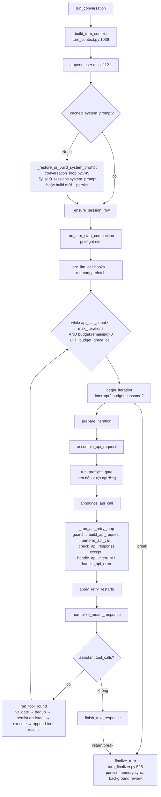

# 01 — Lõi harness của hermes-agent: vòng lặp agent chạy thế nào

> Phạm vi: `run_agent.py`, `agent/conversation_loop.py` + `agent/turn_*.py`, `agent/agent_init.py`,
> `model_tools.py`, `toolsets.py`, `tools/registry.py`, `providers/`, cấu hình/HERMES_HOME/profile,
> `hermes_state*.py` (SQLite).
> Mọi đường dẫn tính từ root repo `research/hermes-agent/`. `path:line` là dòng bắt đầu của symbol
> tại thời điểm đọc (2026-10-18).
> Quy ước: **[Suy luận]** = nhận định của người viết, không đọc thấy trực tiếp trong code/doc.
> **[Doc]** = lấy từ `website/docs/developer-guide/*` hoặc `AGENTS.md`, chưa đối chiếu hết với code.

---

## 0. Tóm tắt một đoạn

`AIAgent` (`run_agent.py:214`) là một *facade* ghép từ ~14 mixin; constructor chỉ forward sang
`agent/agent_init.py:2249 init_agent`. Một lượt hội thoại (turn) = `run_conversation`
(`agent/conversation_loop.py:1717`) → `_run_conversation_turn` (`:1555`): dựng ngữ cảnh turn
(append user msg, restore/build system prompt, nén đầu turn, prefetch memory), rồi vòng `while`
đồng bộ có giới hạn bởi `max_iterations` + `IterationBudget` (+1 "grace call"). Mỗi vòng chạy một
chuỗi **phase** (mỗi phase là một hàm trong file `agent/turn_*.py` riêng, nhận/trả state qua
`_LoopState` và một "verdict" `action ∈ {fallthrough, continue, break, return}`). Nếu model trả
`tool_calls` → `run_tool_round` (song song/tuần tự theo planner an toàn), nếu trả text →
`finish_text_response`. Kết thúc: `finalize_turn` lưu session, đồng bộ memory, và **fork một
"background review"** để tự cập nhật memory/skill. Bất biến số 1 của cả hệ: **system prompt và
tools[] byte-stable suốt hội thoại** để giữ prompt cache; nén ngữ cảnh là ngoại lệ duy nhất.

---

## 1. Sơ đồ luồng

### 1.1 Từ entry point tới một turn

```
hermes (pyproject.toml:560 → hermes_cli.main:main)
 ├─ _apply_profile_override()  → set HERMES_HOME trước mọi import         [hermes_cli/AGENTS.md §Profiles]
 ├─ cli.py: HermesCLI (REPL, slash dispatch qua _SLASH_DISPATCH)           [hermes_cli/AGENTS.md §CLI]
 │    └─ hermes_cli/cli_agent_setup_mixin.py:657   self.agent = AIAgent(...)
 ├─ gateway/ (Telegram/Discord/...; và theo doc là "writer duy nhất" của session)  [Doc session-storage.md:7]
 └─ run_agent.py:1475 main()  (runner trực tiếp/legacy, max_turns=10)

AIAgent.__init__  (run_agent.py:236)  ──► agent/agent_init.py:2249 init_agent
   _resolve_api_mode → _finalize_routing → _init_prompt_cache_config → _init_turn_state
   → _build_client → _init_fallback_chain → _load_tools → _init_session_state
   → load_config_readonly() → _init_memory → _apply_agent_section → _parse_compression_config ...

AIAgent.run_conversation  (agent/turn_facade.py:22)
   ├─ cancel_background_review_for_live_turn()   (review fork đang chạy phải nhường)
   ├─ admit_durable_turn_lease()                 (agent/turn_facade_lease.py:297 — khoá 1 turn/session)
   └─► agent/conversation_loop.py:1717 run_conversation → :1555 _run_conversation_turn
AIAgent.chat(msg) -> str   (agent/turn_facade.py:220) = wrapper lấy final_response
```

### 1.2 Bên trong một turn



Vòng `while` thật: `agent/conversation_loop.py:1656-1709`. Vòng retry API: `:1505-1534`.

---

## 2. Các khái niệm / abstraction chính

### 2.1 `AIAgent` = facade + mixin + forwarder
- `class AIAgent(ClientLifecycleMixin, StreamDeliveryMixin, ..., InterruptControlMixin, ...,
  SessionPersistenceMixin, CompressionFacadeMixin, TurnFacadeMixin, ...)` — `run_agent.py:214-217`.
- `__init__` nhận ~60 tham số (credentials, routing, ~20 callback UI, session context, budget,
  credential_pool, fallback_model...) nhưng chỉ `init_agent(self, **init_kwargs)` — `run_agent.py:236-283`.
- Nhiều method là forwarder lười: `_interruptible_api_call = _forward("agent.chat_completion_helpers",
  "interruptible_api_call")` — `run_agent.py:1225-1227`.
- Quy ước repo "facade + siblings": file thần (god file) được tách thành `<stem>_<topic>.py`, sibling
  late-import facade trong hàm; giới hạn CC ≤ 20, hàm ≤ 300 dòng, file ≤ 2000 dòng — `AGENTS.md`
  §"Facade + siblings layout".

### 2.2 Turn loop dạng "phase + verdict"
- `_LoopState` (`agent/conversation_loop.py:1389`) chứa *mọi* biến cục bộ của vòng lặp (messages,
  api_call_count, retry_count, compression_attempts, response, ...).
- `_run_phase(fn, agent, state)` (`:1484`): đọc signature của phase, truyền đúng field cùng tên từ
  state, rồi copy ngược các field của verdict (trừ `action`/`result`) vào state. → thêm input/output
  cho phase chỉ cần thêm field, không cần sửa call-site.
- Bảng phase (đều là hàm top-level):

| Phase | File:line | Việc chính |
|---|---|---|
| `build_turn_context` | `agent/turn_context.py:1036` | setup 1 lần/turn |
| `begin_iteration` | `agent/turn_iteration_prep.py:352` | redirect, interrupt check, `iteration_budget.consume()` |
| `prepare_iteration` | `agent/turn_iteration_prep.py:144` | chuẩn bị vòng |
| `assemble_api_request` | `agent/turn_request_assembly.py:106` | dựng messages gửi API |
| `run_preflight_gate` | `agent/turn_preflight_gate.py:20` | nén trước khi gọi nếu quá ngưỡng |
| `build_api_request` | `agent/turn_api_request.py:93` | kwargs theo api_mode |
| `perform_api_call` | `agent/turn_api_call.py:67` | stream hoặc non-stream, interruptible |
| `check_api_response` | `agent/turn_response_check.py:92` | validate response |
| `handle_api_error` | `agent/turn_api_error.py:52` | phân loại lỗi → retry/rotate/fallback/nén |
| `normalize_model_response` | `agent/turn_response_intake.py:120` | chuẩn hoá về format nội bộ |
| `run_tool_round` | `agent/turn_tool_round.py:49` | thực thi tool |
| `finish_text_response` | `agent/turn_final_response.py:56` | kết thúc text |
| `finalize_turn` | `agent/turn_finalizer.py:525` | hậu xử lý |

### 2.3 Định dạng message nội bộ
- Luôn là OpenAI chat format `{"role": system|user|assistant|tool, ...}`; reasoning lưu ở
  `assistant_msg["reasoning"]` — `agent/AGENTS.md` §Agent loop. 3 api_mode
  (`chat_completions`, `codex_responses`, `anthropic_messages`) đều quy về format này trước/sau khi gọi
  — [Doc] `agent-loop.md` §API Modes.
- Bất biến luân phiên vai: không bao giờ 2 message cùng role liền nhau (trừ `tool`), không chèn user
  message tổng hợp giữa vòng; ngoại lệ duy nhất `/steer` thành một user row riêng sau tool result —
  `agent/AGENTS.md` §Message-flow invariants.

### 2.4 IterationBudget, grace call, run budget
- `IterationBudget` (`agent/iteration_budget.py:25`): bộ đếm thread-safe `consume()/refund()`;
  `execute_code` được refund để không ăn budget (docstring `:26-27`).
- Kiểm tra trong `begin_iteration`: nếu `_budget_grace_call` thì tiêu cờ thay vì budget, ngược lại
  `iteration_budget.consume()` thất bại → `_turn_exit_reason="budget_exhausted"` —
  `agent/turn_iteration_prep.py:406-417`.
- Default trong code `max_iterations=sys.maxsize` (`run_agent.py:241`); giới hạn thực đến từ
  config `agent.max_turns` (chuẩn hoá ở `hermes_cli/config.py:1807,1836`). AGENTS.md ghi "default 500"
  (`agent/AGENTS.md` §Shape) — **[Suy luận]** 500 là default của config, không phải của constructor.
- Subagent có budget riêng, cap bởi `delegation.max_iterations` — [Doc] `agent-loop.md` §Iteration Budget.
- Còn có `run_budget_seconds` (budget thời gian) — tham số `run_agent.py:273`, normalize ở
  `agent/agent_init.py:324`.

### 2.5 Interrupt / steer / redirect
- `InterruptControlMixin.interrupt()` (`agent/interrupt_control.py:161`) gọi từ thread khác: set
  `_interrupt_requested`, lý do, và `_hard_interrupt_requested` event nếu hard-cancel (`:190-200`).
- `steer(text)` (`:303`): xếp hàng text để giao như user row *sau* khi batch tool hiện tại xong, không
  ngắt.
- `redirect(text)` (`:316`): huỷ đúng request model đang bay, giữ message đã hoàn thành, append sửa
  đổi như user message thật rồi retry.
- Check interrupt đầu mỗi iteration: `agent/turn_iteration_prep.py:382-388`.
- API call chạy trên worker thread để main thread có thể bỏ ngang khi interrupt:
  `interruptible_api_call` — `agent/chat_completion_helpers.py:1261` (ngoại lệ: cron/child chạy inline
  vì nested pool bị treo, `:1268-1269`).

### 2.6 Tool registry, toolsets, dispatch
- **Đăng ký**: mỗi `tools/*.py` gọi `registry.register(...)` ở import-time
  (`tools/registry.py:709`). `ToolEntry` (`tools/registry.py:216`) gồm `name, toolset, schema, handler,
  check_fn, requires_env, is_async, max_result_size_chars, dynamic_schema_overrides,
  execution_timeout`. Schema hỏng bị từ chối ngay lúc register (`:719-727`).
- **Discovery**: `discover_builtin_tools()` (`tools/registry.py:121`) quét AST mọi file `tools/*.py`
  tìm lời gọi `registry.register()` top-level, cache kết quả theo `(mtime_ns,size)`; không có danh
  sách import thủ công.
- **Gating theo service**: `check_fn` trả lời "có reachable/opt-in không" (ví dụ có API key), được
  TTL-cache theo `(fn, scope=hermes_home_key)` — `tools/registry.py:360`. Quy tắc: `check_fn` KHÔNG
  được dùng để quyết định bề mặt theo session; bề mặt theo session đi qua toolset riêng —
  `tools/AGENTS.md` §Surface capability.
- **Toolsets** (`toolsets.py`): `_HERMES_CORE_TOOLS` (`toolsets.py:11`) là bundle mặc định; dict
  `TOOLSETS` (`:74`) với `{description, tools, includes}` (helper `_ts` `:50`); `resolve_toolset`
  (`:366`) đệ quy theo `includes`. Một tool chỉ được expose nếu có toolset nhắc tới nó —
  `tools/AGENTS.md` §Adding a core tool.
- **Chọn tool cho agent**: `_load_tools` (`agent/agent_init.py:1096`) → discover plugins →
  `model_tools.get_tool_definitions(enabled, disabled)` (`model_tools.py:215`) →
  `_select_tool_names` (`:316`, disabled luôn trừ sau cùng) → lọc `check_fn` → rewriter động (ví dụ
  `_rewrite_browser_navigate` `:370`, chỉ cross-reference tool thật sự có) → `agent.valid_tool_names`.
- **Dispatch**: `handle_function_call` (`model_tools.py:873`): coerce args → alias → tool-search bridge
  → request middleware → `_pre_dispatch_guards` (pre_tool_call hook, có thể block) → `_execute_tool`
  → `post_tool_call` hook → `transform_tool_result` hook. Registry `dispatch` (`tools/registry.py:936`)
  bắc cầu async, chuẩn hoá kết quả, mọi exception thành `{"error": ...}`. **Handler luôn trả JSON
  string** — `tools/AGENTS.md` §Registry.
- **Agent-level tools** (`todo_list, memory, session_search, delegate_task`) bị chặn khỏi registry
  (`model_tools.py:607 _AGENT_LOOP_TOOLS`) và xử lý inline qua bảng `INLINE_TOOL_EXECUTORS`
  (`agent/inline_tool_executors.py:254-300`) vì chúng đụng state của agent.

### 2.7 Thực thi một tool round
- `run_tool_round` (`agent/turn_tool_round.py:49`): validate tên/args → mở rộng batch → dedup
  `(name, canonical args)` (`run_agent.py:1194`) + cap số `delegate_task` → **persist assistant
  message trước khi chạy tool** ("persist-before-execute là bất biến độ bền", docstring `:55-58`) →
  tool sai tên nhận error result nhưng vẫn giữ cặp call/result.
- Planner song song: `_plan_tool_batch_segments` (`agent/tool_dispatch_helpers.py:212`) chia batch
  thành segment `parallel|sequential` giữ đúng thứ tự: `_NEVER_PARALLEL_TOOLS` (`:30`, ví dụ `clarify`)
  là barrier; `_PARALLEL_SAFE_TOOLS` (`:33`, read-only như `read_file`, `web_search`); tool theo
  đường dẫn (`read_file/search_files` vs `write_file/patch`) chỉ song song khi path không chồng lấn
  với writer (`:46-49`, `:247-254`).
- Chính sách trước khi chạy thật: `_dispatch_authorized_once` (`agent/tool_executor.py:689`): scope
  → plugin pre-hooks (có thể rewrite args) → chặn args chứa marker "đã bị nén" → guardrails
  (`agent._tool_guardrails.before_call`) → chạy với heartbeat. Guardrail còn có `after_call` phát
  hiện lặp cùng tool không tiến triển và dừng turn với thông điệp tự nhiên
  (`run_agent.py:1240-1258`).

### 2.8 System prompt: 3 tầng cache
- `build_system_prompt_parts` (`agent/system_prompt.py:736`) ghép 3 tầng theo thứ tự ổn định giảm dần:
  - **stable**: identity = `SOUL.md` từ HERMES_HOME (hoặc `DEFAULT_AGENT_IDENTITY`)
    (`_identity_parts` `:550`, `load_soul_md` `agent/prompt_builder.py:1541`), guidance theo tool/model,
    skill được pin (auto_load), coding brief.
  - **context**: `system_message` của caller + context file dự án (chỉ MỘT loại thắng:
    `.hermes.md/HERMES.md` → chuỗi `AGENTS.md` (git root → cwd) → `CLAUDE.md` → `.cursorrules`;
    `build_context_files_prompt` `agent/prompt_builder.py:1749`), workspace snapshot.
  - **volatile**: skills index, memory (`MEMORY.md`/`USER.md` + memory provider ngoài;
    `_memory_parts` `agent/system_prompt.py:522`), plugin sections, dòng profile, timestamp, runtime env.
- Context file bị scan prompt-injection (`_scan_context_content` `agent/prompt_builder.py:83`), cap
  `CONTEXT_FILE_MAX_CHARS = 20_000` + cap động theo context window (`:1045-1063`).
- **Không bao giờ rebuild giữa hội thoại**: `_restore_or_build_system_prompt`
  (`agent/conversation_loop.py:749`) lấy lại *nguyên byte* prompt đã lưu ở `sessions.system_prompt`;
  đồng thời "pin" lại mảng tools[] theo thứ tự session đã gửi (`_restore_pinned_tools` `:696`). Chỉ
  rebuild khi model/provider/cwd đổi (`_stored_prompt_matches_runtime` `:891`) hoặc sau nén
  (`invalidate_system_prompt` `agent/system_prompt.py:814` — cũng reload memory từ đĩa).
- Nội dung phát sinh giữa hội thoại (skill slash command, hint AGENTS.md của thư mục con) đi vào
  **user message hoặc tool result**, không bao giờ vào system prompt — `agent/AGENTS.md` §Message-flow.

### 2.9 Prompt caching
- `agent/prompt_caching.py` thuần hàm. `apply_anthropic_cache_control` (`:345`): tối đa 4 breakpoint
  `cache_control`; có static prefix → [static prefix, cuối system, 2 message gần nhất], không có →
  layout cũ "system_and_3" (docstring `:1-5`, `:349-356`). TTL `5m`/`1h`/`auto` (auto = 1h cho nguồn
  người dùng, 5m cho cron/subagent/...) — `auto_cache_ttl_for_source` `:158`.
- Lưu ý: doc `context-compression-and-caching.md` §Strategy chỉ mô tả "system_and_3"; code hiện tại
  ưu tiên layout có static prefix → doc hơi lạc hậu.
- Bản thân ID tool call cũng được làm deterministic (không uuid4) để giữ prefix cache —
  `run_agent.py:1213-1222`.

### 2.10 Context compression
- ABC `ContextEngine` (`agent/context_engine.py:48`): `update_from_response`, `should_compress`,
  `compress`, hook `on_session_start/end/reset`, có thể expose tool riêng. Mặc định
  `ContextCompressor` (`agent/context_compressor.py:2151`), thay được bằng plugin qua `context.engine`.
- Hai lớp: gateway hygiene 85% (trước agent, ước lượng thô) và compressor trong vòng lặp 50%
  (`compression.threshold`), dùng token thật từ provider làm "usage anchor" — [Doc]
  `context-compression-and-caching.md` §Dual Compression.
- Thuật toán `compress()` (`agent/context_compressor.py:5526`): (1) prune tool result cũ (không gọi
  LLM), (2) giữ head + tail theo token budget, không tách cặp tool_call/result, (3) tóm tắt phần giữa
  bằng *auxiliary model* theo template có cấu trúc (Goal/Progress/Decisions/Files/Next Steps...),
  (4) ghép lại + dọn cặp mồ côi; lần nén sau *cập nhật* summary cũ — [Doc] §Compression Algorithm.
- Có cooldown thất bại leo thang 60s→300s→900s, persist trong `state.db` (cột
  `compression_failure_cooldown_until` ở `hermes_state_common.py:398+`).
- Điểm gọi trong vòng: đầu turn (`run_turn_start_compaction`, `agent/turn_context.py:1168`), preflight
  mỗi iteration (`run_preflight_gate`), khi provider báo overflow (`FailoverReason.context_overflow`).

### 2.11 Provider abstraction, fallback, credential pool
- **ProviderProfile** (`providers/base.py:42`): dataclass khai báo `name, api_mode, env_vars, base_url,
  auth_type, fallback_models, model_capabilities...` + hook (`prepare_messages`, `build_extra_body`,
  `build_api_kwargs_extras`, `get_model_context_length`...). Registry `register_provider` /
  `get_provider_profile` (`providers/__init__.py:122,192`). Mỗi provider là plugin
  `plugins/model-providers/<name>/` (~40 provider); plugin user ở `$HERMES_HOME/plugins/...` ghi đè
  bundled — [Doc] `provider-runtime.md`.
- **Transport** (`agent/transports/base.py:12 ProviderTransport`): `convert_messages`, `convert_tools`,
  `build_kwargs`, `normalize_response`, `extract_cache_stats`, `map_finish_reason`; các impl
  `anthropic.py, chat_completions.py, codex.py, bedrock.py...` trong `agent/transports/`.
- **Thứ tự resolve**: CLI explicit → `config.yaml` → env → default provider — [Doc] §Resolution precedence.
- **Phân loại lỗi**: `FailoverReason` (`agent/error_classifier.py:34`) ~25 lý do (auth, billing,
  rate_limit, context_overflow, model_not_found, content_policy_blocked...) quyết định chiến lược:
  retry, rotate credential, fallback model, hay nén. Plugin có thể override qua hook
  `transform_api_error_classification` (`hermes_cli/plugins.py:130`).
- **Fallback chain**: `try_activate_fallback` (`agent/chat_completion_helpers.py:2055`) đi lần lượt
  `agent._fallback_chain`, có cooldown rate-limit, swap tại chỗ `model/provider/base_url/api_mode/client`
  rồi retry tiếp. Gọi từ `turn_api_error`, `turn_response_check`, `turn_recovery` — [Doc].
- **Credential pool** (`agent/credential_pool.py:966 CredentialPool`): nhiều key cho 1 provider,
  chiến lược `fill_first | round_robin | random | least_used` (`:118-121`, chọn qua config
  `credential_pool_strategies`, `:559`), `select()` (`:1960`), `_mark_exhausted` (`:1183`) với TTL
  cooldown, cooldown theo model.
- **Auxiliary client** (`agent/auxiliary_client.py`, 8.4k dòng): mọi "LLM phụ" (nén, vision, title,
  curator, session_search) có route riêng cấu hình dưới `auxiliary.<task>` — `agent/AGENTS.md`
  §Model and provider resolution.

### 2.12 Cấu hình, HERMES_HOME, profile
- `get_hermes_home()` (`hermes_constants.py:161`): contextvar override → env `HERMES_HOME` → mặc định
  `~/.hermes` (Windows `%LOCALAPPDATA%/hermes`, `:51-58`).
- `~/.hermes/config.yaml` = mọi cấu hình hành vi; `.env` = **chỉ secrets** — `AGENTS.md` §User state,
  `hermes_cli/AGENTS.md` §Config system. `DEFAULT_CONFIG` + `_config_version` để migrate; mọi ghi
  config đi qua `atomic_config_write` (ruamel round-trip, giữ comment).
- Ba loader khác nhau (`load_cli_config`, `load_config`, `load_user_config_effective`) — dễ sai.
- **Profile** = một HERMES_HOME độc lập tại `<root>/profiles/<name>/` (`hermes_cli/profiles.py:283
  _get_profiles_root`), có `config.yaml, .env, SOUL.md, state.db, skills/, memories...` riêng; "là
  các đảo độc lập, không kế thừa config sống", `--clone` chỉ copy lúc tạo. Một gateway process có thể
  phục vụ nhiều profile (multiplex) bằng contextvar override — `hermes_cli/AGENTS.md` §Profiles.
- Mọi state per-profile phải dùng `get_hermes_home()` lúc gọi, không phải hằng module (rule HX001).

### 2.13 Session/state: SQLite `state.db`
- File `get_hermes_home()/state.db`, WAL mode — [Doc] `session-storage.md` §Architecture Overview.
- Schema gốc: `SCHEMA_SQL` ở `hermes_state_common.py:398`. Bảng chính:
  - `sessions` (id, source, user_id, chat_id, model, model_config, **system_prompt** + hash,
    **parent_session_id** (lineage sau nén), started/ended_at, token counters input/output/cache_read/
    cache_write/reasoning, cost, title, cwd/git, trạng thái cooldown nén, profile_name, `tool_names`
    (pin tools[]), archived/pinned...).
  - `messages` (session_id, role, content, tool_call_id, tool_calls, tool_name, timestamp, reasoning*,
    `active`, `compacted`, `api_content`, display_*...).
  - `session_model_usage` (usage/cost theo model+task), `system_prompts(hash, prompt)`.
  - Ledger runtime: `runtime_epoch`, `session_admissions` (hàng đợi input bền vững, intent
    `queue|steer|redirect`, status `queued|started|unknown|terminal`), `worker_executions`,
    `worker_receipts`.
  - FTS5: `messages_fts`, `messages_fts_trigram`, `messages_fts_cjk` cho `session_search`.
- Ghi tranh chấp: SQLite timeout 1s + retry có jitter theo budget thời gian (20s thường, 60s cho
  transcript), `BEGIN IMMEDIATE`, checkpoint WAL mỗi 50 lần ghi — [Doc] §Write Contention.
- Theo doc, **gateway của profile là writer duy nhất của session canonical**; CLI/TUI/Desktop/cron là
  client gửi input qua `/api/ws` — [Doc] `session-storage.md:7-12`, `gateway-local-sessions.md`.
  **[Suy luận]** đây là kiến trúc mới; `AIAgent` vẫn tự ghi qua `_session_db` khi chạy độc lập.

### 2.14 Hooks & plugin quanh vòng lặp
- `VALID_HOOKS` (`hermes_cli/plugins.py:107`): `pre/post_tool_call`, `transform_tool_result`,
  `pre/post_llm_call`, `transform_llm_output`, `pre/post_api_request`, `pre/post_auxiliary_call`,
  `on_session_start/end/finalize/reset`, `subagent_start/stop`, `pre_verify`, `agent_loop_stopped`,
  approval hooks...
- `on_session_start` được phát khi build prompt lần đầu (`agent/conversation_loop.py:865-873`).

### 2.15 Tự cải thiện (điểm móc vào loop)
- Đếm turn cho memory: `_tick_memory_nudge` (`agent/turn_context.py:758`) — mỗi
  `memory.nudge_interval` turn (default 10, `agent/agent_init.py:1304,1333`) bật cờ review.
- Đếm iteration cho skill: `_iters_since_skill` (reset khi model tự gọi `skill_manage`,
  `agent/tool_executor.py:747-750`); ngưỡng `skills.creation_nudge_interval` default 10
  (`agent/agent_init.py:1388-1390`).
- Cuối turn, nếu có final_response, không bị interrupt, và một trong hai cờ bật →
  `agent._spawn_background_review(messages_snapshot, review_memory, review_skills)` chạy **sau khi đã
  trả lời user** — `agent/turn_finalizer.py:763-792`. Review fork bị huỷ khi turn mới tới
  (`agent/turn_facade.py` gọi `cancel_background_review_for_live_turn`). Chi tiết review/curator
  thuộc mảng khác (`agent/background_review.py`, `agent/curator.py`).

### 2.16 Hermes như MCP server
- `mcp_serve.py` (`hermes mcp serve`, stdio): expose *conversations* (list, đọc history, gửi message,
  poll event, approvals) cho Claude Code/Cursor — docstring `mcp_serve.py:1-8`. Không phải expose
  vòng lặp agent như tool. Ngoài ra `agent/transports/hermes_tools_mcp_server.py` tồn tại (chưa đọc).

---

## 3. Pattern đáng học

1. **Phase + verdict + state dataclass** (`_LoopState`, `_run_phase`): vòng lặp chính chỉ ~60 dòng
   điều phối, mỗi phase một file, test được độc lập. Rất hợp để giữ harness dễ đọc khi nó lớn dần.
2. **Prompt-cache là bất biến hạng nhất**: system prompt 3 tầng stable→context→volatile, persist byte
   prompt + pin tools[] theo session, mọi thứ động đi vào user/tool message. Rẻ tiền và đáng mượn ngay.
3. **Persist-before-execute** cho tool round: ghi assistant(tool_calls) trước khi chạy tool phá huỷ để
   resume không chạy lại/không lệch.
4. **Self-registering tool + toolset tách khỏi registry**: tool tự đăng ký, toolset là lớp "chính
   sách expose", `check_fn` chỉ cho reachability. Ba khái niệm tách bạch: *tồn tại* / *khả dụng* /
   *được bật cho session*.
5. **Planner song song an toàn theo path**: read-only song song, writer chặn theo overlap, giữ thứ tự.
6. **Error taxonomy → recovery strategy** (`FailoverReason`): một enum quyết định retry/rotate/
   fallback/nén, plugin override được.
7. **Fallback chain + credential pool có cooldown**: đơn giản mà hiệu quả cho nhiều provider/key.
8. **Agent-level tool tách khỏi registry** (`INLINE_TOOL_EXECUTORS`): tool cần state agent (memory,
   todo, delegate) đi đường riêng, tránh `if name == ...`.
9. **Nudge theo bộ đếm + review fork sau khi trả lời**: cơ chế tự cải thiện không chặn UX, có thể huỷ.
10. **Profile = thư mục HOME độc lập** (config + secrets + SOUL + state.db): mô hình "một agent = một
    thư mục" rất dễ thêm/sửa/xoá.
11. **Hook taxonomy rõ ràng** (observer fail-open vs transform vs veto) làm điểm cắm quan sát.

---

## 4. Áp dụng cho agent-hub

| Hạng mục | Mượn / Bỏ | Ghi chú & độ phức tạp |
|---|---|---|
| Vòng lặp đồng bộ `while` + budget (iteration + thời gian) + grace call | **Mượn** | Thấp. Viết ~200 dòng đầu, cấu trúc phase+verdict ngay từ đầu để mở rộng. |
| `_LoopState` + phase functions | **Mượn (bản rút gọn)** | Thấp–TB. 6–8 phase: prepare → (compress?) → call → classify error → tools → finalize. |
| Message format nội bộ OpenAI-style + transport adapter per provider | **Mượn** | TB. Chỉ cần 2 transport đầu (Anthropic native, OpenAI-compatible). Bỏ Codex/Bedrock/Gemini/MoA. |
| System prompt 3 tầng + persist prompt/tools theo session | **Mượn** | Thấp, lợi ích chi phí lớn. Agent-hub có SOUL/persona per agent → tầng stable. |
| Tool registry tự đăng ký + toolset + check_fn | **Mượn** | Thấp–TB. Thêm khái niệm "toolset per agent" = cách gán quyền cho từng agent trong team. |
| Planner song song theo path | Mượn sau | TB. Ban đầu chạy tuần tự, thêm khi có tool đọc file song song. |
| Inline agent-level tools (memory, todo, delegate) | **Mượn** | Thấp. Cần cho tự cải thiện + điều phối team. |
| Context compression (ContextEngine ABC) | **Mượn interface, implementation tối giản** | TB. Bắt đầu: prune tool result cũ + summary bằng model rẻ khi >50–70%. Bỏ usage anchor, cooldown ladder, codex native compaction. |
| Prompt caching Anthropic (4 breakpoint) | **Mượn** | Thấp, hàm thuần. |
| FailoverReason + fallback chain + credential pool | Mượn bản nhỏ | TB. Enum ~8 lý do; pool `fill_first/round_robin`. |
| Hooks (pre/post tool, pre/post llm, session start/end) | **Mượn** | Thấp. Đây chính là điểm "harness quan sát thao tác user" để tự cải thiện + nguồn event cho CLI UI xem agent đang chạy. |
| Nudge counter + background review fork | **Mượn ý tưởng** | TB. Cốt lõi của "tự cải thiện dựa trên sử dụng"; nên log tín hiệu user (sửa, hủy, chấp nhận) qua hook rồi review định kỳ. |
| SQLite WAL: `sessions`, `messages`, `session_model_usage`, FTS5 | **Mượn schema rút gọn** | Thấp–TB. Thêm bảng `agents` (định nghĩa agent/team) và `events` (cho UI live). Bỏ ledger admissions/epoch/worker_receipts. |
| Profile = HOME dir độc lập | Mượn có điều chỉnh | Thấp. **[Suy luận]** Với agent-hub nên là `hub_home/agents/<name>/` (config + SOUL + memory + skills) nhưng **một** DB chung có cột `agent_id` để UI xem cả team. |
| Gateway là writer duy nhất qua `/api/ws` | Mượn ý tưởng, đơn giản hoá | TB–Cao. **[Suy luận]** Hợp với yêu cầu "CLI xem agent đang hoạt động": một daemon sở hữu state, CLI/MCP là client. Bản đầu: daemon + JSON-RPC/WS đơn giản, không cần epoch/lease. |
| Expose qua MCP | Khác Hermes | **[Suy luận]** `mcp_serve.py` chỉ expose conversation; agent-hub nên expose `list_agents / run_agent / get_status / give_feedback` như tool MCP (kiểu Serena). |
| Interrupt/steer/redirect đa luồng | Mượn `interrupt` + `steer` | TB. Bỏ redirect, liveness generation, hard/soft phân biệt phức tạp. |
| Multiplex nhiều profile trong 1 process, secret scope contextvar | **Bỏ** (giai đoạn đầu) | Cao, nhiều bẫy (rò profile qua `os.environ`). |
| MoA, codex app-server, voice route, Bot Chat, kanban, billing/credits, i18n | **Bỏ** | Không liên quan lõi. |
| Quy mô 1.8k–8k dòng/file, ~60 tham số constructor | **Tránh** | **[Suy luận]** Đây là nợ tích luỹ; agent-hub nên dùng object config thay vì 60 kwargs + 20 callback (gom thành 1 event bus/emitter). |

**Ước lượng tổng [Suy luận]**: một lõi harness tương đương "Hermes tối giản" (loop + 2 provider +
registry/toolset + prompt 3 tầng + caching + SQLite + hooks + nén đơn giản) khoảng 2–4k dòng Python;
phần tự cải thiện (hook ghi tín hiệu + review fork định kỳ) thêm ~0.5–1k dòng.

---

## 5. Câu hỏi mở / chỗ chưa đọc kỹ
- Chi tiết `_spawn_background_review`, `agent/background_review.py`, curator (mảng khác).
- `agent/transports/hermes_tools_mcp_server.py` — có thể là cách expose tool Hermes qua MCP cho
  codex app-server; chưa xác minh.
- Gateway/TurnRunner và giao thức `/api/ws` (`gateway-local-sessions.md`) — chỉ đọc lướt doc.
- `delegate_tool.py` (subagent, role leaf/orchestrator) — chỉ đọc qua `tools/AGENTS.md` §Delegation;
  liên quan trực tiếp tới "team agent", nên có người đào sâu.
